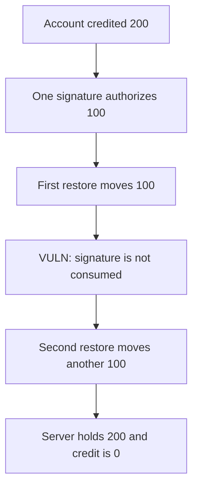

# Overprotocol — one RestoreData signature moves the balance twice

> **Vulnerability classes:** vuln/auth/signature-replay · vuln/bridge/replay

<!-- non-defihacklabs -->
<!-- source-auditvault: https://github.com/Auditware/AuditVault/blob/main/findings/40983-malicious-restoration-servers-can-replay-restoredata-message.md -->
<!-- date: 2024-05 -->

## Key info

| | |
|---|---|
| **Protocol** | Overprotocol |
| **Finding** | Spearbit, May 2024, AuditVault 40983 |
| **Vulnerable code** | `restore` accepts RestoreData with no nonce |
| **Harm** | The second restore moves another 100. The server ends holding 200. |
| **Chain** | local synthetic (audited restoration rule) |

## TL;DR

`RestoreData` is a signature over the account and an amount. It has no nonce and it is not tied to one restoration transaction. A restoration server that has seen one valid request can submit it again.

The account is credited 200. Each restore moves 100 to the server. The first is the request. The second is the same signature. Credit goes to 0.

A desk that records a nonce accepts the first 100 and reverts the second. 100 stays with the account.

## The vulnerable code

```solidity
bytes32 hash = keccak256(abi.encode(account, amount));
require(_recover(hash, sig) == account, "signer");
credit[account] -= amount;
// @> VULN: RestoreData has no nonce and is not rooted to a single RestorationTX.
token.transfer(msg.sender, amount);
```

The signature was produced offline. Private key is Anvil account 1, `0x70997970C51812dc3A010C7d01b50e0d17dc79C8`. The digest is `keccak256(abi.encode(account, 100))`, signed as a raw 32-byte hash.

## Root cause

Nothing in the restore path consumes the message. The EVM-side check only recovers the signer. A second transaction with the same bytes is indistinguishable from the first.

## Preconditions

The desk custodies 200 of the account's tokens. One signature authorizes 100. The caller is the restoration server. One transaction, no time change.

## Attack walkthrough

1. Mint 200 to the desk and credit the signer.
2. Pack the precomputed signature.
3. `restore(account, 100, sig)` moves 100. The server's balance is 100.
4. The same call moves another 100. `secondMoved` is 100. Credit is 0. The server holds 200.

Control uses the same signature on a desk that sets `used[account]`. The second call reverts. Credit left is 100. Only the first 100 moved.

## Diagrams



## Impact

The account that asked for one restoration of 100 loses the second 100 as well. Two replays would keep going until the credit is gone. Here the credit was 200, so the replay drains it.

## Remediation

Put a nonce in RestoreData, or store that the signature was used, and reject the second restore.

## How to reproduce

```bash
cd 40983-malicious-restoration-servers-can-replay-restoredata-message_exp
forge test -vv
```

## Sources

- AuditVault finding: https://github.com/Auditware/AuditVault/blob/main/findings/40983-malicious-restoration-servers-can-replay-restoredata-message.md
- Spearbit report: https://github.com/spearbit/portfolio/blob/master/pdfs/Overprotocol-Spearbit-vCISO-May-2024.pdf
- The audited code is the Go restoration path in `core/types/restore_data.go`. This file is the EVM rule that report describes: RestoreData with no nonce.
