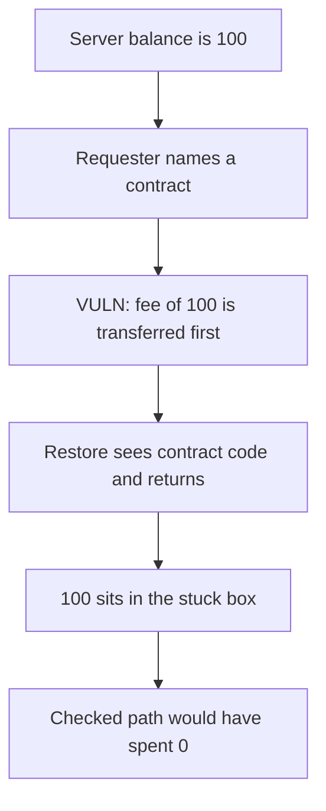

# Overprotocol — a contract restore target sticks the server's fee

> **Vulnerability classes:** vuln/dos/griefing · vuln/logic/missing-check

<!-- non-defihacklabs -->
<!-- source-auditvault: https://github.com/Auditware/AuditVault/blob/main/findings/40985-malicious-request-could-burn-restoration-server-gas-fees-spe.md -->
<!-- date: 2024-05 -->

## Key info

| | |
|---|---|
| **Protocol** | Overprotocol |
| **Finding** | Spearbit, May 2024, AuditVault 40985 |
| **Vulnerable code** | `fulfill` spends the server fee before rejecting a contract target |
| **Harm** | 100 of the server's balance is stuck. The checked path spends 0. |
| **Chain** | local synthetic (audited restoration rule) |

## TL;DR

`GetRestorationProof` does not ask whether the target is a contract. `Restore` then cannot apply the proof, but the server has already paid for the attempt.

Here the server holds 100. One request against a contract target subtracts that 100 and transfers it to a stuck box. The restore returns without completing. A path that checks `target.code.length` first leaves the 100 where it was. After the buggy call the balance is already 0, so the checked call also moves nothing further. The stuck balance stays 100.

## The vulnerable code

```solidity
require(balance >= FEE, "server balance");
balance -= FEE;
// @> VULN: a contract target is not rejected before the server's fee is spent.
token.transfer(stuck, FEE);
if (target.code.length != 0) {
    return;
}
```

`FEE` is 100, the server's whole balance.

## Root cause

The proof builder and the restore disagree. The builder will produce a proof for a contract. The restore rejects that target. The fee is taken on the way in, and a failed restore does not refund it. Repeating the request spends whatever the server still has. One request is enough when the fee equals the balance.

## Preconditions

The server's balance is 100. The target is a deployed contract, so `code.length` is not zero. The caller is any requester. One transaction.

## Attack walkthrough

1. Mint 100 to the server and set its balance mirror to 100.
2. Confirm the target has code.
3. `fulfill(target)` subtracts 100 and transfers it.
4. The code-size check then returns. The box holds 100. The server balance is 0.
5. `fulfillChecked(target)` returns before the transfer. The box is still 100.

## Diagrams



## Impact

The restoration server loses 100. The requester pays nothing. Pointing every request at a contract spends the balance down to 0.

## Remediation

Reject a contract target before paying the fee, which is what `fulfillChecked` does.

## How to reproduce

```bash
cd 40985-malicious-request-could-burn-restoration-server-gas-fees-spe_exp
forge test -vv
```

## Sources

- AuditVault finding: https://github.com/Auditware/AuditVault/blob/main/findings/40985-malicious-request-could-burn-restoration-server-gas-fees-spe.md
- Spearbit report: https://github.com/spearbit/portfolio/blob/master/pdfs/Overprotocol-Spearbit-vCISO-May-2024.pdf
- The audited check is missing in `internal/ethapi/api.go` before a proof is built. This file is that missing check, with the fee moved where a balance can show it.
