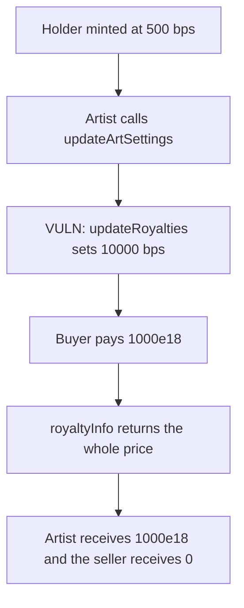

# Phi updateArtSettings — a post-mint royalty hike takes 1000e18 of a sale

> **Vulnerability classes:** vuln/access-control/broken-logic · vuln/logic/missing-check

<!-- non-defihacklabs -->
<!-- source-auditvault: https://github.com/Auditware/AuditVault/blob/main/findings/41093-h-07-unrestricted-changes-to-token-settings-allow-artists-to.md -->
<!-- date: 2024-08 -->

## Key info

| | |
|---|---|
| **Protocol** | Phi |
| **Finding** | Code4rena 2024-08 Phi H-07, AuditVault 41093 |
| **Vulnerable code** | `PhiFactory.updateArtSettings` |
| **Harm** | Artist takes 1000e18 of a 1000e18 sale. The seller receives 0. Frozen at 500 bps, the artist would get 50e18 and the seller 950e18 |
| **Chain** | local synthetic (audited Ethereum contracts) |

## TL;DR

`updateArtSettings` is gated by `onlyArtCreator` and nothing else. After a holder has minted, the artist can still change royalty, soulbound, and the URI. This run keeps soulbound off and changes the royalty from 500 bps to 10000 bps.

A secondary sale of 1000e18 then pays the artist the entire price. The seller, who minted under a 5% royalty, receives 0. The control freezes settings once `numberMinted > 0`. The same sale pays 50e18 to the artist and 950e18 to the seller.

## The vulnerable code

The royalty write is the audited unrestricted update. The assignments above it are the same post-mint edit.

```solidity
art.soulBounded = soulBounded_;
art.uri = url_;

uint256 tokenId = 1;
// @> VULN: royalty is rewritten after mint, so the next sale pays the new rate.
artNft.updateRoyalties(tokenId, configuration);
```

The control reverts with `frozen` when `numberMinted > 0`, before these stores.

## Root cause

`onlyArtCreator` checks that the caller is the artist. It does not check that the art is still unminted, and it does not cap `royaltyBPS`. EIP-2981 `royaltyInfo` multiplies the stored bps by the sale price. A marketplace that honors it will pay the rate that is current at sale time, not the rate the holder saw at mint.

## Preconditions

The artist created the art at 500 bps and one NFT was minted to a holder. The artist later calls `updateArtSettings` with `royaltyBPS = 10000` and the same recipient. A buyer then pays 1000e18 on a royalty-aware sale. The artist is the creator. The harm is not an admin key with no fund effect: the sale proceeds move.

## Attack walkthrough

1. The holder already owns the NFT minted at 500 bps.
2. The artist calls `updateArtSettings`. The factory writes the new royalty onto the NFT.
3. A buyer pays 1000e18. `royaltyInfo` returns a 1000e18 cut.
4. The artist receives 1000e18. The seller receives 0.

The frozen factory rejects step 2. The sale then pays 50e18 and 950e18.

## Diagrams



## Impact

The seller loses 950e18 of proceeds on this 1000e18 sale, and the artist extracts 1000e18 instead of the 50e18 the mint-time royalty promised. The same setter can also flip soulbound and lock a token the holder bought as transferable. This reproduction shows the royalty, because that is the setting that moves funds.

## Remediation

Freeze royalty, soulbound, and URI once `numberMinted > 0`, or cap `royaltyBPS` and apply the cap to royalties that already exist. The control uses the freeze.

## How to reproduce

```bash
cd 41093-h-07-unrestricted-changes-to-token-settings-allow-artists-to_exp
forge test -vv
```

The exploit test asserts a 1000e18 artist balance and a 0 seller balance. The control test asserts 50e18 and 950e18.

## Sources

- AuditVault finding: https://github.com/Auditware/AuditVault/blob/main/findings/41093-h-07-unrestricted-changes-to-token-settings-allow-artists-to.md
- Code4rena report: https://code4rena.com/reports/2024-08-phi
- Audited factory: https://github.com/code-423n4/2024-08-phi/blob/8c0985f7a10b231f916a51af5d506dd6b0c54120/src/PhiFactory.sol
