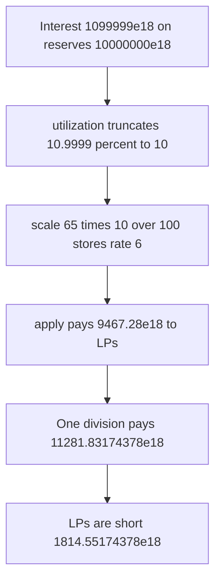

# Borrow fee truncates 10.9999% utilization to 10% and underpays LPs

> **Vulnerability classes:** vuln/arithmetic/precision-loss · vuln/defi/fee-underpayment

> **Reproduction:** self-contained synthetic Foundry reduction; see [output.txt](output.txt).

<!-- non-defihacklabs -->
<!-- source-auditvault: https://github.com/Auditware/AuditVault/blob/main/findings/41278-h-1-fee-precision-loss-disrupts-liquidations-and-causes-loss.md -->
<!-- date: 2024-08 -->

## Key info

| Field | Value |
|---|---|
| **Loss** | LPs receive 9467.28e18 of collateral for one year. The fair fee is 11281.83174378e18. The shortfall is 1814.55174378e18 |
| **Vulnerable contract** | `FeeEngine.charge` (reduction of `utilization` / `scale` / `apply`) |
| **Attacker EOA** | `0x1111111111111111111111111111111111111111` |
| **Attack contract** | `Exploit` |
| **Attack tx** | `Exploit.run()` |
| **Chain / block / date** | Ethereum model · block 0 · 2024-08 |
| **Compiler** | solc 0.8.27, cancun, via IR |
| **Bug class** | Whole-percent utilization, then an integer fee rate, understates the borrow fee |

## TL;DR

`utilization` returns `interest / (reserves / 100)`. Open interest of `1_099_999e18` against reserves of `10_000_000e18` is 10.9999% and is stored as 10. `scale(65, 10)` is `(65 * 10) / 100 = 6`, not 7.14999. `apply` then pays `collateral * rate * 15_778_800 / 1e9`. On `100_000e18` of collateral that is `9467.28e18`. The same inputs with a single final division pay `11281.83174378e18`. LPs are short `1814.55174378e18`. The fixed charge pays that fair amount.

## Background

Sherlock's August 2024 Velar Artha contest, issue H-1, reported by 0xbranded. Borrow and funding fees are built from `utilization`, `scale`, and `apply` in the Vyper math. `DENOM` is `1e9`. `MAX_FEE` of 65 is the annualized cap near 100%. A whole-percent utilization plus an integer rate drops a full step of fee. Positions pay less, so borrow-fee liquidations take longer, and LPs are paid less for the same risk. This reduction uses the report's numbers: interest `1_099_999e18`, reserves `10_000_000e18`, collateral `100_000e18`, and `15_778_800` blocks in a year.

## The vulnerable code

```solidity
util = interest / (reserves / 100); // @> VULN: whole percent only. 10.9999 becomes 10.
rate = (MAX_FEE * s1) / 100;
fee = (COLLATERAL * rate * YEAR_BLOCKS) / DENOM;
```

The audited expressions are `utilization`, `scale`, and `apply` as quoted in the finding. `check_fee` is not quoted. At these inputs `scale` already returns 6, which is the rate the report uses.

## Root cause

Two integer divisions run before the fee is multiplied by the collateral and the number of blocks. The first keeps only a whole percent. The second stores the rate as an integer. Both round down. The fair fee multiplies collateral, max fee, interest, and blocks, then divides once by reserves and `DENOM`.

## Preconditions

- Reserves are `10_000_000e18`. Open interest is `1_099_999e18`.
- `MAX_FEE` is 65. `DENOM` is `1_000_000_000`. The term is `15_778_800` blocks.
- Collateral charged is `100_000e18`.
- Buggy path: utilization 10, rate 6, fee `9467280000000000000000`.
- Fair path: fee `11281831743780000000000`.

## Attack walkthrough

1. `charge` stores utilization 10 and rate 6, then transfers `9467280000000000000000` to the LP receiver.
2. The fair fee on the same inputs is `11281831743780000000000`.
3. The difference, `1814551743780000000000`, is minted to the sink as the unpaid fee.
4. The control uses one final division and pays the fair fee. The LP receiver is not short.

## Diagrams



## Impact

LPs earn `9467.28e18` instead of `11281.83174378e18` on this collateral for the year. The unpaid `1814.55174378e18` stays with the position. The same truncation makes borrow-fee liquidations later than the unrounded rate, because the position is charged less than it owes.

## Remediation

Keep more than two digits of utilization, and do not round the rate to an integer before multiplying by collateral and elapsed blocks:

```diff
- util = interest / (reserves / 100);
- rate = (MAX_FEE * util) / 100;
- fee = (collateral * rate * terms) / DENOM;
+ fee = (collateral * MAX_FEE * interest * terms) / (reserves * DENOM);
```

## How to reproduce

```bash
cd 41278-h-1-fee-precision-loss-disrupts-liquidations-and-causes-loss_exp
forge test -vv
```

## Sources

- AuditVault finding: [41278-h-1-fee-precision-loss-disrupts-liquidations-and-causes-loss](https://github.com/Auditware/AuditVault/blob/main/findings/41278-h-1-fee-precision-loss-disrupts-liquidations-and-causes-loss.md)
- Sherlock, Velar Artha, August 2024: https://github.com/sherlock-audit/2024-08-velar-artha-judging/issues/66
