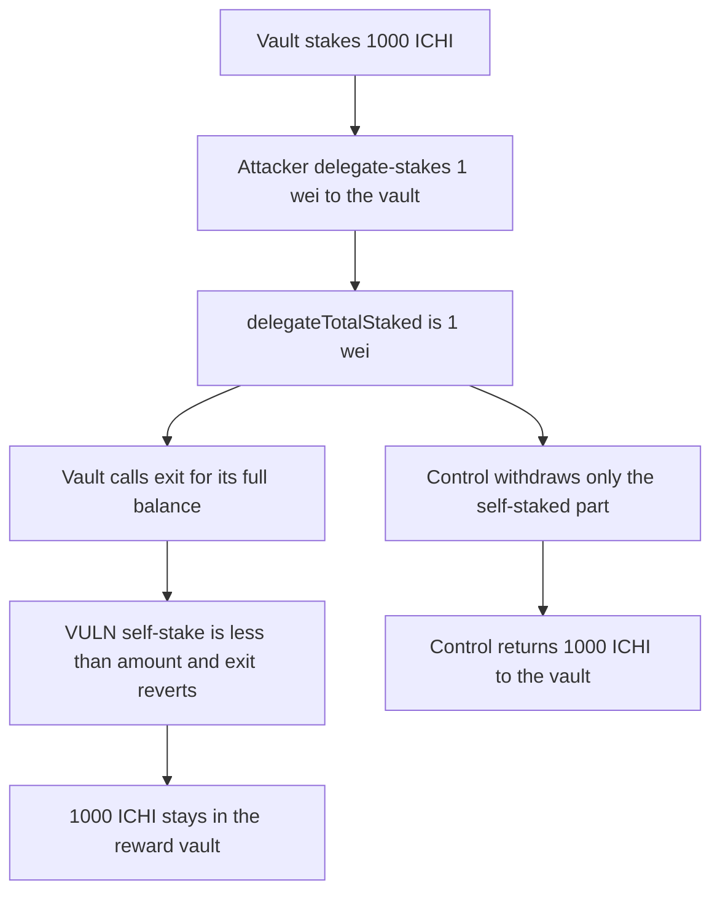

# Aegis Vault: one delegated wei makes exit revert and freezes 1000 ICHI

> **Vulnerability classes:** `vuln/dos/frozen-funds` · `vuln/logic/wrong-condition`

<!-- non-defihacklabs -->
<!-- source-auditvault: https://github.com/Auditware/AuditVault/blob/main/findings/41319-c-01-dos-attack-on-aegis-vault-when-staking-is-enabled-pasho.md -->
<!-- date: 2024-09 -->

## Key info

| Field | Value |
|---|---|
| **Loss** | 1000 ICHI of the vault's own stake cannot leave the reward vault |
| **Vulnerable contract** | `RewardVault._checkSelfStakedBalance` |
| **Attacker EOA** | `0xda8e18557648ed0cf97272f620278913c4ff8f49` (the delegator) |
| **Attack contract** | `Exploit` |
| **Attack tx** | `Exploit.run()` |
| **Chain / block / date** | Ethereum model · block 0 · 2024-09 |
| **Compiler** | solc 0.8.27, cancun, via IR |
| **Bug class** | exit withdraws the full balance after delegation has reduced self-stake |

## TL;DR

`exit` loads the caller's full staked balance and passes that amount to `_checkSelfStakedBalance`. Self-stake is `balance - delegateTotalStaked`. Anyone can call `delegateStake` with the vault as the account. One wei makes self-stake smaller than the amount `exit` requests, so the call reverts and the vault's 1000 ICHI stays in the reward vault. The control withdraws only the self-staked portion and returns the 1000 ICHI to the vault.

## Background

Pashov Audit Group's September 2024 Aegis Vault review, finding C-01. With staking enabled, the vault's `preAction` and `setStakingStatus` call `rewardsVault.exit`. The Berachain reward vault's `exit` assumes the whole balance was self-staked. `delegateStake` lets a third party add to `delegateTotalStaked` for any account.

## The vulnerable code

```solidity
function _checkSelfStakedBalance(address account, uint256 amount) internal view {
    unchecked {
        uint256 balance = _accountInfo[account].balance;
        uint256 delegateTotalStaked = _delegateStake[account].delegateTotalStaked;
        uint256 selfStaked = balance - delegateTotalStaked;
        // @> VULN: exit asks for the full balance, so any delegated stake makes selfStaked < amount and the vault's tokens stay locked
        if (selfStaked < amount) revert InsufficientSelfStake();
    }
}
```

`exit` sets `amount` to `_accountInfo[msg.sender].balance` before this check.

## Root cause

The withdrawn amount and the self-staked amount are different once any delegate has staked to the account. The check treats that gap as a hard revert instead of withdrawing the self-staked part.

## Preconditions

- The vault has staked its own tokens, here 1000 ICHI.
- Staking is enabled, so the vault will call `exit` on the way into a deposit, withdrawal, or `setStakingStatus`.
- `delegateStake` is permissionless.

## Attack walkthrough

1. The vault stakes 1000 ICHI. Its reward-vault balance is 1000 ICHI and `delegateTotalStaked` is 0.
2. The attacker calls `delegateStake(vault, 1)`. The vault's balance becomes 1000 ICHI plus 1 wei, and the delegated total is 1 wei.
3. The vault calls `exit`. `amount` is the full balance.
4. `selfStaked` is 1 wei short. The check reverts.
5. The reward vault still holds 1000 ICHI plus 1 wei. The vault's token balance is 0.
6. The control exits with `balance - delegateTotalStaked` and the vault receives its 1000 ICHI back.

## Diagrams



## Impact

Every vault operation that must `exit` before it can proceed reverts. The 1000 ICHI the vault staked itself cannot be withdrawn, and disabling staking hits the same `exit`. One wei of delegated stake is enough.

## Remediation

Withdraw `balanceOf - getTotalDelegateStaked` and then claim rewards, instead of calling `exit` for the full balance.

## How to reproduce

```bash
cd 41319-c-01-dos-attack-on-aegis-vault-when-staking-is-enabled-pasho_exp
forge test -vv
```

`test_exploit_delegated_wei_freezes_vault_exit` asserts `exit` fails and the reward vault still holds 1000 ICHI plus 1 wei. `test_control_exit_withdraws_only_self_stake` asserts the vault recovers 1000 ICHI. Captured output is `output.txt`.

## Sources

- AuditVault finding: https://github.com/Auditware/AuditVault/blob/main/findings/41319-c-01-dos-attack-on-aegis-vault-when-staking-is-enabled-pasho.md
- Pashov report: https://github.com/pashov/audits/blob/master/team/md/Aegis-security-review-September.md
