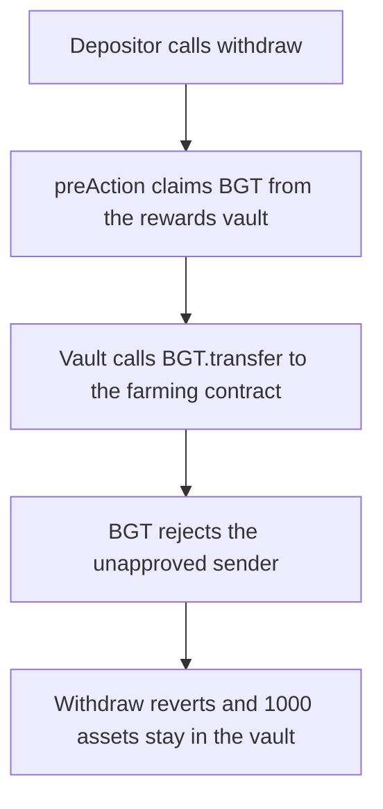

# Aegis — withdrawing reverts because the vault cannot forward BGT

> **Vulnerability classes:** `vuln/dependency/unsafe-external-call` · `vuln/dos/frozen-funds`

> **Reproduction:** a self-contained Foundry PoC that compiles and runs offline
> with only `forge-std` — no fork and no RPC. Trace: [output.txt](output.txt).
> PoC: [test/41320-h-01-potential-issues-that-can-arise-from-bgt-being-reward-t_exp.sol](test/41320-h-01-potential-issues-that-can-arise-from-bgt-being-reward-t_exp.sol).

<!-- non-defihacklabs -->
<!-- source-auditvault: https://github.com/Auditware/AuditVault/blob/main/findings/41320-h-01-potential-issues-that-can-arise-from-bgt-being-reward-t.md -->
<!-- date: 2024-09 -->

---

## Key info

| | |
|---|---|
| **Impact** | **HIGH** — a depositor cannot withdraw **1,000** assets; they stay in the vault |
| **Protocol** | Aegis vault `_transferRewardsToFarmingContract` with BGT as `REWARD_TOKEN` |
| **Vulnerable code** | `bgt.transfer(farming, rewardBalance)` from a sender BGT has not approved |
| **Bug class** | Reward forward ignores BGT's approved-sender rule and bricks `_preAction` |
| **Finding** | Pashov H-01 — Aegis, September 2024 · id 41320 |
| **Report** | [Aegis security review](https://github.com/pashov/audits/blob/master/team/md/Aegis-security-review-September.md) |
| **Source** | [AuditVault finding](https://github.com/Auditware/AuditVault/blob/main/findings/41320-h-01-potential-issues-that-can-arise-from-bgt-being-reward-t.md) |
| **Compiler** | solc 0.8.27, cancun, via IR |

---

## TL;DR

BGT transfers only succeed for whitelisted senders. The Berachain rewards vault is whitelisted, so it can pay BGT into the Aegis vault. The Aegis vault is not whitelisted, so it cannot forward that balance to the farming contract.

`withdraw` always runs `_preAction`, which claims and then calls `transfer`. The transfer reverts, the whole withdrawal reverts, and the depositor's 1,000 assets stay in the vault. Shares are not burned.

The fixed withdraw claims the reward and skips the forward when `isWhitelistedSender(vault)` is false. The depositor then receives the 1,000 assets, and the BGT stays in the vault instead of reverting the exit.

## The vulnerable code

```solidity
uint256 rewardBalance = bgt.balanceOf(address(this));
if (rewardBalance > 0) {
    bgt.transfer(farming, rewardBalance); // @> VULN: vault is not an approved BGT sender
}
```

```diff
-if (rewardBalance > 0) {
+if (rewardBalance > 0 && bgt.isWhitelistedSender(address(this))) {
     bgt.transfer(farming, rewardBalance);
 }
```

## Attack walkthrough

1. Staking is on. The rewards vault holds 50 BGT and is an approved sender. The Aegis vault is not. A depositor has 1,000 shares backed by 1,000 assets.
2. The depositor calls `withdraw(1000)`. The share check passes.
3. `_preAction` claims the BGT into the vault, then `transfer` to the farming contract reverts with "Not approved sender".
4. The catch path observes the revert. Shares are still 1,000. The depositor's asset balance is still 0. The vault still holds 1,000.

## Diagrams



## Impact

While staking is enabled and the reward token is BGT, depositors cannot exit. The 1,000 assets in this position are frozen. The same `_preAction` path is what the review says also breaks deposits, `collectRewards`, and `setStakingStatus`.

## Sources

- [AuditVault 41320](https://github.com/Auditware/AuditVault/blob/main/findings/41320-h-01-potential-issues-that-can-arise-from-bgt-being-reward-t.md)
- [Pashov Aegis review](https://github.com/pashov/audits/blob/master/team/md/Aegis-security-review-September.md)
- [aegis-vault @ b88e991](https://github.com/labs-solo/aegis-vault/tree/b88e9915b8087aea18b3c7e51b5f5cecab014a8f) — `_transferRewardsToFarmingContract`
