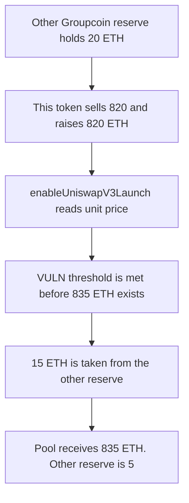

# Groupcoin: Uniswap v3 launch is enabled 15 ETH short

> **Vulnerability classes:** `vuln/logic/missing-check` · `vuln/logic/state-update`

<!-- non-defihacklabs -->
<!-- source-auditvault: https://github.com/Auditware/AuditVault/blob/main/findings/41349-c-01-uniswap-v3-launch-can-be-enabled-without-raising-enough.md -->
<!-- date: 2024-10 -->

## Key info

| Field | Value |
|---|---|
| **Loss** | The launch pulls 835 ETH after this token raised 820. 15 ETH is taken from the other token's reserve, which falls from 20 to 5 |
| **Vulnerable contract** | `GroupcoinFactory.enableUniswapV3Launch` |
| **Attacker EOA** | `0x1111111111111111111111111111111111111111` (the buyer) |
| **Attack contract** | `Exploit` |
| **Attack tx** | `Exploit.run()` |
| **Chain / block / date** | Ethereum model · block 0 · 2024-10 |
| **Compiler** | solc 0.8.27, cancun |
| **Bug class** | The gate is `unitPrice >= thresholdPrice`, not ETH raised |

## TL;DR

The report's test buys 8,200,000 tokens while liquidity needs about 8,357,142. This reduction keeps that ratio: unit price crosses the threshold after 820 tokens, and the launch still takes ETH for 835. The missing 15 ETH is subtracted from another Groupcoin's 20 ETH reserve. The pool receives 835 ETH. Further buys of this token are closed, so the shortfall cannot be filled by its own sales.

## The vulnerable code

```solidity
uint256 unitPrice = getUnitPrice(tokenId);
require(unitPrice >= THRESHOLD_PRICE, "NotAtThreshold"); // @> VULN: unit price reaches the threshold before token1Amount of ETH has been raised
uint256 shortfall = need - have;
otherRaised -= shortfall;
```

```diff
- require(unitPrice >= THRESHOLD_PRICE, "NotAtThreshold");
+ require(sold[tokenId] >= TOKENS_FOR_LIQUIDITY, "not enough sold");
```

## Root cause

`thresholdPrice` is treated as a proxy for "enough ETH was paid." The unit price hits that level before `token1Amount` of ETH has been raised. The launch then spends a fixed ETH amount and, when this token is short, spends ETH that belongs to other tokens in the same factory.

## Preconditions

- Another token's reserve in the factory is 20 ETH.
- Buying 820 tokens of this token raises 820 ETH and sets unit price to 820, which equals the threshold.
- Liquidity requires 835 ETH. Buys are refused after the launch commits.

## Attack walkthrough

1. The other reserve is credited 20 ETH.
2. 820 tokens are bought. Raised ETH is 820.
3. `enableUniswapV3Launch` is called.
4. Unit price 820 meets the threshold. Sold amount is not checked against 835.
5. 15 ETH is taken from the other reserve. It falls to 5.
6. The pool holds 835 ETH.

## Diagrams



## Impact

The other token's buyers lose 15 ETH of backing. This token cannot sell the remaining tokens after the launch commits, so the factory is insolvent relative to the liquidity it promised both tokens. Gating the launch on tokens sold, not on unit price, keeps the launch inside the ETH this token actually raised.

## How to reproduce

```bash
cd 41349-c-01-uniswap-v3-launch-can-be-enabled-without-raising-enough_exp
forge test -vv
```

## Sources

- AuditVault finding: https://github.com/Auditware/AuditVault/blob/main/findings/41349-c-01-uniswap-v3-launch-can-be-enabled-without-raising-enough.md
- Pashov Groupcoin review: https://github.com/pashov/audits/blob/master/team/md/Groupcoin-security-review.md
- Reviewed tree: https://github.com/ControlCplusControlV/groupcoin/tree/ebcf64a54fc9a028ae115425c770fa325c27138d
