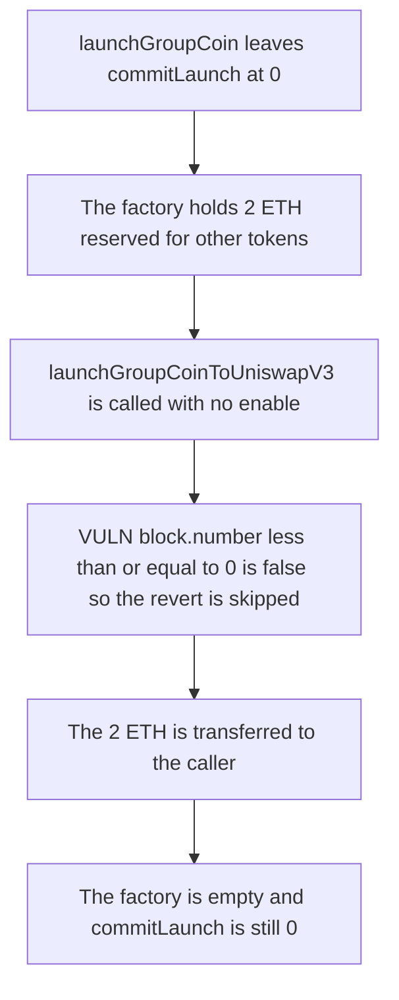

# Groupcoin: an unset commitLaunch lets a caller take 2 ETH of liquidity

> **Vulnerability classes:** `vuln/logic/wrong-condition` · `vuln/logic/missing-check`

<!-- non-defihacklabs -->
<!-- source-auditvault: https://github.com/Auditware/AuditVault/blob/main/findings/41350-c-02-tokens-can-be-launched-to-uniswap-v3-anytime-allowing-t.md -->
<!-- date: 2024-10 -->

## Key info

| Field | Value |
|---|---|
| **Loss** | 2 ETH of factory liquidity taken without enableUniswapV3Launch |
| **Vulnerable contract** | `GroupcoinFactory.launchGroupCoinToUniswapV3` |
| **Attacker EOA** | `0x1111111111111111111111111111111111111111` |
| **Attack contract** | `Exploit` |
| **Attack tx** | `Exploit.run()` |
| **Chain / block / date** | Ethereum model · block 5 · 2024-10 |
| **Compiler** | solc 0.8.27, cancun, via IR |
| **Bug class** | commitLaunch defaults to 0, so the next-block gate does not revert |

## TL;DR

Launching a Groupcoin to Uniswap v3 is supposed to be two steps. `enableUniswapV3Launch` writes `block.number` into `commitLaunch` only after the buy price clears the threshold, and `launchGroupCoinToUniswapV3` should revert until a later block. The check is `block.number <= commitLaunch[tokenId]`. An unset slot is 0, so on any later block the check does not revert. The report deals 2 ETH onto the factory and then calls the launch. Those 2 ETH, which are liquidity reserved for other tokens, transfer to the caller. The same-block control, where `enable` was called, reverts and keeps the 2 ETH.

## Background

Pashov Audit Group's Groupcoin review, published 11 October 2024, finding C-02. The audited tree is `ControlCplusControlV/groupcoin` at `ebcf64a54fc9a028ae115425c770fa325c27138d`. `GroupcoinFactory` gates the Uniswap v3 launch so a token cannot be listed before its bonding curve has raised enough ETH. The recommended fix also reverts when `commitLaunch[tokenId] == 0`.

## The vulnerable code

```solidity
function launchGroupCoinToUniswapV3(uint256 tokenId) external {
    if (block.number <= commitLaunch[tokenId]) { // @> VULN: unset commitLaunch[tokenId] is 0, so this passes once block.number > 0
        revert CantLaunchPoolYet();
    }
    uint256 amount = eth.balanceOf(address(this));
    eth.transfer(msg.sender, amount);
}
```

The factory starts with the 2 ETH the report's proof deals in before the launch. In this reduction that balance is what the launch seizes. The real function would wrap `config.token1Amount` into a Uniswap v3 position; the missing gate is what lets the caller reach that ETH without `enableUniswapV3Launch`.

```diff
- if (block.number <= commitLaunch[tokenId]) {
+ if (block.number <= commitLaunch[tokenId] || commitLaunch[tokenId] == 0) {
      revert CantLaunchPoolYet();
  }
```

## Root cause

The gate treats 0 as "enabled in a previous block" because `block.number <= 0` is false as soon as the chain has produced a block. `enableUniswapV3Launch` is the only writer of a non-zero commit, and the launch never checks that the writer ran. The price threshold inside `enable` is therefore skipped entirely.

## Preconditions

- `commitLaunch[tokenId]` was never written. It is 0.
- `block.number` is greater than 0. This run uses block 5. Foundry's default block 1 behaves the same way.
- The factory holds 2 ETH reserved for liquidity, matching the report's `vm.deal(address(factory), 2 ether)`.

## Attack walkthrough

1. `launchGroupCoin` assigns a token id and does not call `enableUniswapV3Launch`. `commitLaunch[id]` stays 0.
2. `launchGroupCoinToUniswapV3` evaluates `block.number <= 0`. The comparison is false, so `CantLaunchPoolYet` does not fire.
3. The factory transfers its 2 ETH balance to the caller and records `drained = 2 ETH`.
4. The factory balance is 0. The caller's balance is 2 ETH.
5. The control calls `enableUniswapV3Launch` first, which stores the current block. The launch in that same block hits `block.number <= commitLaunch` and reverts. The 2 ETH stays on the factory.

## Diagrams



## Impact

The caller takes 2 ETH that the factory was holding for other tokens' Uniswap v3 liquidity. `enableUniswapV3Launch` never ran, so the bonding-curve price threshold was never checked. The same-block control, which does enable first, reverts and the 2 ETH remains on the factory.

## Remediation

Revert when `commitLaunch[tokenId]` is 0, in addition to the existing `block.number <= commitLaunch[tokenId]` check. That is the diff in the report. A token that was never enabled cannot launch.

## How to reproduce

```bash
cd 41350-c-02-tokens-can-be-launched-to-uniswap-v3-anytime-allowing-t_exp
forge test -vv
```

`test_exploit_launch_without_enable_takes_2_eth` asserts `commitLaunch` is 0 and the caller holds 2 ETH. `test_control_enabled_launch_reverts_in_the_same_block` asserts `CantLaunchPoolYet` and that the factory still holds 2 ETH. Captured output is `output.txt`.

## Sources

- AuditVault finding: https://github.com/Auditware/AuditVault/blob/main/findings/41350-c-02-tokens-can-be-launched-to-uniswap-v3-anytime-allowing-t.md
- Pashov report: https://github.com/pashov/audits/blob/master/team/md/Groupcoin-security-review.md
- Audited tree: https://github.com/ControlCplusControlV/groupcoin/tree/ebcf64a54fc9a028ae115425c770fa325c27138d
- Report added: https://github.com/pashov/audits/commit/eb1511d5458ec40dd9c70a0d5926269434c093f4
