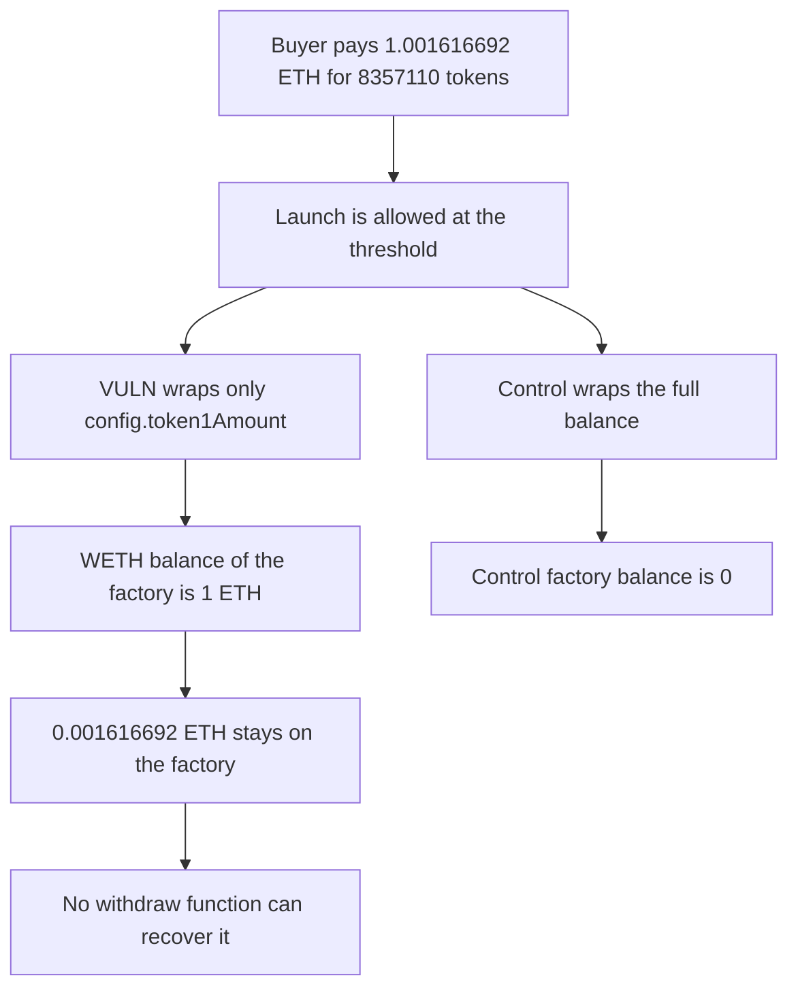

# Groupcoin: launching to Uniswap wraps 1 ETH and leaves 0.001616692 ETH stuck in the factory

> **Vulnerability classes:** `vuln/dos/frozen-funds` · `vuln/logic/missing-check`

<!-- non-defihacklabs -->
<!-- source-auditvault: https://github.com/Auditware/AuditVault/blob/main/findings/41352-h-02-eth-gets-locked-in-the-groupcoinfactory-contract-pashov.md -->
<!-- date: 2024-10 -->

## Key info

| Field | Value |
|---|---|
| **Loss** | 0.001616692 ETH left on `GroupcoinFactory` after launch |
| **Vulnerable contract** | `GroupcoinFactory.launchGroupCoinToUniswapV3` |
| **Attacker EOA** | `0x1111111111111111111111111111111111111111` |
| **Attack contract** | `Exploit` |
| **Attack tx** | `Exploit.run()` |
| **Chain / block / date** | Ethereum model · block 0 · 2024-10 |
| **Compiler** | solc 0.8.27, cancun, via IR |
| **Bug class** | Fixed WETH wrap ignores ETH above `config.token1Amount` |

## TL;DR

`launchGroupCoinToUniswapV3` wraps only `config.token1Amount`. Buying 8,357,110 tokens still clears the launch threshold and pays 1.001616692 ETH. One ETH is wrapped. The other 0.001616692 ETH stays on the factory, and the contract has no withdraw. The control wraps the whole balance and leaves 0.

## Background

Pashov Audit Group's Groupcoin review, published 2024-10-11, finding H-02. The factory is supposed to put every ETH raised by the bonding curve into the new Uniswap v3 position. The wrap uses a configured constant instead of `address(this).balance`. The report's modified `testLaunchToUniswapV3` buys 8,357,110 tokens and asserts a non-zero factory balance of about 0.001616692 ETH.

## The vulnerable code

```solidity
// @> VULN: only config.token1Amount is wrapped, so every wei above that stays in the factory with no withdraw
IWETH9(WETH).deposit{ value: config.token1Amount }();
```

## Root cause

The launch path never reads the factory's ETH balance. Anything the curve collected above `config.token1Amount` is not wrapped, not sent to the pool, and not recoverable.

## Preconditions

- `config.token1Amount` is 1 ETH in this model.
- The buyer pays that amount plus 1,616,692,000,000,000 wei, the dust quoted for an 8,357,110 token buy.
- Launch is allowed once the threshold is reached. No second transaction and no admin call are required.

## Attack walkthrough

1. The buyer calls `buy` with 1.001616692 ETH for 8,357,110 tokens.
2. The factory records the full payment. Its native balance is the same number.
3. `launchGroupCoinToUniswapV3` wraps exactly 1 ETH.
4. WETH credits the factory 1 ETH.
5. The factory's native balance is 0.001616692 ETH.
6. The control wraps `address(this).balance` and finishes at 0.

## Diagrams



## Impact

The factory holds 1,616,692,000,000,000 wei that buyers paid and that the Uniswap position never received. That ETH cannot be withdrawn. The control, which deposits the whole balance, wraps 1.001616692 ETH and leaves the factory empty.

## Remediation

Wrap `address(this).balance` after the launch checks, or add a sweep for the surplus. The report's note that an `onlyOwner` sweep assumes a trusted owner is still true. The wrap itself should not leave a remainder.

## How to reproduce

```bash
cd 41352-h-02-eth-gets-locked-in-the-groupcoinfactory-contract-pashov_exp
forge test -vv
```

`test_exploit_leaves_1616692000000000_wei_locked` asserts the dust and a 1 ETH WETH credit. `test_control_wrapping_the_full_balance_leaves_nothing` asserts a zero native balance. Captured output is `output.txt`.

## Sources

- AuditVault finding: https://github.com/Auditware/AuditVault/blob/main/findings/41352-h-02-eth-gets-locked-in-the-groupcoinfactory-contract-pashov.md
- Pashov report: https://github.com/pashov/audits/blob/master/team/md/Groupcoin-security-review.md
