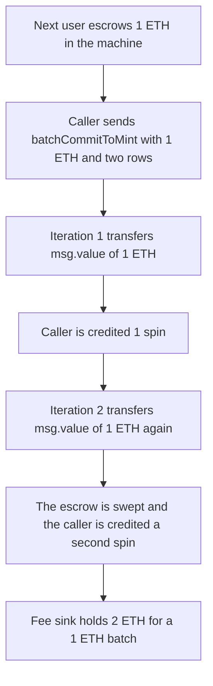

# Sofamon GachaMachine — `msg.value` is spent twice inside one batch

> **Vulnerability classes:** vuln/logic/fee-calculation · vuln/logic/incorrect-order-of-operations · vuln/logic/wrong-condition

<!-- non-defihacklabs -->
<!-- source-auditvault: https://github.com/Auditware/AuditVault/blob/main/findings/41366-h-02-use-of-msgvalue-inside-a-loop-pashov-audit-group-none-s.md -->
<!-- date: 2024-08 -->

## Key info

| Field | Value |
|---|---|
| **Loss** | 2 ETH taken by the fee sink, and 2 mint credits, for a 1 ETH batch. 1 ETH of that was the next user's escrow |
| **Vulnerable contract** | `GachaMachine.commitToMint` |
| **Attacker EOA** | `0x1111111111111111111111111111111111111111` |
| **Attack contract** | `Exploit` |
| **Attack tx** | `Exploit.run()` with value 2 ETH |
| **Chain / block / date** | Ethereum model · block 0 · 2024-08 |
| **Compiler** | solc 0.8.27, cancun, via IR |
| **Bug class** | `msg.value` reused across a loop of internal calls |

## TL;DR

`batchCommitToMint` calls `commitToMint` in a loop. The inner function does `payable(protocolFeeTo).transfer(msg.value)`. An internal call does not reduce `msg.value`, so each row forwards the entire batch payment. A caller who sends 1 ETH for two spins is credited 2 tickets, and the second transfer spends 1 ETH that a later user had already escrowed in the machine. A fixed batch subtracts each spin's cost from the budget and transfers `msg.value` only once: the same 1 ETH payment yields 1 credit and leaves the escrow in place.

## Background

Pashov Audit Group reviewed Sofamon v2 (Gacha NFT mint, commit-reveal) in August 2024. The reviewed tree is `Sofamon/sofamon-v2-contracts` at `44f64fb0a0920cd11387d18e19e83fe6303dd89d`. `batchCommitToMint` is documented as a commit-controller entry point that fans one transaction out into several `commitToMint` calls. `commitToMint` itself is correct for a single external call: it forwards the ETH attached to that call. It is not correct when the same call frame is re-entered internally.

## The vulnerable code

```solidity
function batchCommitToMint(MintData[] calldata mintData) public payable returns (uint256[] memory ticketNonces) {
    ticketNonces = new uint256[](mintData.length);

    for (uint256 i; i < mintData.length;) {
        MintData memory data = mintData[i];

        uint256 nonce = commitToMint(data.collectionId, data.spins, data.minter, "");
        ticketNonces[i] = nonce;

        unchecked {
            ++i;
        }
    }
}

function commitToMint(uint256 _collectionId, uint256 spins, address minter, bytes memory signature)
    public
    payable
    returns (uint256 ticketNonce)
{
    if (msg.value != 0) {
        // @> VULN: msg.value is the whole batch payment and is transferred again on every iteration
        payable(protocolFeeTo).transfer(msg.value);
        accounted += msg.value;
    }
    credits[minter] += spins;
}
```

The fix counts the attached value once and only credits spins the budget still covers:

```diff
-        uint256 nonce = commitToMint(data.collectionId, data.spins, data.minter, "");
+        uint256 cost = data.spins * UNIT;
+        if (budget < cost) break;
+        budget -= cost;
+        credits[data.minter] += data.spins;
     }
+    uint256 spent = msg.value - budget;
+    if (spent != 0) payable(protocolFeeTo).transfer(spent);
```

## Root cause

`msg.value` is the value of the current external call. `batchCommitToMint` calls `commitToMint` as an internal function, so every iteration observes the same `msg.value`. The fee transfer and the `accounted` accumulator both add that full amount again. Nothing in the loop reduces a remaining budget, and the credit `credits[minter] += spins` does not depend on whether this iteration actually paid for a new spin.

## Preconditions

- A later user has already escrowed 1 ETH in the machine (`escrowFor`). That ETH is still in the contract balance, so the second `transfer` does not revert for lack of funds.
- The batch caller is the commit controller, which is how `batchCommitToMint` is meant to be used. The controller path skips the per-call signature.
- The batch contains two rows of one spin each, and the caller attaches 1 ETH, the cost of one spin.

## Attack walkthrough

1. The exploit escrows 1 ETH for `0x2222…2222`. `escrowOf` is 1 ETH and the machine holds 1 ETH.
2. The exploit calls `batchCommitToMint` with two `MintData` rows and value 1 ETH.
3. Iteration 1 reads `msg.value == 1 ETH`, transfers 1 ETH to the fee sink, and adds 1 credit. The machine now holds only the escrow.
4. Iteration 2 reads `msg.value == 1 ETH` again, transfers the escrow, and adds a second credit.
5. The fee sink holds 2 ETH. `accounted` is 2 ETH. `credits` is 2. The machine balance is 0, while `escrowOf[victim]` is still 1 ETH.

## Diagrams



## Impact

The caller pays 1 ETH and receives 2 mint credits. The protocol fee sink receives 2 ETH. The extra 1 ETH is the next user's escrow: their booking still says 1 ETH, but the machine balance is 0, so that ETH cannot fund their own commit. The control path, given the same 1 ETH escrow and the same 1 ETH batch, credits 1 spin, transfers 1 ETH once, and leaves 1 ETH in the machine.

## PoC

```bash
cd 41366-h-02-use-of-msgvalue-inside-a-loop-pashov-audit-group-none-s_exp
forge test -vv
```

`test_exploit_one_payment_two_credits` asserts credits = 2, fee balance = 2 ETH, accounted = 2 ETH, machine balance = 0, and the victim booking still equal to 1 ETH. `test_control_counts_msg_value_once` asserts credits = 1, fee balance = 1 ETH, accounted = 1 ETH, and the victim's 1 ETH still sitting in the fixed machine.

## Sources

- AuditVault finding: https://github.com/Auditware/AuditVault/blob/main/findings/41366-h-02-use-of-msgvalue-inside-a-loop-pashov-audit-group-none-s.md
- Pashov report: https://github.com/pashov/audits/blob/master/team/md/Sofamon-security-review-August.md
- Reviewed source: https://github.com/Sofamon/sofamon-v2-contracts/tree/44f64fb0a0920cd11387d18e19e83fe6303dd89d
