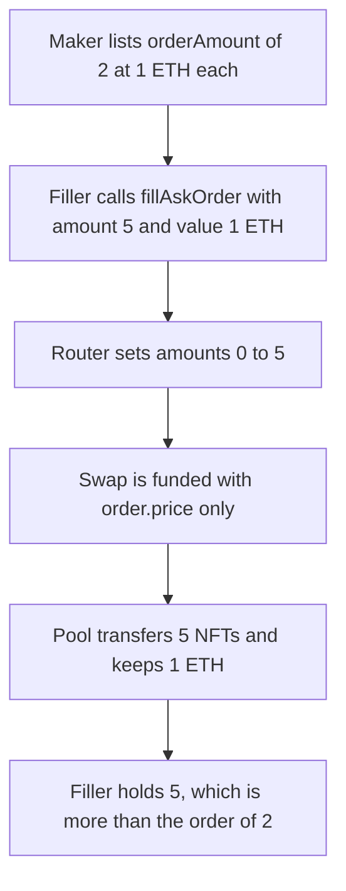

# SofamonExchange — `fillAskOrder` lets the filler take more than the order

> **Vulnerability classes:** vuln/logic/missing-check · vuln/logic/fee-calculation · vuln/logic/wrong-condition

<!-- non-defihacklabs -->
<!-- source-auditvault: https://github.com/Auditware/AuditVault/blob/main/findings/41367-h-03-orderamount-not-accounted-when-filling-pashov-audit-gro.md -->
<!-- date: 2024-08 -->

## Key info

| Field | Value |
|---|---|
| **Loss** | 5 NFTs taken from an order of 2, paid with 1 ETH instead of 5 ETH |
| **Vulnerable contract** | `Exchange.fillAskOrder` |
| **Attacker EOA** | `0x1111111111111111111111111111111111111111` |
| **Attack contract** | `Exploit` |
| **Attack tx** | `Exploit.run()` with value 1 ETH |
| **Chain / block / date** | Ethereum model · block 0 · 2024-08 |
| **Compiler** | solc 0.8.27, cancun, via IR |
| **Bug class** | Fill size is not capped at the listed amount, and the payment is not `price * amount` |

## TL;DR

The maker's ask lists `orderAmount = 2` at 1 ETH each. `fillAskOrder` copies the calldata `order.amount` straight into the Sudoswap-style swap and sends `value: order.price`, not `order.price * order.amount`. A filler sets `amount` to 5, pays 1 ETH, and receives 5 NFTs. The fixed router caps the fill at `orderAmount` and requires `msg.value == price * fill`, so the same request of 5 pays 2 ETH and receives 2 NFTs.

## Background

Pashov Audit Group reviewed Sofamon v2 in August 2024 (`Sofamon/sofamon-v2-contracts` at `44f64fb0a0920cd11387d18e19e83fe6303dd89d`). `SofamonExchange` wraps Sudoswap pair swaps. `fulfillMultipleOrders` multiplies `order.price * order.amount`. `fillAskOrder` and `fillBidOrder` do not. The report notes that with the unscaled call, `order.amount` would have to stay 1. This reduction keeps the quoted call and shows the numeric consequence: the swap input is the calldata amount, the ETH attached is a single price, and the maker's listed size is never applied as a cap.

## The vulnerable code

```solidity
function fillAskOrder(FulfillOrder calldata order) public payable {
    uint256[] memory amounts = new uint256[](1);
    amounts[0] = order.amount;

    // @> VULN: pays order.price once and forwards order.amount with no cap at the listed size
    order.orderPool.swapTokenForSpecificNFTs{ value: order.price }(
        amounts, order.price, payable(msg.sender), false, address(0)
    );

    emit AskFilled(address(order.orderPool), msg.sender, order.nftId, order.amount, order.price);
}
```

`fulfillMultipleOrders` in the same review does scale the payment:

```solidity
order.orderPool.swapTokenForSpecificNFTs{ value: order.price * order.amount }(
    amounts, order.price * order.amount, payable(msg.sender), false, address(0)
);
```

The fix used by the control reads the listed size and charges for it:

```diff
-    amounts[0] = order.amount;
-    order.orderPool.swapTokenForSpecificNFTs{ value: order.price }(
-        amounts, order.price, payable(msg.sender), false, address(0)
-    );
+    uint256 cap = order.orderPool.orderAmount();
+    uint256 fill = order.amount > cap ? cap : order.amount;
+    require(msg.value == order.price * fill, "payment");
+    amounts[0] = fill;
+    order.orderPool.swapTokenForSpecificNFTs{ value: msg.value }(
+        amounts, msg.value, payable(msg.sender), false, address(0)
+    );
```

## Root cause

`amounts[0]` is taken from the filler's calldata, and the ETH value is `order.price` alone. The pool then transfers `amounts[0]` NFTs as long as `msg.value` equals the `maxExpected` argument, which the router also sets to `order.price`. The maker's stored `orderAmount` is not an input to this function, so a calldata amount above that listing is filled in full and underpaid.

## Preconditions

- The pool holds 10 NFTs and publishes `orderAmount = 2` at a unit price of 1 ETH.
- The filler can call `fillAskOrder` and attach 1 ETH.
- The pool trusts the amount array from the router. That is the wrapper's job to get right, which `fulfillMultipleOrders` does and `fillAskOrder` does not.

## Attack walkthrough

1. The exploit reads `orderAmount` and gets 2.
2. It builds a `FulfillOrder` with `amount = 5` and `price = 1 ETH`, and calls `fillAskOrder` with value 1 ETH.
3. The router sets `amounts[0] = 5` and calls `swapTokenForSpecificNFTs` with value 1 ETH.
4. The pool sets `take = 5`, transfers 5 NFTs to the filler, and stores `filled = 5`.
5. The filler's NFT balance is 5. The pool's ETH balance is 1 ETH. 5 is greater than the listed 2.

## Diagrams



## Impact

The filler receives 5 NFTs and pays 1 ETH. The order offered 2 NFTs, which at the quoted unit price would have cost 2 ETH for a capped fill, or 5 ETH for an honest fill of 5. The pool is short 3 NFTs versus the listing and short 4 ETH versus a full payment for 5. The control path, given the same request of 5, caps the fill at 2, requires 2 ETH, and leaves the other 8 NFTs in the pool.

## PoC

```bash
cd 41367-h-03-orderamount-not-accounted-when-filling-pashov-audit-gro_exp
forge test -vv
```

`test_exploit_fill_exceeds_order_amount` logs `order_amount: 2`, `taken: 5`, `paid_wei: 1000000000000000000`. `test_control_caps_fill_at_order_amount` asserts the filler receives 2, the pool records 2, 8 NFTs remain, and the pool holds 2 ETH.

## Sources

- AuditVault finding: https://github.com/Auditware/AuditVault/blob/main/findings/41367-h-03-orderamount-not-accounted-when-filling-pashov-audit-gro.md
- Pashov report: https://github.com/pashov/audits/blob/master/team/md/Sofamon-security-review-August.md
- Reviewed source: https://github.com/Sofamon/sofamon-v2-contracts/tree/44f64fb0a0920cd11387d18e19e83fe6303dd89d
