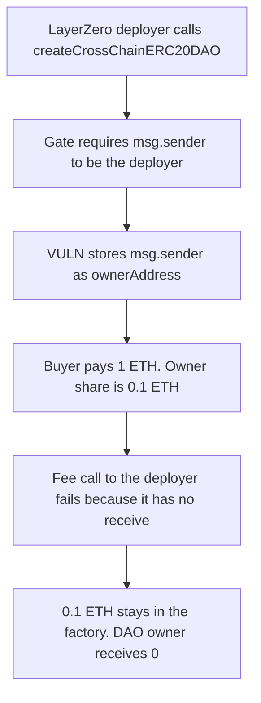

# StationX: cross-chain DAO fees are sent to the LayerZero deployer

> **Vulnerability classes:** `vuln/logic/state-update` · `vuln/logic/fee-calculation`

<!-- non-defihacklabs -->
<!-- source-auditvault: https://github.com/Auditware/AuditVault/blob/main/findings/41382-c-01-the-layerzero-implementation-contract-is-the-receiver-o.md -->
<!-- date: 2024-10 -->

## Key info

| Field | Value |
|---|---|
| **Loss** | 0.1 ETH of a 1 ETH buy stays in the factory. The DAO owner receives 0 |
| **Vulnerable contract** | `Factory.createCrossChainERC20DAO` |
| **Attacker EOA** | `0x1111111111111111111111111111111111111111` (the buyer) |
| **Attack contract** | `Exploit` |
| **Attack tx** | `Exploit.run()` with 1 ETH |
| **Chain / block / date** | Ethereum model · block 0 · 2024-10 |
| **Compiler** | solc 0.8.27, cancun |
| **Bug class** | `ownerAddress` is `msg.sender`, which the gate forces to be the LayerZero deployer |

## TL;DR

`createCrossChainERC20DAO` reverts unless `msg.sender` is the LayerZero deployer, then stores that same `msg.sender` as `ownerAddress`. A later buy sends `ownerShare` (10 percent) to that address. The deployer has no `receive()`. The call fails, the result is ignored, and the 0.1 ETH fee from a 1 ETH buy remains in the factory. The DAO owner's received balance is 0. The other 0.9 ETH is booked as the raise.

## The vulnerable code

```solidity
require(msg.sender == commLayer, "Caller not LZ Deployer");
address lzOwner = msg.sender; // @> VULN: ownerAddress is the LayerZero deployer, not the DAO creator
ccDetails[_daoAddress] = CrossChainDetails(1, false, lzOwner, false);
```

```solidity
address feeTo = ccDetails[_daoAddress].ownerAddress; // @> VULN: owner fee is sent to the stored LayerZero deployer
```

```diff
- address lzOwner = msg.sender;
+ address lzOwner = intendedOwner;
```

## Root cause

The only allowed caller is the deployer, and the fee owner is taken from `msg.sender` instead of an owner the DAO creator chooses. The fee call does not check success, so a deployer without `receive()` silently keeps the fee in the factory.

## Preconditions

- A cross-chain DAO is created by the LayerZero deployer.
- The real DAO owner is a contract that can receive ETH.
- A buyer pays 1 ETH. Owner share is `msg.value / 10`.

## Attack walkthrough

1. The deployer creates the DAO and passes the intended owner.
2. `msg.sender == commLayer` passes.
3. `ownerAddress` is set to the deployer.
4. The buyer pays 1 ETH.
5. 0.1 ETH is addressed to the deployer. The call fails and the value stays in the factory.
6. The DAO owner's received counter is 0. The factory balance is 0.1 ETH.

## Diagrams



## Impact

The DAO owner loses the 0.1 ETH fee on this buy. The ETH is stuck in the factory because the failed call is ignored. The 0.9 ETH raise is delivered to the treasury, so the missing piece is specifically the owner fee.

## How to reproduce

```bash
cd 41382-c-01-the-layerzero-implementation-contract-is-the-receiver-o_exp
forge test -vv
```

## Sources

- AuditVault finding: https://github.com/Auditware/AuditVault/blob/main/findings/41382-c-01-the-layerzero-implementation-contract-is-the-receiver-o.md
- Pashov StationX review: https://github.com/pashov/audits/blob/master/team/md/StationX-security-review.md
- Reviewed tree: https://github.com/StationX-Network/smartcontract/tree/de6dbb69fd6ec51570899d6e110030d0d5ac602f
