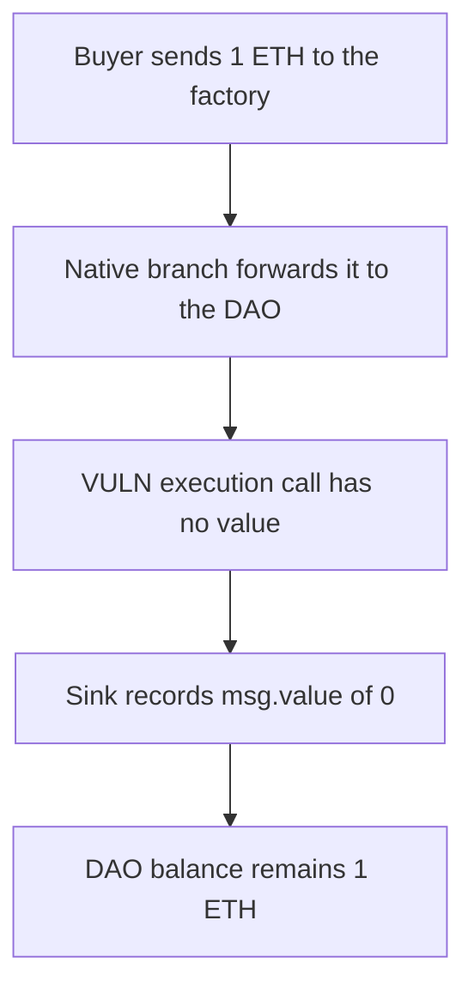

# StationX: native deposits sit on the DAO and the execution call cannot move them

> **Vulnerability classes:** `vuln/dos/frozen-funds` · `vuln/logic/missing-check`

<!-- non-defihacklabs -->
<!-- source-auditvault: https://github.com/Auditware/AuditVault/blob/main/findings/41383-c-02-native-tokens-in-the-daos-are-stuck-pashov-audit-group.md -->
<!-- date: 2024-06 -->

## Key info

| Field | Value |
|---|---|
| **Loss** | 1 ETH sent to the DAO on a native governance-token purchase. The execution call forwards 0 |
| **Vulnerable contract** | `ERC20DAO.updateProposalAndExecution` |
| **Attacker EOA** | `0x1111111111111111111111111111111111111111` |
| **Attack contract** | `Exploit` |
| **Attack tx** | `Exploit.run()` |
| **Chain / block / date** | Ethereum model · block 0 · 2024-06 |
| **Compiler** | solc 0.8.27, cancun, via IR |
| **Bug class** | Native custody with no value-bearing execution path |

## TL;DR

`_buyGovernanceTokenERC20DAO` sends `msg.value` to the DAO when `depositTokenAddress` is the native token. `updateProposalAndExecution` is the DAO's call-out, and it uses `_contract.call(_data)` with no value. A 1 ETH deposit stays on the DAO. The target observes `msg.value == 0`.

## The vulnerable code

```solidity
payable(_daoDetails.assetsStoredOnGnosis ? _daoDetails.gnosisAddress : dao).call{value: _totalAmount}("");
(bool success,) = _contract.call(_data); // @> VULN: the call forwards no value, so native deposits on the DAO cannot be moved
```

The review's fix adds a `_value` argument and `call{value: _value}`, and makes the function payable so the DAO can attach value without spending its deposits.

## Root cause

Deposits arrive as ETH. The only outbound call cannot name an amount of ETH. There is no withdraw function either.

## Preconditions

- The DAO's deposit token is the native token address.
- A buyer sends 1 ETH through the factory buy path.
- A later execution targets a payable sink.

## Attack walkthrough

1. The buyer calls the factory with 1 ETH.
2. The native branch forwards that 1 ETH to the DAO.
3. Execution calls the sink with empty value.
4. The sink records 0. The DAO balance is still 1 ETH.

## Diagrams



## Impact

Every DAO that takes native deposits accumulates ETH it cannot spend, send, or return. This run leaves 1 ETH on the DAO. The same path applies to every later native purchase.

## Remediation

Pass `_value` into `updateProposalAndExecution` and forward it with `call{value: _value}`, as the Pashov diff specifies. Make the function payable if callers should attach fresh ETH instead of spending deposits.

## How to reproduce

```bash
cd 41383-c-02-native-tokens-in-the-daos-are-stuck-pashov-audit-group_exp
forge test -vv
```

Captured output is `output.txt`.

## Sources

- AuditVault finding: https://github.com/Auditware/AuditVault/blob/main/findings/41383-c-02-native-tokens-in-the-daos-are-stuck-pashov-audit-group.md

- Pashov StationX review: https://github.com/pashov/audits/blob/master/team/md/StationX-security-review.md
- Report published from the June 2024 review. The finding file has no genome frontmatter. Severity in the report is Impact High, Likelihood High.
