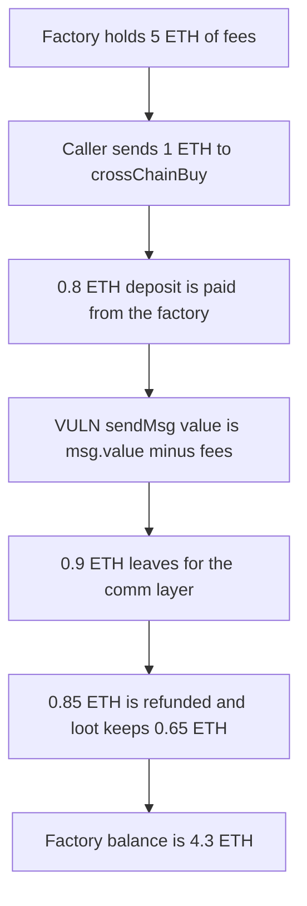

# StationX: crossChainBuy spends protocol fees on the LayerZero refund

> **Vulnerability classes:** `vuln/logic/missing-check`

<!-- non-defihacklabs -->
<!-- source-auditvault: https://github.com/Auditware/AuditVault/blob/main/findings/41384-c-03-native-tokens-can-be-drained-from-the-factory-contract.md -->
<!-- date: 2024-10 -->

## Key info

| Field | Value |
|---|---|
| **Loss** | 0.65 ETH of the factory 5 ETH fee balance is taken. The factory is left with 4.3 ETH |
| **Vulnerable contract** | `Factory.crossChainBuy` |
| **Attacker EOA** | `0x1111111111111111111111111111111111111111` |
| **Attack contract** | `Exploit` |
| **Attack tx** | `Exploit.run()` |
| **Chain / block / date** | Ethereum model · block 0 · 2024-10 |
| **Compiler** | solc 0.8.27, cancun |
| **Bug class** | msg.value minus fees is forwarded after the deposit was already paid |

## TL;DR

`crossChainBuy` sends the 0.8 ETH deposit out of the factory balance, then calls the comm layer with `msg.value - fees`. A 1 ETH call therefore forwards another 0.9 ETH. The factory already held 5 ETH of fees, so it supplies the shortfall. The comm layer keeps 0.05 ETH and refunds 0.85 ETH to the caller. Net, the caller gains 0.65 ETH and the factory loses 0.7 ETH.

## The vulnerable code

```solidity
(bool ok,) = dao.call{value: DEPOSIT}("");
uint256 fees = FEES;
comm.sendMsg{value: msg.value - fees}(refundTo); // @> VULN: value ignores the deposit already paid
```

Subtract the deposit, the owner share, and every fee before funding the message, which is what the report asks: the remaining value must account for the native deposit, the owner share, deposit fees, and KYC fees.

## Root cause

`checkDepositFeesSent` only requires `msg.value` to cover the deposit. The same `msg.value` is then reduced by `fees` alone and forwarded. Both transfers come out of the factory balance, so previously collected native fees pay the second one. The unused message value is refunded to an address the caller chooses.

## Preconditions

- The factory holds 5 ETH of protocol fees before the call.
- The caller sends 1 ETH. Deposit is 0.8 ETH, the formula fee is 0.1 ETH, and the message cost is 0.05 ETH.
- The refund address is the caller.

## Attack walkthrough

1. `crossChainBuy` receives 1 ETH. The factory balance is 6 ETH.
2. 0.8 ETH is sent to the caller as the DAO deposit. Balance is 5.2 ETH.
3. `sendMsg` is called with 0.9 ETH. Balance is 4.3 ETH.
4. The comm layer keeps 0.05 ETH and refunds 0.85 ETH.
5. Caller balance is 1.65 ETH. Profit after returning the 1 ETH capital is 0.65 ETH.
6. That 0.65 ETH is what loot holds.

## Diagrams



## Impact

The factory's accumulated native fees pay for a cross-chain buy the caller did not fully fund. In this run 0.7 ETH leaves the 5 ETH fee balance, 0.05 ETH is the real message cost, and 0.65 ETH is profit to the caller. Repeating the call drains the rest.

## How to reproduce

```bash
cd 41384-c-03-native-tokens-can-be-drained-from-the-factory-contract_exp
forge test -vv
```

`output.txt` is the captured passing run. The control test checks the recommended fix.

## Sources

- AuditVault finding: https://github.com/Auditware/AuditVault/blob/main/findings/41384-c-03-native-tokens-can-be-drained-from-the-factory-contract.md
- Report: https://github.com/pashov/audits/blob/master/team/md/StationX-security-review.md
- Provenance: Pashov StationX review, report added 2024-10-11. Factory.crossChainBuy and _buyGovernanceTokenERC20DAO as quoted in the finding. Review commit de6dbb69.
