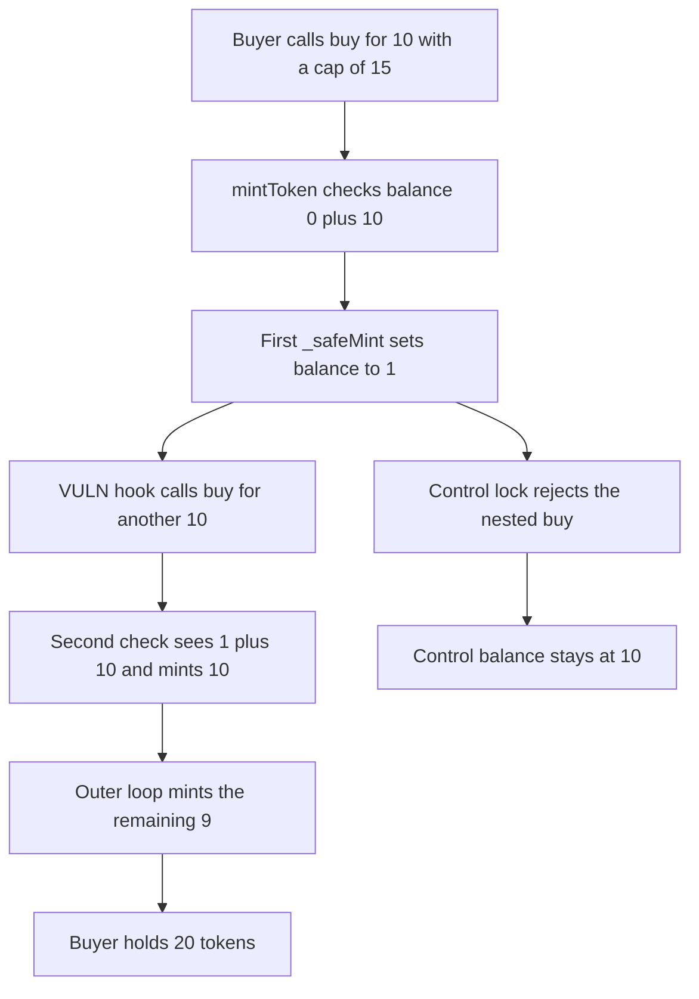

# StationX: an ERC721 buyer reenters mint and holds 20 tokens when the cap is 15

> **Vulnerability classes:** `vuln/reentrancy/cross-function` · `vuln/logic/missing-check`

<!-- non-defihacklabs -->
<!-- source-auditvault: https://github.com/Auditware/AuditVault/blob/main/findings/41385-h-01-bypassing-maxtokensperuser-limits-for-erc721-dao-pashov.md -->
<!-- date: 2024-10 -->

## Key info

| Field | Value |
|---|---|
| **Loss** | One buyer holds 20 governance NFTs. `maxTokensPerUser` is 15 |
| **Vulnerable contract** | `ERC721DAO.mintToken` / `_safeMint` |
| **Attacker EOA** | `0x1111111111111111111111111111111111111111` (the buyer) |
| **Attack contract** | `Exploit` |
| **Attack tx** | `Exploit.run()` |
| **Chain / block / date** | Ethereum model · block 0 · 2024-10 |
| **Compiler** | solc 0.8.27, cancun, via IR |
| **Bug class** | Cap check runs before a `_safeMint` loop, and the receiver hook buys again |

## TL;DR

`buyGovernanceTokenERC721DAO` checks `maxTokensPerUser`, then `mintToken` checks it once more and mints ids one by one. `_safeMint` calls `onERC721Received` after only the current id is added to `balanceOf`. The buyer calls `buy` again from that hook. The second check sees a balance of 1, not 10, so another 10 tokens pass a cap of 15. The first loop then finishes its remaining 9. The buyer holds 20. A reentrancy lock on the same buy stops the second purchase and leaves the balance at 10.

## Background

Pashov Audit Group's StationX review, finding H-01, against `StationX-Network/smartcontract` at `de6dbb69fd6ec51570899d6e110030d0d5ac602f`. The report's own walkthrough buys 10, reenters for another 10, and ends at 20 when the cap is 15. The cap matters most for whitelist DAOs, because one member can hold more votes than the DAO allowed.

## The vulnerable code

```solidity
if (balanceOf[_to] + _amount > erc721DaoDetails.maxTokensPerUser) {
    revert MaxTokensMintedForUser(_to);
}
for (uint256 i; i < _amount;) {
    _tokenIdTracker += 1;
    _safeMint(_to, _tokenIdTracker);
    // @> VULN: the hook runs before the rest of _amount is minted, so balanceOf is only partially updated
}
```

The recommended change is a reentrancy guard, or the checks-effects-interactions order, so the hook cannot call `buy` again until `balanceOf` includes the whole purchase.

## Root cause

Both cap checks read `balanceOf` before the loop. OpenZeppelin-style `_safeMint` updates the balance for the id it is minting and then calls the receiver. The other ids in `_amount` are still unminted, so a nested `buy` of 10 sees `1 + 10 <= 15` and is accepted. After the hook returns, the outer loop mints the rest.

## Preconditions

- `maxTokensPerUser` is 15 and total distribution is 100, so the supply check is not what stops the purchase.
- The buyer is a contract. An EOA has no hook, so this path is the contract buyer in the report.
- The first purchase is 10 and the reentered purchase is 10. Those are the amounts in the report's proof.

## Attack walkthrough

1. The buyer calls `buyGovernanceTokenERC721DAO` for 10. The balance is 0, so both cap checks pass.
2. The DAO mints id 1 and the balance becomes 1.
3. `onERC721Received` calls `buy` for another 10. `1 + 10` is still under 15, so that purchase mints 10 ids.
4. The outer loop mints its remaining 9 ids.
5. `balanceOf` is 20 and `maxTokensPerUser` is still 15.
6. The control sets a lock for the whole buy. The nested buy reverts, the hook swallows that revert, and the balance stays at 10.

## Diagrams



## Impact

The buyer holds 20 ERC721 governance tokens. The DAO set the per-user cap at 15. Those extra 5 tokens are votes the whitelist was supposed to deny. The control buyer, with the guard, holds 10, which is inside the cap.

## Remediation

Put a reentrancy lock around `buyGovernanceTokenERC721DAO`, or mint with `_mint` and update the accounted balance before any external call. The report recommends a reentrancy guard or checks-effects-interactions.

## How to reproduce

```bash
cd 41385-h-01-bypassing-maxtokensperuser-limits-for-erc721-dao-pashov_exp
forge test -vv
```

`test_exploit_reenter_mints_20_when_max_is_15` asserts a balance of 20 against a max of 15. `test_control_reentrancy_guard_stops_at_10` asserts the guarded buy stops at 10. Captured output is `output.txt`.

## Sources

- AuditVault finding: https://github.com/Auditware/AuditVault/blob/main/findings/41385-h-01-bypassing-maxtokensperuser-limits-for-erc721-dao-pashov.md
- Pashov report: https://github.com/pashov/audits/blob/master/team/md/StationX-security-review.md
- Reviewed tree: https://github.com/StationX-Network/smartcontract/tree/de6dbb69fd6ec51570899d6e110030d0d5ac602f
