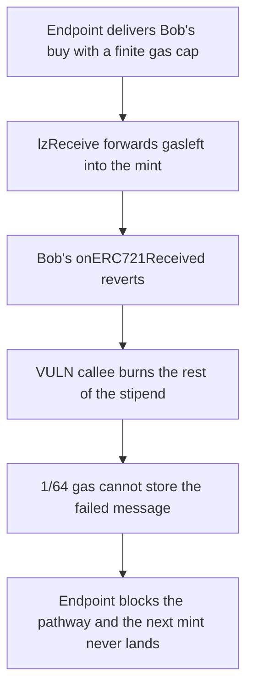

# StationX: a gas-burning NFT receiver blocks the LayerZero pathway

> **Vulnerability classes:** `vuln/dos/gas-limit` · `vuln/dos/griefing`

<!-- non-defihacklabs -->
<!-- source-auditvault: https://github.com/Auditware/AuditVault/blob/main/findings/41387-h-03-users-can-break-the-lz-communication-pashov-audit-group.md -->
<!-- date: 2024-06 -->

## Key info

| Field | Value |
|---|---|
| **Loss** | Bob's cross-chain mint does not land, and the next buyer's message is rejected |
| **Vulnerable contract** | `LayerZeroImpl._blockingLzReceive` |
| **Attacker EOA** | `0x1111111111111111111111111111111111111111` |
| **Attack contract** | `Exploit` |
| **Attack tx** | `Exploit.run()` |
| **Chain / block / date** | Ethereum model · block 0 · 2024-06 |
| **Compiler** | solc 0.8.27, cancun, via IR |
| **Bug class** | gasleft forward plus a safe-mint callback |

## TL;DR

`_blockingLzReceive` calls `nonblockingLzReceive` with `gasleft()`. Bob is a contract. His `onERC721Received` reverts, and the callee burns the rest of the forwarded stipend. EIP-150 leaves about 1/64 of the gas. That is not enough for the cold SSTORE that would record the failed message, so `lzReceive` itself runs out of gas. The endpoint's catch marks the pathway blocked. A later delivery to an ordinary buyer reverts, and that buyer is minted 0 DAO tokens.

The production adapter asks the relayer for 600,000 gas. This run forwards 80,000, which is the same failure with a shorter trace: 80,000 / 64 is about 1,250 gas, under a cold SSTORE.

## The vulnerable code

```solidity
(bool success,) = address(this).call{gas: gasleft()}(
    abi.encodeWithSelector(this.nonblockingLzReceive.selector, buyer)
); // @> VULN: gasleft() leaves only 1/64 gas if the callee burns its stipend
if (!success) {
    _storeFailedMessage();
}
```

The report's fix is to `mint` instead of `safeMint`, so there is no receiver hook.

## Root cause

`safeMint` gives the buyer a callback inside the gas-limited call. A buyer who reverts and whose callee then spins until out-of-gas consumes the 63/64 stipend. The failure store was supposed to run in the remainder. A cold SSTORE does not fit there, so the revert escapes to the endpoint, which blocks the source pathway instead of recording a retryable message.

## Preconditions

- The buyer of the cross-chain DAO mint is a contract with `onERC721Received`.
- The endpoint forwards a finite gas stipend to `lzReceive`.
- A second, honest buyer is waiting on the same pathway.

## Attack walkthrough

1. Deliver Bob's message with an 80,000 gas cap inside a 250,000 gas outer call.
2. `lzReceive` forwards `gasleft()` into `nonblockingLzReceive`.
3. Bob's hook reverts. The callee burns the rest of the stipend.
4. `_storeFailedMessage` cannot SSTORE. `failedStored` stays 0. Bob's balance stays 0.
5. The endpoint catch sets `blocked`.
6. `deliver` for the honest buyer reverts with `pathway blocked`. Their balance stays 0.

## Diagrams



## Impact

The pathway is stuck. Bob is not minted, which is what a reverting receiver should cause, but the endpoint also refuses every later message from that source. An EOA buyer on a fresh endpoint is minted 1 token and the pathway stays open.

## Remediation

Mint without a receiver hook, or reserve a fixed gas stipend for `_storeFailedMessage` before the external call. Do not forward `gasleft()`.

## How to reproduce

```bash
cd 41387-h-03-users-can-break-the-lz-communication-pashov-audit-group_exp
forge test -vv
```

## Sources

- AuditVault finding: https://github.com/Auditware/AuditVault/blob/main/findings/41387-h-03-users-can-break-the-lz-communication-pashov-audit-group.md
- Pashov review: https://github.com/pashov/audits/blob/master/team/md/StationX-security-review.md
