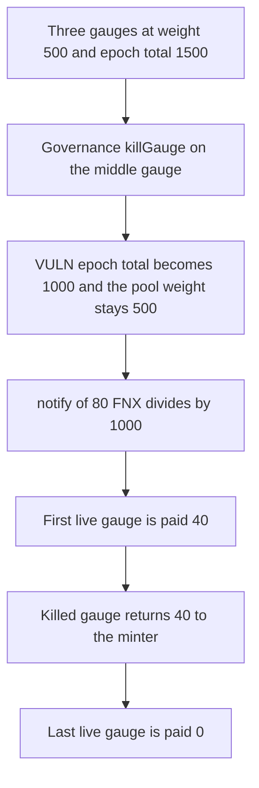

# Fenix: killGauge prices 80 FNX on a smaller total, pays the first gauge 40, and pays the last gauge 0

> **Vulnerability classes:** `vuln/logic/reward-calculation` · `vuln/logic/state-update`

<!-- non-defihacklabs -->
<!-- source-auditvault: https://github.com/Auditware/AuditVault/blob/main/findings/41460-h-01-killgauge-will-lead-to-wrong-calculation-of-emission-co.md -->
<!-- date: 2024-09 -->

## Key info

| Field | Value |
|---|---|
| **Loss** | The first live gauge receives 40 FNX. The last live gauge receives 0. Each gauge's fair share of 80 FNX is 26.666... FNX. 40 FNX is returned to the minter |
| **Vulnerable contract** | `Voter.killGauge` |
| **Attacker EOA** | `0x1111111111111111111111111111111111111111` |
| **Attack contract** | `Exploit` |
| **Attack tx** | `Exploit.run()` |
| **Chain / block / date** | Ethereum model · block 0 · 2024-09 |
| **Compiler** | solc 0.8.27, cancun, via IR |
| **Bug class** | Epoch total is reduced and the pool weight is left in place |

## TL;DR

`killGauge` subtracts the gauge's weight from `totalWeightsPerEpoch` and does not delete `weightsPerEpoch`. Three gauges each have weight 500. After one is killed the epoch total is 1000, but all three pool weights are still 500. Notifying 80 FNX divides by 1000, so each pool is owed 40. The first live gauge is paid 40, the killed gauge sends 40 back to the minter, and the last live gauge's transfer reverts. Without the kill, each gauge is paid `26666666666666666500` wei.

## The vulnerable code

```solidity
uint256 epochTimestamp = epoch;
// @> VULN: epoch total loses the weight, weightsPerEpoch[pool] is left in place
totalWeightsPerEpoch[epochTimestamp] -= weightsPerEpoch[epochTimestamp][state.pool];
```

`notifyRewardAmount` then does `index += (amount * 1e18) / totalWeightsPerEpoch[previous]`. `_distribute` still reads `weightsPerEpoch[previous][pool]`, including the killed pool. Both lines are copied from `VoterUpgradeableV2`.

## Root cause

The index is built on the post-kill total. The per-pool claim is built on the pre-kill weight. The sum of claims is 120 against an 80 token balance.

## Preconditions

- Three gauges, weight 500 each, epoch total 1500, index and per-gauge index 10e18.
- Governance calls `killGauge` on one gauge during the epoch. The Code4rena judge treated that call as normal operation.
- The next epoch notifies 80 FNX and distributes the gauges in the order live, killed, live.

## Attack walkthrough

1. Kill the middle gauge. The epoch total falls to 1000. Its pool weight stays 500.
2. Roll the epoch and notify 80 FNX. The index grows by `80e18 / 1000e18`.
3. Distribute the first live gauge. It is paid 40 FNX.
4. Distribute the killed gauge. 40 FNX is transferred back to the minter.
5. Distribute the last live gauge. The voter holds nothing, so the 40 FNX payment reverts. That gauge's `paid` stays 0.

## Diagrams



## Impact

One live gauge's LPs receive nothing of an emission they were entitled to share. Another live gauge receives 40 FNX, above the fair `26666666666666666500` wei. Forty FNX sits back on the minter instead of with the gauges. Distributing with no kill pays that fair amount to all three.

## Remediation

Delete `weightsPerEpoch[epoch][pool]` in `killGauge` when the weight is subtracted from the epoch total, so the killed pool is not priced into the next distribution.

## How to reproduce

```bash
cd 41460-h-01-killgauge-will-lead-to-wrong-calculation-of-emission-co_exp
forge test -vv
```

## Sources

- AuditVault finding: https://github.com/Auditware/AuditVault/blob/main/findings/41460-h-01-killgauge-will-lead-to-wrong-calculation-of-emission-co.md
- Code4rena report: https://code4rena.com/reports/2024-09-fenix-finance
- Voter source: https://github.com/code-423n4/2024-09-fenix-finance/blob/main/contracts/core/VoterUpgradeableV2.sol
