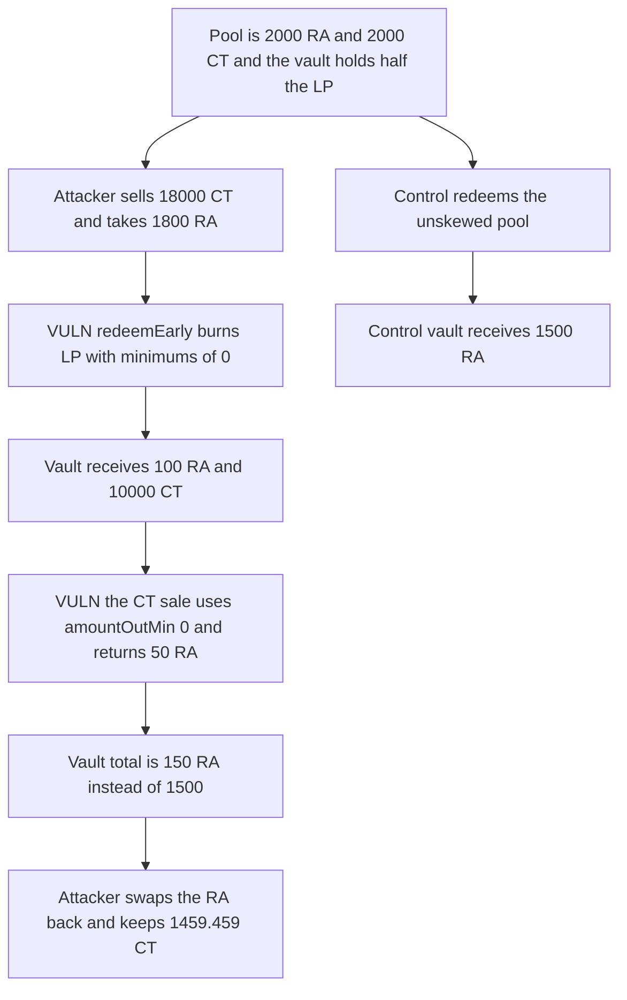

# Cork: early redeem sells CT and burns LP with zero minimums

> **Vulnerability classes:** `vuln/defi/slippage` · `vuln/defi/sandwich-attack`

<!-- non-defihacklabs -->
<!-- source-auditvault: https://github.com/Auditware/AuditVault/blob/main/findings/41475-h-1-lack-of-slippage-protection-leads-to-loss-of-protocol-fu.md -->
<!-- date: 2024-08 -->

## Key info

| Field | Value |
|---|---|
| **Loss** | Vault receives 150 RA instead of 1,500. Sandwich keeps 1,459.459 CT |
| **Vulnerable contract** | `Vault.redeemEarly` |
| **Attacker EOA** | `0x1111111111111111111111111111111111111111` |
| **Attack contract** | `Exploit` |
| **Attack tx** | `Exploit.run()` |
| **Chain / block / date** | Ethereum model · block 0 · 2024-08 |
| **Compiler** | solc 0.8.27, cancun, via IR |
| **Bug class** | `removeLiquidity` minimums and `swapExactTokensForTokens` `amountOutMin` are 0 |

## TL;DR

`redeemEarly` burns the vault's RA/CT LP with `amountAMin` and `amountBMin` of 0, then sells the CT it received with `amountOutMin` 0. Both calls use `block.timestamp` as the deadline. A swap of 18,000 CT moves a 2,000/2,000 pool to 200 RA and 20,000 CT. The vault owns half the LP and comes back with 150 RA. The same redemption on the unskewed pool returns 1,500 RA. The attacker swaps the RA back and finishes 1,459.459 CT ahead.

## Background

Sherlock contest 2024-08-cork-protocol, issue 66, judged valid. `VaultLib.__liquidateUnchecked` calls `removeLiquidity` with minimums 0. `_redeemCtDsAndSellExcessCt` calls `swapExactTokensForTokens` with `amountOutMin` 0. The protocol later fixed the slippage parameters. This reduction keeps both zero-minimum calls and a constant-product pool with no fee, so the integer result is exact.

## The vulnerable code

```solidity
// @> VULN: amountAMin and amountBMin are 0, and the deadline is block.timestamp
(uint256 raAmt, uint256 ctAmt) =
    router.removeLiquidity(address(ra), address(ct), lp, 0, 0, address(this), block.timestamp);
// @> VULN: amountOutMin is 0, so the CT sale accepts any RA out
raAmt += router.swapExactTokensForTokens(ctAmt, 0, path, address(this), block.timestamp)[1];
```

Quoted from the contest at `VaultLib.sol` lines 282 and 345 of commit `db23bf67e45781b00ee6de5f6f23e621af16bd7e`.

## Root cause

The vault's own redemption accepts whatever the pool returns. A trade that lands immediately before it sets that return.

## Preconditions

- The pool starts at 2,000 RA and 2,000 CT, with 2,000 LP.
- The vault holds 1,000 LP. Another LP holder keeps the other half, so the vault does not empty the pool before the CT sale.
- The attacker starts with 18,000 CT.

## Attack walkthrough

1. The attacker sells 18,000 CT and receives 1,800 RA. Reserves are 200 RA and 20,000 CT.
2. The vault burns 1,000 LP with minimums 0. It receives 100 RA and 10,000 CT.
3. It sells that 10,000 CT with `amountOutMin` 0 and receives 50 RA. Total RA is 150.
4. The attacker sells the 1,800 RA back into the pool and receives 19,459.459 CT.
5. Net CT profit is 1,459.459459459459459459.
6. The control redeems the same vault on a fresh 2,000/2,000 pool and receives 1,500 RA.

## Diagrams



## Impact

The vault's early redeem returns 150 RA instead of 1,500 RA. The missing 1,350 RA is the value the sandwich extracts. The attacker's CT balance rises by 1,459.459459459459459459. That CT came out of the vault's sale into the skewed pool. The unskewed control returns 1,500 RA and no attacker profit.

## Remediation

Pass the preview's minimum RA and CT into `removeLiquidity` and `swapExactTokensForTokens`, and pass a deadline that is not `block.timestamp`. That is the fix the contest recommended and the team applied in Cork pull 76, aside from the deadline item they left open.

## How to reproduce

```bash
cd 41475-h-1-lack-of-slippage-protection-leads-to-loss-of-protocol-fu_exp
forge test -vv
```

`test_exploit_zero_slippage_redeems_150_ra` asserts 150 RA to the vault and the CT profit above. `test_control_unskewed_redeem_returns_1500_ra` asserts 1,500 RA. Captured output is `output.txt`.

## Sources

- AuditVault finding: https://github.com/Auditware/AuditVault/blob/main/findings/41475-h-1-lack-of-slippage-protection-leads-to-loss-of-protocol-fu.md
- Sherlock issue 66: https://github.com/sherlock-audit/2024-08-cork-protocol-judging/issues/66
- Blamed lines: https://github.com/sherlock-audit/2024-08-cork-protocol/blob/db23bf67e45781b00ee6de5f6f23e621af16bd7e/Depeg-swap/contracts/libraries/VaultLib.sol#L282
