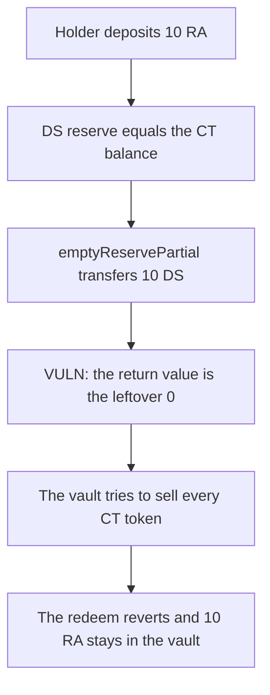

# Cork: emptyReservePartial returns 0 and the last LV redeem locks 10 RA

> **Vulnerability classes:** vuln/logic/state-update · vuln/dos/frozen-funds

<!-- non-defihacklabs -->
<!-- source-auditvault: https://github.com/Auditware/AuditVault/blob/main/findings/41476-h-2-flashswaprouteremptyreserve-and-flashswaprouteremptyrese.md -->
<!-- date: 2024-08 -->

## Key info

| Field | Value |
|---|---|
| **Loss** | 10 RA stays in the vault. The holder's redeem reverts |
| **Vulnerable contract** | `FlashSwapRouter.emptyReservePartial` |
| **Attacker EOA** | `0x0000000000000000000000000000000000414761` (the LV holder) |
| **Attack contract** | `Exploit` |
| **Attack tx** | `Exploit.run()` |
| **Chain / block / date** | Ethereum model · block 0 · 2024-08 |
| **Compiler** | solc 0.8.27, cancun, via IR |
| **Bug class** | The emptied amount is reported as the reserve left behind |

## TL;DR

`emptyReservePartial` transfers the DS reserve out and then returns `dsPos.reserve`, which is 0 when the reserve was fully emptied. The last LV redeem had a DS reserve equal to the CT balance, so the correct sell amount is 0. The 0 return makes `ctSellAmount` the entire CT balance. That transfer reverts after the CT was already burned for the paired redeem, and the 10 RA deposit stays in the vault. Returning the emptied amount pays the 10 RA back.

## Background

Sherlock's August 2024 Cork Protocol contest, issue 68 (H-2). `VaultLib._redeemCtDsAndSellExcessCt` uses the return value of `emptyReservePartial` as the DS that was taken. The protocol later changed the function to return the amount that was emptied.

## The vulnerable code

```solidity
dsPos.ds.transfer(to, amount);
dsPos.reserve -= amount;
// @> VULN: returns the leftover reserve, which is 0 after a full empty
reserve = dsPos.reserve;
lastReturned = reserve;
```

Via IR keeps the store of that return value on `lastReturned`. The caller reads 0.

## Root cause

The function's name and the callers both mean "how much was emptied". The implementation returns the balance after the subtraction. A full empty is indistinguishable from "nothing was reserved".

## Preconditions

- The DS reserve and the vault's CT balance are both 10 ether, the last-redeem case in the report.
- The holder deposits 10 RA and then calls `redeemEarly` in the same transaction.

## Attack walkthrough

1. The holder deposits 10 RA. The vault balance becomes 10 RA.
2. `redeemEarly` reads a reserve of 10 and a CT balance of 10, so `redeemAmount` is 10.
3. `emptyReservePartial` moves 10 DS and returns 0.
4. The vault burns 10 CT for the paired redeem, then computes `ctSellAmount` as 10 and tries to transfer 10 more CT.
5. The transfer reverts. The deposit call already committed, so the vault still holds 10 RA and the holder holds 0.
6. The fixed function returns `amount` instead of the leftover. `ctSellAmount` is 0 and the holder receives the 10 RA.

## Diagrams


