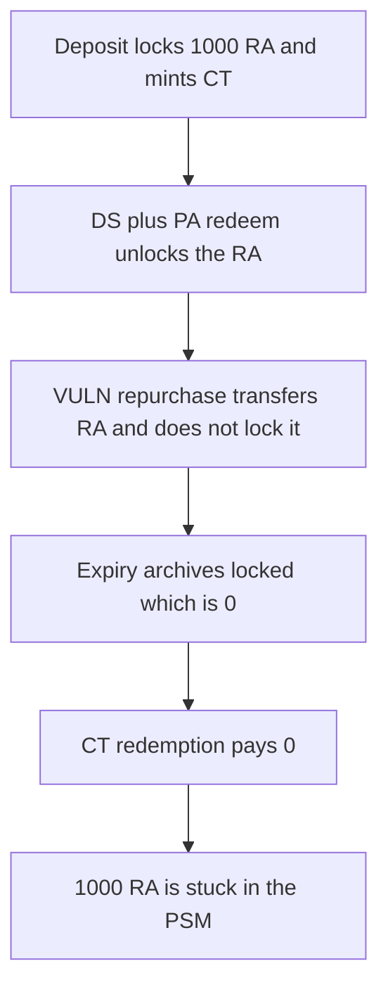

# Cork: repurchase pulls RA and does not lock it

> **Vulnerability classes:** `vuln/logic/state-update` · `vuln/dos/frozen-funds`

<!-- non-defihacklabs -->
<!-- source-auditvault: https://github.com/Auditware/AuditVault/blob/main/findings/41479-h-5-incoming-redemption-assets-not-being-tracked-when-repurc.md -->
<!-- date: 2024-08 -->

## Key info

| Field | Value |
|---|---|
| **Loss** | 1000 RA stuck in the PSM. The CT redemption pays 0 |
| **Vulnerable contract** | `Psm.repurchase` |
| **Attacker EOA** | `0x1111111111111111111111111111111111111111` |
| **Attack contract** | `Exploit` |
| **Attack tx** | `Exploit.run()` |
| **Chain / block / date** | Ethereum model · block 0 · 2024-08 |
| **Compiler** | solc 0.8.27, cancun, via IR |
| **Bug class** | Incoming RA transferred without increasing locked |

## TL;DR

Deposit uses `lockFrom`, which increases `locked` and pulls RA. Repurchase uses `lockUnchecked`, which only pulls RA. After a DS plus PA redeem has brought `locked` back to 0, a 1000 RA repurchase leaves the tokens in the contract and `locked` at 0. At expiry, `separateLiquidity` archives 0. Redeeming the cover token pays nothing. Calling `lockFrom` from repurchase archives the 1000 RA and pays it to the CT holder.

## Background

Sherlock's August 2024 Cork contest, issue 126, reported by dimulski and several others. `PsmLib.repurchase` transfers redemption assets with `lockUnchecked` instead of `lockFrom`. After expiry, `_separateLiquidity` archives `convertAllToFree()`, which only knows about `locked`. The team fixed it in Cork-Technology/Depeg-swap pull 77.

## The vulnerable code

```solidity
function lockUnchecked(uint256 amount, address from) internal {
    ra.transferFrom(from, address(this), amount); // @> VULN: locked is not increased
}
```

`lockFrom` does `locked += amount` and then the same transfer. `_separateLiquidity` stores `convertAllToFree()` and resets the balances.

## Root cause

The repurchase inflow is a token transfer with no matching write to the variable expiry later treats as the whole RA inventory.

## Preconditions

- A deposit has minted CT and a DS plus PA redeem has returned `locked` to 0 while the CT supply remains.
- The market expiry is this block, so `separateLiquidity` is allowed.
- The user repurchases with 1000 RA.

## Attack walkthrough

1. Deposit locks 1000 RA, mints 1000 CT and 1000 DS.
2. Redeeming DS plus PA unlocks the RA and leaves the CT in place.
3. Repurchase pulls 1000 RA through `lockUnchecked`. `locked` stays 0.
4. `separateLiquidity` archives 0.
5. `redeemWithCt` pays 0. The PSM still holds 1000 RA.

## Diagrams



## Impact

The cover-token holder receives none of the RA that was paid in at repurchase. 1000 RA remains in the PSM and is absent from the archive, so no later CT redemption can claim it. The `lockFrom` control archives 1000 RA, pays it out, and leaves the PSM empty.

## How to reproduce

```bash
cd 41479-h-5-incoming-redemption-assets-not-being-tracked-when-repurc_exp
forge test -vv
```

`test_exploit_ra_stuck` asserts a 0 archive, a 0 CT payout, and 1000 RA stuck. `test_control_lockFrom_archives_ra` asserts the full payout. Output is `output.txt`.

## Sources

- AuditVault finding: https://github.com/Auditware/AuditVault/blob/main/findings/41479-h-5-incoming-redemption-assets-not-being-tracked-when-repurc.md
- Sherlock issue 126: https://github.com/sherlock-audit/2024-08-cork-protocol-judging/issues/126
- PsmLib repurchase: https://github.com/sherlock-audit/2024-08-cork-protocol/blob/main/Depeg-swap/contracts/libraries/PsmLib.sol
- Fix: https://github.com/Cork-Technology/Depeg-swap/pull/77
