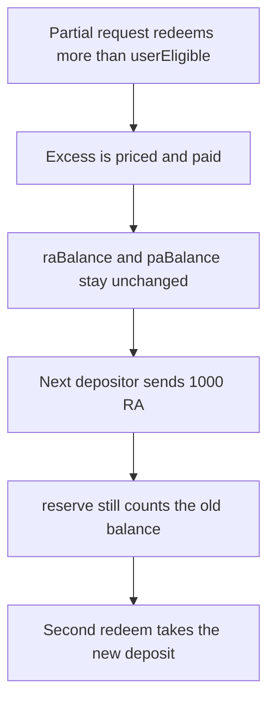

# Cork — expiry redeem pays RA twice because the withdrawal pool is not debited

> **Vulnerability classes:** `vuln/logic/state-update` · `vuln/logic/missing-check`

> **Reproduction:** a self-contained Foundry PoC that compiles and runs offline
> with only `forge-std` — no fork and no RPC. Trace: [output.txt](output.txt).
> PoC: [test/41480-h-6-users-will-steal-excess-funds-from-the-vault-due-to-vaul_exp.sol](test/41480-h-6-users-will-steal-excess-funds-from-the-vault-due-to-vaul_exp.sol).

<!-- non-defihacklabs -->
<!-- source-auditvault: https://github.com/Auditware/AuditVault/blob/main/findings/41480-h-6-users-will-steal-excess-funds-from-the-vault-due-to-vaul.md -->
<!-- date: 2024-08 -->

---

## Key info

| | |
|---|---|
| **Impact** | **HIGH** — the caller extracts **2,000 RA** from a pool that held **1,000 RA**; the next depositor loses the deposit |
| **Protocol** | Cork, `VaultPoolLib.redeem` / `__tryRedeemExcessFromAmmPool` |
| **Vulnerable code** | excess is added to the payout and `raBalance` / `paBalance` are not decreased |
| **Bug class** | Withdrawal-pool accounting is left stale, then counted again |
| **Finding** | Sherlock #144 — Cork Protocol, August 2024 · id 41480 |
| **Report** | [Sherlock issue 144](https://github.com/sherlock-audit/2024-08-cork-protocol-judging/issues/144) |
| **Source** | [AuditVault finding](https://github.com/Auditware/AuditVault/blob/main/findings/41480-h-6-users-will-steal-excess-funds-from-the-vault-due-to-vaul.md) |
| **Compiler** | solc 0.8.27, cancun, via IR |

---

## TL;DR

`redeemExpired` takes the excess path when the caller asks for more than `userEligible`. The inner helper is a view: it prices the excess with `raExchangeRate` and returns the sum, but it never decreases `withdrawalPool.raBalance` or `paBalance`. The vault still transfers the full amount.

The next issuance's `reserve()` still reads that stale balance. A second redeem pays it again out of the new deposit. The caller ends with 2,000 RA. The vault and the victim are at zero, while `raBalance` still reads 1,000.

The fixed path debits the pool and pays only the 400 RA that was actually requested.

## The vulnerable code

```solidity
(raOut, paOut) = __tryRedeemfromWithdrawalPool(amountAttributed);
withdrawnFromAmm = (excessAmount * withdrawalPool.raExchangeRate) / 1e18; // @> VULN
raOut += withdrawnFromAmm;
```

`__tryRedeemfromWithdrawalPool` is `view`. Nothing writes `raBalance` or `paBalance`.

```diff
-(raOut, paOut) = __tryRedeemfromWithdrawalPool(amountAttributed);
+(raOut, paOut) = __redeemfromWithdrawalPool(amountAttributed); // debits raBalance and paBalance
```

## Attack walkthrough

1. The pool holds 1,000 RA. The caller is eligible for 400 and calls `redeemExpired(1000)`.
2. The excess of 600 is priced at the 1:1 exchange rate and added to the 400. The vault transfers 1,000 RA.
3. `raBalance` and `paBalance` are still 1,000.
4. The victim deposits 1,000 RA. `reserve()` sets `phantomClaim` to the stale `raBalance`.
5. `redeemStale` transfers that 1,000. The caller now holds 2,000 RA.

## Diagrams



## Impact

The caller takes the original 1,000 RA and the victim's 1,000 RA. Other withdrawal-pool claims cannot be paid. The vault is insolvent while its own accounting still shows a 1,000 RA balance.

## Sources

- [AuditVault 41480](https://github.com/Auditware/AuditVault/blob/main/findings/41480-h-6-users-will-steal-excess-funds-from-the-vault-due-to-vaul.md)
- [Sherlock judging issue 144](https://github.com/sherlock-audit/2024-08-cork-protocol-judging/issues/144)
- [Cork contest repo](https://github.com/sherlock-audit/2024-08-cork-protocol) — `VaultPoolLib.__tryRedeemExcessFromAmmPool`
