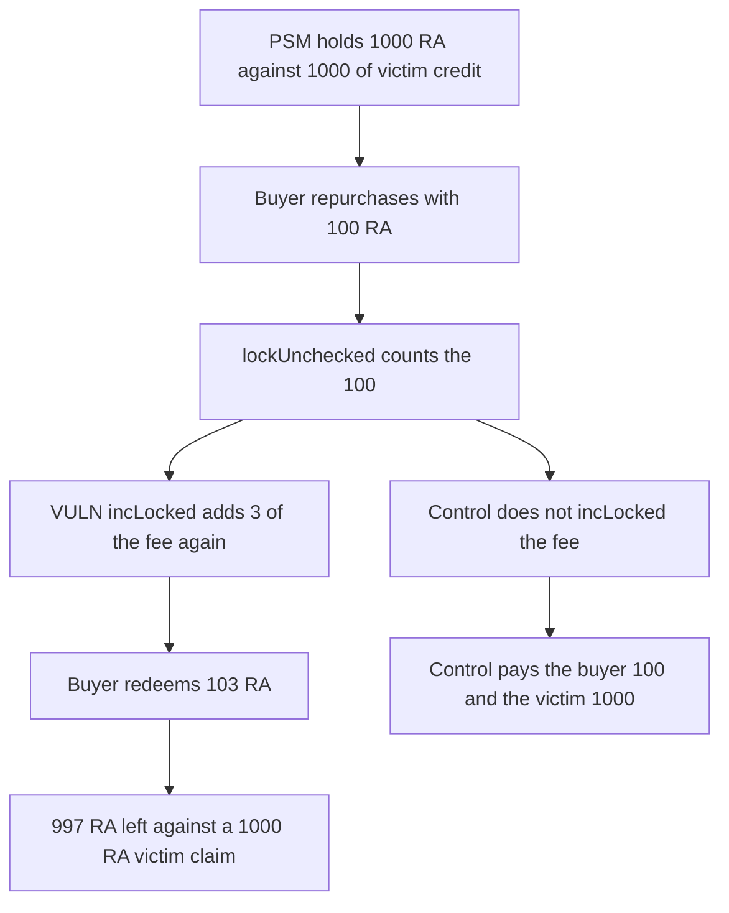

# Cork: repurchase counts 3 RA of fee twice and the last depositor is short

> **Vulnerability classes:** vuln/logic/state-update · vuln/dos/frozen-funds

<!-- non-defihacklabs -->
<!-- source-auditvault: https://github.com/Auditware/AuditVault/blob/main/findings/41481-h-7-wrong-accounting-of-locked-ra-when-repurchasing-dspa-wit.md -->
<!-- date: 2024-08 -->

## Key info

| Field | Value |
|---|---|
| **Loss** | Buyer deposits 100 RA and withdraws 103. The victim's 1000 RA claim has only 997 RA left |
| **Vulnerable contract** | `Psm.unsafeIssueToLv` |
| **Attacker EOA** | `0x0000000000000000000000000000000000041481` |
| **Attack contract** | `Exploit` |
| **Attack tx** | `Exploit.run()` |
| **Chain / block / date** | Ethereum model · block 0 · 2024-08 |
| **Compiler** | solc 0.8.27, cancun, via IR |
| **Bug class** | `incLocked` counts fee RA that `lockUnchecked` already counted |

## TL;DR

`repurchase` pulls 100 RA and `lockUnchecked` adds 100 to `locked` and to the buyer's credit. `unsafeIssueToLv` then mints CT with 3 RA of the 5 percent fee and calls `incLocked(3)` even though those 3 RA are already inside the 100. Locked becomes 1103 while the contract holds 1100. The buyer redeems 103. The victim is still credited 1000 and only 997 RA remains.

## Background

Sherlock's August 2024 Cork Protocol contest, issue 155, reported by 0x73696d616f, dimulski, and vinica_boy. The sponsor agreed `repurchase` should not account the fee RA twice. The report's numbers are a pool of 1000 locked RA, a 100 RA repurchase, a 5 percent fee, and 3 of that fee used to mint CT+DS. The escalation accepted that the first redeemers are paid from RA the last redeemers can no longer withdraw.

## The vulnerable code

```solidity
lockUnchecked(amount, msg.sender);
uint256 raUsedToMint = 3 ether;
unsafeIssueToLv(raUsedToMint);

function unsafeIssueToLv(uint256 amount) internal {
    // @> VULN: incLocked adds the CT mint on top of RA that lockUnchecked already counted
    locked += amount;
    credit[msg.sender] += amount;
}
```

`lockUnchecked` already did `locked += amount` for the full 100 RA that arrived. The second `locked += amount` is the 3 RA fee slice.

## Root cause

The RA used to mint CT+DS for the AMM is a slice of the RA the user just provided. It is already in `locked`. `PsmLibrary.unsafeIssueToLv` increments `locked` again by the CT amount. Claims are paid from credit that now sums to more than the token balance.

## Preconditions

- The PSM holds 1000 RA and a victim has 1000 of credit.
- Repurchase fee is 5 percent. Of a 100 RA repurchase, 3 RA is the amount passed to `unsafeIssueToLv`, matching the report's example.
- The buyer can redeem their credit before the victim.

## Attack walkthrough

1. The buyer calls `repurchase(100 ether)`. The contract pulls 100 RA. Cash is 1100.
2. `lockUnchecked` credits the buyer 100. `locked` is 1100.
3. `unsafeIssueToLv(3 ether)` adds 3 to `locked` and to the buyer's credit. `locked` is 1103. Cash is still 1100.
4. The buyer redeems 103 RA.
5. Cash left is 997. The victim's credit is still 1000, so 3 RA of that claim cannot be paid.
6. The buyer's balance is 103. They started `run` with 100, so the gain is 3 RA.

## Diagrams



## Impact

The buyer extracts 3 RA that was never deposited on top of the 100 RA they sent. The victim cannot redeem the full 1000 RA because the contract balance is 997. That is the report's outcome: earlier redeemers are paid from RA the last redeemers are short. The control redeems the buyer for 100 and the victim for 1000 and leaves the PSM empty.

## Remediation

Do not call `incLocked` for the fee RA that `lockUnchecked` already counted. The team's fix, in Cork-Technology/Depeg-swap pull 77, stops accounting that fee when the user provides RA.

## How to reproduce

```bash
cd 41481-h-7-wrong-accounting-of-locked-ra-when-repurchasing-dspa-wit_exp
forge test -vv
```

`test_exploit_double_locked_fee_steals_3_ra` asserts a 103 RA redemption and a 3 RA shortfall. `test_control_fee_is_not_locked_twice_and_victim_can_exit` asserts both parties are paid in full. Captured output is `output.txt`.

## Sources

- AuditVault finding: https://github.com/Auditware/AuditVault/blob/main/findings/41481-h-7-wrong-accounting-of-locked-ra-when-repurchasing-dspa-wit.md
- Sherlock judging issue 155: https://github.com/sherlock-audit/2024-08-cork-protocol-judging/issues/155
- Fix: https://github.com/Cork-Technology/Depeg-swap/pull/77
