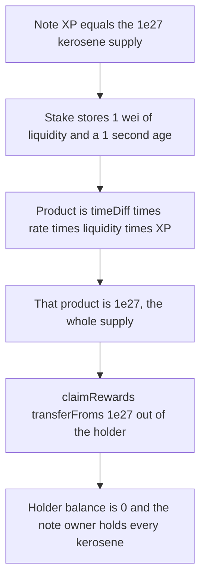

# DYAD — a 1 wei Uniswap stake claims the entire kerosene supply

> **Vulnerability classes:** vuln/logic/reward-calculation · vuln/arithmetic/precision-loss · vuln/logic/missing-check

> **Reproduction:** cheatcode-free local synthetic. `UniswapV3Staking._calculateRewards` is the audited body. Full trace: [output.txt](output.txt). PoC: [test/41686-c-01-the-entire-kerosene-supply-can-be-drained-by-claiming-r_exp.sol](test/41686-c-01-the-entire-kerosene-supply-can-be-drained-by-claiming-r_exp.sol).

<!-- non-defihacklabs -->
<!-- source-auditvault: https://github.com/Auditware/AuditVault/blob/main/findings/41686-c-01-the-entire-kerosene-supply-can-be-drained-by-claiming-r.md -->
<!-- date: 2024-09 -->

**AuditVault taxonomy:** `lang/solidity` · `sector/staking` · `platform/pashov` · `has/github` · `severity/high` · genome: `reward-calculation` · `reward-theft` · `variant` · `reward-accounting`

## Key info

| | |
|---|---|
| **Protocol** | DYAD Uniswap V3 staking rewards |
| **Finding** | Pashov DYAD review C-01, AuditVault 41686 |
| **Vulnerable code** | `UniswapV3Staking._calculateRewards` |
| **Harm** | 1 wei of liquidity, staked for 1 second at `rewardsRate` 1, with note XP equal to the 1_000_000_000e18 kerosene supply, is paid that entire supply. The rewards holder is left at 0 |
| **Chain** | local synthetic |

## TL;DR

Kerosene rewards are `timeDiff * rewardsRate * liquidity * xp` with no decimal scale. Note XP is a 1e18-style accumulator and is large enough to rival the 1 billion kerosene supply. The product is then `transferFrom`'d out of the rewards holder. One second and one wei of liquidity are enough, at rate 1, when XP equals the supply: the claim is 1e27 wei, which is every kerosene token.

## The vulnerable code

Audited `UniswapV3Staking._calculateRewards` (`DyadStablecoin/contracts` @ `973cb961`):

```solidity
function _calculateRewards(uint256 noteId, StakeInfo storage stakeInfo) internal view returns (uint256) {
    uint256 timeDiff = block.timestamp - stakeInfo.lastRewardTime;

    uint256 xp = dyadXP.balanceOfNote(noteId);

    // @> VULN: no 1e18 scale, so 1 second * rate 1 * 1 wei * note XP pays XP kerosene
    return timeDiff * rewardsRate * stakeInfo.liquidity * xp;
}
```

`_claimRewards` pays that number with no cap:

```solidity
uint256 rewards = _calculateRewards(noteId, stakeInfo);
stakeInfo.lastRewardTime = block.timestamp;
if (rewards > 0) {
    rewardsToken.transferFrom(rewardsTokenHolder, recipient, rewards);
}
```

```solidity
// FIX: return timeDiff * rewardsRate * stakeInfo.liquidity * xp / 1e18;
```

The report also says to divide again by 1e18 after `rewardsRate * liquidity` if XP itself is still unscaled. One division is enough for the numbers below.

## Root cause

`liquidity` is a Uniswap uint128 count of liquidity units. `xp` is `balanceOfNote`, which the same review shows is built from 1e18 wad math (`elapsed * adjustedAccrualRate * bonus / 1e18`, with an accrual rate of 1e7 or the documented 1e9). Multiplying those raw values treats 1 unit of XP as 1 wei of kerosene per wei of liquidity per second. There is no division to bring the product back to token decimals.

## Preconditions

The caller owns the note. The note is staked (`isStaked`) with `liquidity > 0`. `rewardsRate` is 1, which the owner can set. The note's XP equals the kerosene supply, 1_000_000_000e18. The rewards holder has approved the staking contract for that supply and holds it. The stake's `lastRewardTime` is one second before the claim. No `vm.warp` is used: the stake record is written as `block.timestamp - 1`, so the gap is 1 second at whatever timestamp the chain is on.

## Attack walkthrough

1. XP for note 1 is set to 1e27.
2. The holder approves the staking contract for 1e27 kerosene.
3. The note owner opens a stake with liquidity 1 and `lastRewardTime = block.timestamp - 1`.
4. `currentRewards` evaluates the product. It is 1 * 1 * 1 * 1e27 = 1e27.
5. `claimRewards` `transferFrom`s 1e27 from the holder to the note owner.
6. The holder balance is 0. The note owner holds the entire supply. `totalSupply` is unchanged.

The control uses the same inputs and divides by 1e18. The claim is 1e9 wei. The holder keeps `supply - 1e9`.

## Diagrams



## Impact

The rewards inventory is the kerosene allocation for every staker. This claim takes all of it: 1,000,000,000 kerosene, from 1 wei of liquidity and 1 second. Anyone else with a stake is left claiming against an empty holder. The report's best case is the other direction of the same bug: XP so large that the product overflows and staking or claiming reverts for everyone. The numbers here are the drain, not the overflow.

## Remediation

Divide the product by 1e18, and divide by 1e18 again if XP is still a wad. Cap the transfer at the holder's balance only as a backstop. The scale fix is what stops a 1 wei position from being owed the supply.

## How to reproduce

```bash
cd 41686-c-01-the-entire-kerosene-supply-can-be-drained-by-claiming-r_exp
forge test -vv
```

## Sources

- AuditVault finding: https://github.com/Auditware/AuditVault/blob/main/findings/41686-c-01-the-entire-kerosene-supply-can-be-drained-by-claiming-r.md
- Pashov report: https://github.com/pashov/audits/blob/master/team/md/Dyad-security-review.md
- Audited staking: https://github.com/DyadStablecoin/contracts/blob/973cb961198890449e0a80b4be4065dccff0abc0/src/staking/UniswapV3Staking.sol
