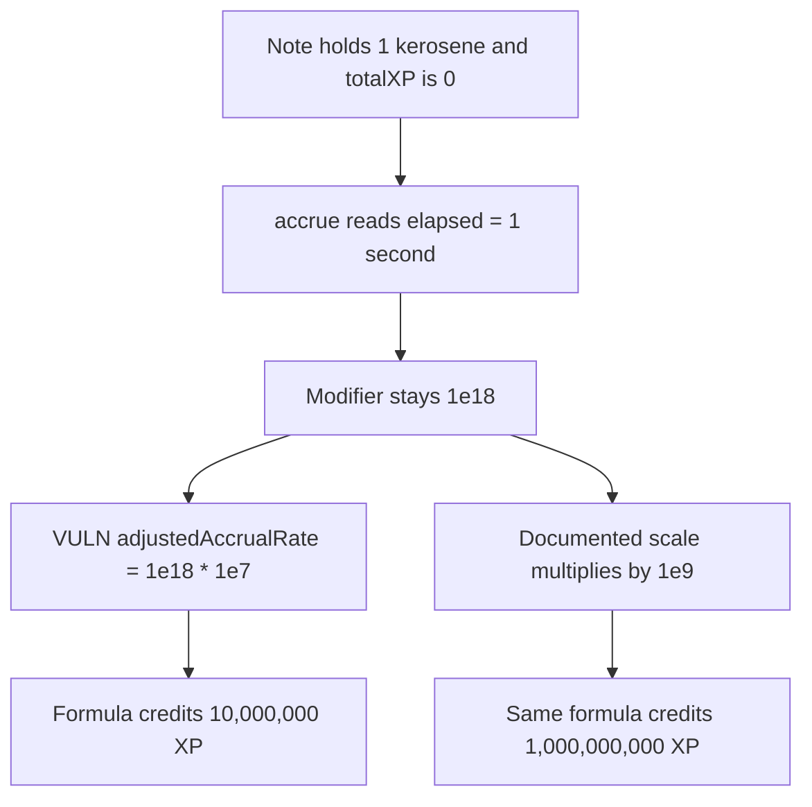

# DYAD H-01: base XP accrual uses `1e7` and pays 1/100 of the documented rate

> **Vulnerability classes:** vuln/arithmetic/scaling · vuln/logic/reward-calculation

<!-- non-defihacklabs -->
<!-- source-auditvault: https://github.com/Auditware/AuditVault/blob/main/findings/41688-h-01-users-will-get-1100-of-the-intended-accrual-rate-pashov.md -->
<!-- date: 2024-10 -->

## Key info

| Field | Value |
|---|---|
| **Loss** | 10,000,000 XP credited instead of 1,000,000,000. The depositor is paid 1/100 of the documented base accrual on 1 kerosene for the 1-second window |
| **Vulnerable contract** | `DyadXPv2._computeXP` |
| **Attacker EOA** | `0x1111111111111111111111111111111111111111` |
| **Attack contract** | `Exploit` at `0x15452ec016c4dc8c549e7fe6ff4b26324ea8b7a4` |
| **Attack tx** | `Exploit.run()` |
| **Chain / block / date** | Ethereum model · block 0 · 2024-10 |
| **Compiler** | solc 0.8.27, cancun, via IR |
| **Bug class** | accrual scale constant is `1e7` instead of the documented `1e9` |

## TL;DR

`DyadXPv2._computeXP` builds `adjustedAccrualRate` as `accrualRateModifier * 1e7`. The review says the documented base scale is `1e9`. A note whose `totalXP` is still 0 keeps the base modifier `1e18`, so the product is `1e25` instead of `1e27`. On 1 kerosene and a 1-second window the note is minted 10,000,000 XP. The same formula with `1e9` mints 1,000,000,000 XP.

## The vulnerable code

```solidity
uint256 accrualRateModifier = 1e18;
if (totalXP > 0) {
    revert("base-rate note");
}

// @> VULN: documented base accrual scale is 1e9; 1e7 pays 1/100 of that XP
uint256 adjustedAccrualRate = accrualRateModifier * 1e7;

uint256 bonus = deposited;
if (dyadMinted + deposited != 0) {
    uint256 ratio = divWadDown(dyadMinted, dyadMinted + deposited);
    bonus += mulWadDown(deposited, ratio);
}

return lastUpdate.lastXP + (elapsed * adjustedAccrualRate * bonus) / 1e18;
```

With `dyadMinted == 0` the wad ratio is 0 and `bonus` stays equal to the kerosene deposit. The only difference between the two credits is the scale constant.

## Root cause

The base accrual constant is two orders of magnitude below the value the documentation specifies. Every later XP read, including staking rewards that multiply by `balanceOfNote`, inherits that 1/100 credit.

## Preconditions

- The note has deposited 1 kerosene and has minted no DYAD, so the bonus equals the deposit.
- `totalXP` is 0, which selects the base modifier `1e18` rather than `1e18 / log10(totalXP)`.
- The model clock is timestamp 1 and `lastAction` is 0, so `elapsed` is 1. Any longer window scales both credits by the same factor and keeps the 100x gap.

## Attack walkthrough

1. The note holder calls `accrue`. No privileged role is required.
2. Elapsed time is `block.timestamp - lastAction` = 1.
3. The modifier stays `1e18`.
4. `adjustedAccrualRate` is `1e18 * 1e7`.
5. The formula returns `1e25` XP and mints that amount.
6. The fixed scale `1e9` returns `1e27` XP for the same deposit and window.

## Diagrams



## Impact

The depositor's XP balance is 10,000,000 instead of 1,000,000,000. That is the yield the note is paid for this window. Rewards that multiply by the note's XP pay 1/100 of the documented amount.

## Remediation

Use the documented base scale:

```diff
-    uint256 adjustedAccrualRate = accrualRateModifier * 1e7;
+    uint256 adjustedAccrualRate = accrualRateModifier * 1e9;
```

## How to reproduce

```bash
cd 41688-h-01-users-will-get-1100-of-the-intended-accrual-rate-pashov_exp
forge test -vv
```

`test_baseAccrualPaysOneHundredth` asserts 10,000,000 XP. `test_control_scale1e9_doesNotHitTheBuggyCredit` asserts 1,000,000,000 XP and that the fair credit is not the buggy number.

## Sources

- AuditVault finding: https://github.com/Auditware/AuditVault/blob/main/findings/41688-h-01-users-will-get-1100-of-the-intended-accrual-rate-pashov.md
- Pashov DYAD review, H-01: https://github.com/pashov/audits/blob/master/team/md/Dyad-security-review.md
