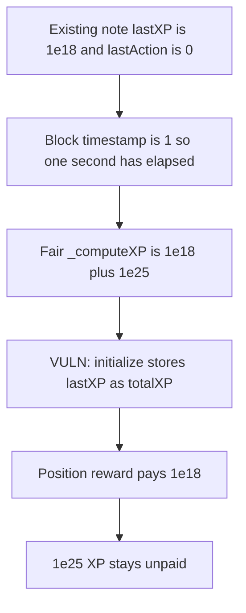

# DYAD — initialize credits lastXP and drops the elapsed bonus

> **Vulnerability classes:** vuln/logic/reward-calculation

<!-- non-defihacklabs -->
<!-- source-auditvault: https://github.com/Auditware/AuditVault/blob/main/findings/41689-h-02-totalxp-is-wrongly-calculated-for-existing-users-pashov.md -->
<!-- date: 2024-09 -->

## Key info

| | |
|---|---|
| **Protocol** | DYAD |
| **Finding** | Pashov Dyad security review H-02, AuditVault 41689 |
| **Vulnerable code** | `DyadXPv2.initialize` |
| **Harm** | An existing note is credited 1e18 XP. The fair total is 1e18 + 1e25. The position reward pays 1e18 and leaves 1e25 unpaid. |
| **Chain** | local synthetic |

## TL;DR

`initialize` sets `totalXP` to `noteData[i].lastXP`. It does not call `_computeXP`, so the bonus accrued since `lastAction` is dropped. On this replay block the timestamp is 1 and `lastAction` is 0, so one second of the audited formula is due. `lastXP` is 1e18, the rate is 1e25, and the fair total is 1e18 + 1e25. The stored total is 1e18. A position reward of `timeDiff * rewardsRate * liquidity * xp` pays 1e18. The control stores `_computeXP` and pays 1e18 + 1e25.

## The vulnerable code

```solidity
// @> VULN: totalXP copies lastXP and drops the elapsed bonus
noteData[i] = NoteXPData({
    lastAction: uint40(block.timestamp),
    keroseneDeposited: uint96(kerosene.id2asset(i)),
    lastXP: noteData[i].lastXP,
    totalXP: noteData[i].lastXP,
    dyadMinted: dyad.mintedDyad(i)
});
```

`_computeXP` is the formula the report quotes. With `totalXP == 0` the accrual modifier is 1e18, the adjusted rate is 1e25, and the bonus is the deposited kerosene. The return is `lastXP + elapsed * 1e25`.

## Root cause

The upgrade rewrites each note and copies `lastXP` into `totalXP`. The elapsed bonus is a separate term in `_computeXP`. Skipping that call freezes the note at its last checkpoint.

## Preconditions

One existing note. `lastAction` is 0, `lastXP` is 1e18, kerosene deposited is 1e18, minted DYAD is 0, and the previous `totalXP` is 0. The block timestamp is 1, which is the anvil header this replay uses. No warp is applied inside `run()`. The report's worked example uses 10000 seconds and gets 1e18 + 1e29. The same formula for the one second available here is 1e18 + 1e25.

## Attack walkthrough

1. The existing note is seated and `_computeXP` is previewed. Elapsed time is 1. The fair total is 1e18 + 1e25.
2. The reward pool is funded with that fair total.
3. `initialize` writes `totalXP: noteData[i].lastXP`. The stored total is 1e18.
4. The position reward uses that stored total and pays 1e18.
5. 1e25 XP remains in the pool.

The control calls `_computeXP` before the write, stores that total, and the same reward pays 1e18 + 1e25.

## Diagrams



## Impact

The note's XP is 1e25 short of the formula. The position reward, which multiplies XP by time, rate, and liquidity, pays 1e18 instead of 1e18 + 1e25. The next accrual also starts from the short total, so later rewards stay low. The fixed initialize pays the full fair amount.

## Remediation

Before writing the note, set `uint256 totalXP = _computeXP(noteData[i])` and store that value in the `totalXP` field.

## How to reproduce

```bash
cd 41689-h-02-totalxp-is-wrongly-calculated-for-existing-users-pashov_exp
forge test -vv
```

## Sources

- AuditVault finding: https://github.com/Auditware/AuditVault/blob/main/findings/41689-h-02-totalxp-is-wrongly-calculated-for-existing-users-pashov.md
- Pashov report: https://github.com/pashov/audits/blob/master/team/md/Dyad-security-review.md
- Review commit: https://github.com/DyadStablecoin/contracts/tree/973cb961198890449e0a80b4be4065dccff0abc0
- Vulnerable function: `src/staking/DyadXPv2.sol` `initialize`
