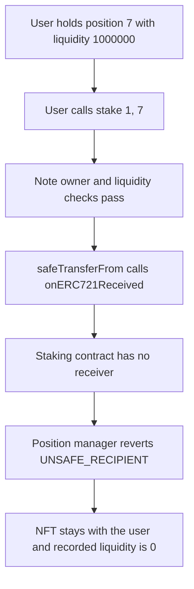

# DYAD UniswapV3Staking — users cannot stake a Uniswap V3 position

> **Vulnerability classes:** vuln/logic/missing-check · vuln/logic/incorrect-state-transition

<!-- non-defihacklabs -->
<!-- source-auditvault: https://github.com/Auditware/AuditVault/blob/main/findings/41692-h-05-users-cannot-stake-in-univ3staking-pashov-audit-group-n.md -->
<!-- date: 2024-09 -->

## Key info

| Field | Value |
|---|---|
| **Loss** | 1,000,000 LP stays with the user. `stake()` reverts, so recorded liquidity is 0 and the position is not staked |
| **Vulnerable contract** | `UniswapV3Staking.stake` |
| **Attacker EOA** | `0x1111111111111111111111111111111111111111` |
| **Attack contract** | `Exploit` |
| **Attack tx** | `Exploit.run()` |
| **Chain / block / date** | Ethereum model · block 0 · 2024-09 |
| **Compiler** | solc 0.8.27, cancun, via IR |
| **Bug class** | ERC721 receiver missing, so `safeTransferFrom` into the staking contract always reverts |

## TL;DR

`stake` pulls the user's Uniswap V3 LP NFT with `positionManager.safeTransferFrom`. That callback requires `onERC721Received` to return its selector. `UniswapV3Staking` does not implement the function, so every stake reverts. A position with 1,000,000 liquidity stays in the user's wallet, `stakes[noteId].isStaked` stays false, and recorded liquidity stays 0. The fixed contract returns `onERC721Received.selector`. The same stake then custodies the NFT and records liquidity 1,000,000.

## Background

Pashov Audit Group reviewed DYAD at `DyadStablecoin/contracts` commit `973cb961198890449e0a80b4be4065dccff0abc0` (2024-09-13). `UniswapV3Staking` is the contract that is supposed to hold a user's Uniswap V3 position NFT and pay rewards against its liquidity. The pull uses the safe ERC721 transfer, which is only legal if the recipient implements `IERC721Receiver`.

## The vulnerable code

```solidity
function stake(uint256 noteId, uint256 tokenId) external {
    require(dnft.ownerOf(noteId) == msg.sender, "You are not the Note owner");

    StakeInfo storage stakeInfo = stakes[noteId];
    require(!stakeInfo.isStaked, "Note already used for staking");

    (,,,,,,, uint128 liquidity,,,,) = positionManager.positions(tokenId);
    require(liquidity > 0, "No liquidity");

    // @> VULN: safeTransferFrom calls onERC721Received, which this contract does not implement
    positionManager.safeTransferFrom(msg.sender, address(this), tokenId);

    stakes[noteId] = StakeInfo({
        liquidity: liquidity,
        lastRewardTime: block.timestamp,
        tokenId: tokenId,
        isStaked: true
    });
}
```

The recommended receiver, which the control implements:

```solidity
function onERC721Received(address, address, uint256, bytes calldata) public pure returns (bytes4) {
    return msg.sig;
}
```

## Root cause

`safeTransferFrom` writes the new owner and then calls `onERC721Received` on the recipient. `UniswapV3Staking` has no such function and no fallback, so the call returns failure, the position manager reverts `UNSAFE_RECIPIENT`, and the owner write is rolled back. The lines that would store `liquidity`, `tokenId`, and `isStaked` never run.

## Preconditions

- The caller owns DYAD note 1 and Uniswap V3 position 7.
- Position 7 has liquidity 1,000,000, so the empty-position check passes.
- The caller has approved `UniswapV3Staking` to move token 7.
- The staking contract has not implemented `onERC721Received`.

## Attack walkthrough

1. The user is minted 1,000,000 LP units, the measurable size of the position, and approves the staking contract for token 7.
2. `stake(1, 7)` passes the note-owner check and reads liquidity 1,000,000.
3. `safeTransferFrom` calls `onERC721Received` on the staking contract. The call fails.
4. The position manager reverts `UNSAFE_RECIPIENT`. The NFT owner is still the user.
5. `stakes[1]` is the zero value: liquidity 0, `isStaked` false. The user still holds 1,000,000 LP.

## Diagrams



## Impact

The user cannot stake. The 1,000,000 liquidity position remains in their wallet, unstaked, so the staking contract records nothing and will not pay rewards on it. This is not a theft: the NFT never leaves the user, and the stake write is rolled back. It is a broken deposit. The control, with `onERC721Received` returning its selector, moves token 7 into the staking contract and stores liquidity 1,000,000 with `isStaked` true.

## PoC

```bash
cd 41692-h-05-users-cannot-stake-in-univ3staking-pashov-audit-group-n_exp
forge test -vv
```

`test_exploit_stake_reverts_lp_stays_with_user` logs `stuck_lp: 1000000` and `recorded_liquidity: 0`, and asserts the NFT holder is still the user. `test_control_stake_records_the_position` asserts the fixed contract holds token 7 and recorded liquidity is 1,000,000.

## Sources

- AuditVault finding: https://github.com/Auditware/AuditVault/blob/main/findings/41692-h-05-users-cannot-stake-in-univ3staking-pashov-audit-group-n.md
- Pashov report: https://github.com/pashov/audits/blob/master/team/md/Dyad-security-review.md
- Reviewed source: https://github.com/DyadStablecoin/contracts/blob/973cb961198890449e0a80b4be4065dccff0abc0/src/staking/UniswapV3Staking.sol
