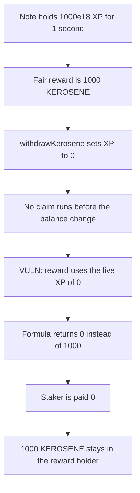

# DYAD — withdrawing before the reward claim pays 0 instead of 1,000 KEROSENE

> **Vulnerability classes:** vuln/logic/reward-calculation · vuln/logic/missing-check

<!-- non-defihacklabs -->
<!-- source-auditvault: https://github.com/Auditware/AuditVault/blob/main/findings/41693-h-06-staking-rewards-should-be-claimed-before-each-balanceof.md -->
<!-- date: 2024-10 -->

## Key info

| | |
|---|---|
| **Protocol** | DYAD |
| **Finding** | Pashov DYAD security review H-06, AuditVault 41693 |
| **Vulnerable code** | `UniswapV3Staking._calculateRewards` |
| **Harm** | Staker is paid 0 instead of 1,000 KEROSENE |
| **Chain** | local synthetic |

## TL;DR

Staking rewards are `timeDiff * rewardsRate * liquidity * balanceOfNote`. Nothing claims before `balanceOfNote` changes. The note held 1,000e18 XP for the elapsed second. `withdrawKerosene` sets that XP to 0, and the later claim multiplies the whole second by 0. The staker receives 0 KEROSENE. The fair amount, at the old XP, is 1,000.

## The vulnerable code

```solidity
function _calculateRewards(uint256 noteId, StakeInfo storage stakeInfo) internal view returns (uint256) {
    uint256 timeDiff = block.timestamp - stakeInfo.lastRewardTime;

    // @> VULN: live balanceOfNote. A withdraw that skipped claimRewards prices the whole window at the new XP.
    uint256 xp = dyadXP.balanceOfNote(noteId);

    return timeDiff * rewardsRate * stakeInfo.liquidity * xp;
}
```

`withdrawKerosene` writes `noteXp` to 0 and does not call `claimRewards`. The note was staked at timestamp 0. This block's timestamp is 1, so `timeDiff` is 1. `rewardsRate` and `liquidity` are both 1.

At the old XP the product is `1 * 1 * 1 * 1000e18 = 1000e18`. After the withdraw the product is 0.

The control calls `claimRewards` while `balanceOfNote` is still 1000e18. The staker receives 1,000 KEROSENE. The withdraw happens only after that.

## Root cause

The reward formula reads the current XP, not the XP that was in force since `lastRewardTime`. Deposit, withdraw, mint, burn, and liquidate all change `balanceOfNote` and none of them claim first. A decrease prices the entire elapsed window at the smaller balance, so the staker is underpaid. An increase would overpay. This reproduction is the decrease: the user loses 1,000 KEROSENE.

## Preconditions

The note is staked, `lastRewardTime` is in the past, and `balanceOfNote` is non-zero. A later call reduces that balance before `claimRewards`. Here the note was staked at timestamp 0 and the call runs at timestamp 1, so exactly one second of rewards is at stake. No warp is used inside `run()`.

## Attack walkthrough

1. `balanceOfNote(1)` is 1000e18. The fair reward for the elapsed second is 1,000 KEROSENE.
2. `withdrawKerosene` sets the note's XP to 0. It does not claim.
3. `claimRewards` calls `_calculateRewards`. The live XP is 0.
4. The return is `1 * 1 * 1 * 0 = 0`. The transfer is skipped.
5. The staker's KEROSENE balance stays 0. The reward holder still has the 1,000. The staker lost 1,000 KEROSENE.

The control claims first. `claimRewards` pays 1,000 KEROSENE to the staker, the holder's balance goes to 0, and only then does the withdraw zero the XP.

## Diagrams



## Impact

The staker loses 1,000 KEROSENE that had already accrued at the old XP. The tokens stay in the reward holder because the claim transfers nothing. Any later balance decrease, including withdraw, burn, and the liquidated note's debt change, repeats the same underpayment for whatever time has elapsed.

## Remediation

Call `claimRewards` for every staked note before `deposit`, `withdraw`, `mintDyad`, `burnDyad`, or `liquidate` changes `balanceOfNote`. The window is then closed at the old XP, and the next window starts at the new one.

## How to reproduce

```bash
cd 41693-h-06-staking-rewards-should-be-claimed-before-each-balanceof_exp
forge test -vv
```

## Sources

- AuditVault finding: https://github.com/Auditware/AuditVault/blob/main/findings/41693-h-06-staking-rewards-should-be-claimed-before-each-balanceof.md
- Pashov report: https://github.com/pashov/audits/blob/master/team/md/Dyad-security-review.md
- Review commit: https://github.com/DyadStablecoin/contracts/tree/973cb961198890449e0a80b4be4065dccff0abc0
