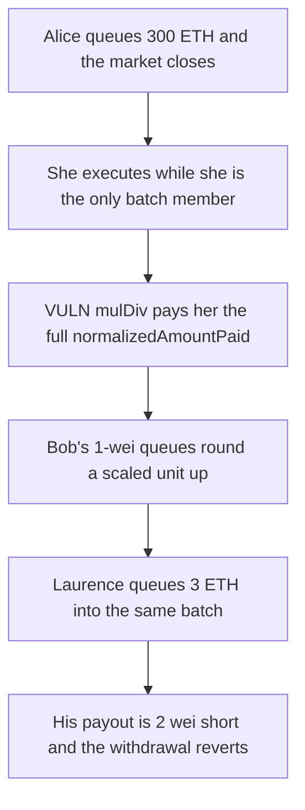

# Wildcat: the last lender in a closed-market batch cannot withdraw

> **Vulnerability classes:** `vuln/arithmetic/rounding` · `vuln/logic/incorrect-state-transition`

<!-- non-defihacklabs -->
<!-- source-auditvault: https://github.com/Auditware/AuditVault/blob/main/findings/41701-h-01-user-could-withdraw-more-than-supposed-to-forcing-last.md -->
<!-- date: 2024-08 -->

## Key info

| Field | Value |
|---|---|
| **Loss** | Laurence's withdrawal reverts. About 3 ETH stays in the market and his scaled balance is already 0 |
| **Vulnerable contract** | `Market.executeWithdrawal` |
| **Attacker EOA** | `0x1111111111111111111111111111111111111111` |
| **Attack contract** | `Exploit` |
| **Attack tx** | `Exploit.run()` |
| **Chain / block / date** | Ethereum model · block 0 · 2024-08 |
| **Compiler** | solc 0.8.27, cancun, via IR |
| **Bug class** | batch payout uses a total that later queues still change |

## TL;DR

On a closed market, withdrawals execute before every lender has joined the batch. `executeWithdrawal` pays `mulDiv(normalizedAmountPaid, scaledAmount, scaledTotalAmount)` against the live totals. Alice queues 100 scaled units, worth 300 ETH at the 3x scale factor, and withdraws all 300 while she is the only member. Bob then queues two 1-wei withdrawals. Each rounds up to 1 scaled unit and reserves only 1 wei. Laurence queues 1 ETH of scaled balance, worth 3 ETH. His payout is 2 wei short of the unclaimed balance, so the subtraction reverts. He receives 0. The market still holds 3 ETH minus 3 wei.

## The vulnerable code

```solidity
uint128 newTotalWithdrawn = uint128(
    MathUtils.mulDiv(normalizedAmountPaid, scaledQueued[lender], scaledTotalAmount)
); // @> VULN: the batch is still open, so this share uses a total later rounding will shrink
normalizedUnclaimedWithdrawals -= owed;
```

The Wildcat fix stopped new requests from joining a batch that can already be executed.

## Root cause

The pro-rata formula is only safe once `scaledTotalAmount` is frozen. Closure was supposed to be that moment. It instead makes execution legal while `queueWithdrawal` can still round new scaled units into the same batch. Alice's earlier payout is larger than her final share, and the missing wei lands on the last `-=`.

## Preconditions

- Scale factor is 3x RAY, so one scaled unit of Alice's size normalizes to 3 units of asset.
- The market holds 300 ETH for Alice, 3 ETH for Laurence, and 5 wei for Bob's rounded queues.
- The market is closed before Alice executes and before the others queue.

## Attack walkthrough

1. Alice queues her full 100 ETH-scaled balance. The batch reserves 300 ETH.
2. The market closes. Alice executes and receives 300 ETH.
3. Bob queues 1 wei twice. Each adds 1 scaled unit and 1 wei of normalized assets.
4. Bob and Laurence queue the rest of their balances into the same batch.
5. Bob's payout of 8 wei fits. Laurence is owed `2999999999999999999` wei and the unclaimed balance is 2 wei lower.
6. His execution reverts. His token balance stays 0. His scaled balance was burned when he queued.

## Diagrams



## Impact

Laurence cannot withdraw. The assets that back his burned scaled balance remain in the market. The same ordering is what the Code4rena PoC shows after interest has accrued and the market is closed: the last execution reverts because `normalizedUnclaimedWithdrawals` is short.

## Remediation

On close, freeze the pending batch so later `queueWithdrawal` calls open a new batch. Do not pay a batch with `mulDiv` until its `scaledTotalAmount` can no longer change.

## How to reproduce

```bash
cd 41701-h-01-user-could-withdraw-more-than-supposed-to-forcing-last_exp
forge test -vv
```

## Sources

- AuditVault finding: https://github.com/Auditware/AuditVault/blob/main/findings/41701-h-01-user-could-withdraw-more-than-supposed-to-forcing-last.md
- Code4rena issue 64: https://github.com/code-423n4/2024-08-wildcat-findings/issues/64
- Payout line: https://github.com/code-423n4/2024-08-wildcat/blob/main/src/market/WildcatMarketWithdrawals.sol
