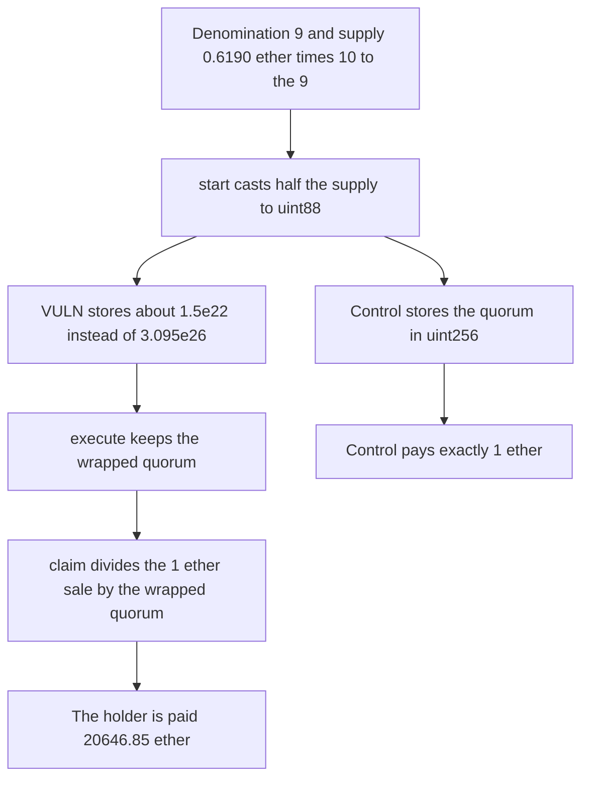

# Flayer: a wrapped shutdown quorum pays 20646 ether on a 1 ether sale

> **Vulnerability classes:** vuln/arithmetic/overflow

<!-- non-defihacklabs -->
<!-- source-auditvault: https://github.com/Auditware/AuditVault/blob/main/findings/41741-h-3-quorum-overflow-in-collectionshutdown-leads-to-complete.md -->
<!-- date: 2024-08 -->

## Key info

| Field | Value |
|---|---|
| **Loss** | 20646.851990532126 ETH paid to one holder. The sale proceeds were 1 ETH |
| **Vulnerable contract** | `CollectionShutdown.start` |
| **Attacker EOA** | `0x0000000000000000000000000000000000041741` |
| **Attack contract** | `Exploit` |
| **Attack tx** | `Exploit.run()` |
| **Chain / block / date** | Ethereum model · block 0 · 2024-08 |
| **Compiler** | solc 0.8.27, cancun, via IR |
| **Bug class** | `uint88` downcast of quorum votes |

## TL;DR

`CollectionShutdown` stores quorum as `uint88(totalSupply * 50 / 100)`. With denomination 9 and `totalSupply = 0.6190 ether * 10**9`, the check against `MAX_SHUTDOWN_TOKENS` still passes, but the cast wraps. `claim` divides the 1 ether sale by that tiny quorum and transfers 20646851990532126875611 wei. A full-width quorum pays exactly 1 ether.

## Background

Sherlock's August 2024 Flayer contest, issue 146, reported by araj and others. `MAX_SHUTDOWN_TOKENS` is `4 ether` and `SHUTDOWN_QUORUM_PERCENT` is 50. Collection tokens are minted as `tokenIds * 1 ether * 10**denomination`. The judging write-up uses `0.6190 ether * 10**9`, which is under the cap and above `type(uint88).max / 2`.

## The vulnerable code

```solidity
if (totalSupply > MAX_SHUTDOWN_TOKENS * 10 ** collectionToken.denomination()) revert TooManyItems();
// @> VULN: uint88(newQuorum) wraps 0.3095 ether * 10**9 down to about 1.5e22, and claim divides by that
quorumVotes = uint88(totalSupply * SHUTDOWN_QUORUM_PERCENT / ONE_HUNDRED_PERCENT);
```

The claim then does:

```solidity
amount = availableClaim * claimableVotes / (quorumVotes * ONE_HUNDRED_PERCENT / SHUTDOWN_QUORUM_PERCENT);
```

`quorumVotes` is 14990178654931275218944. The holder is the whole supply, `availableClaim` is 1 ether, and `amount` is 20646851990532126875611 wei.

## Root cause

`uint88` cannot hold half of `0.6190 ether * 10**9`. The explicit cast truncates instead of reverting. Every later division by quorum inflates the payout by about the ratio of the true quorum to the wrapped one.

## Preconditions

- The collection token's denomination is 9.
- Total supply is `0.6190 ether * 10**9`, which is below `4 ether * 10**9`.
- The holder starts shutdown, the shutdown is executed, and the sale credits 1 ether of claimable proceeds.
- The shutdown contract holds 30000 ether, which is what the PoC deals in so the inflated transfer can succeed.

## Attack walkthrough

1. The holder approves and calls `start`. The supply check passes.
2. `uint88(...)` stores 14990178654931275218944 instead of `0.3095 ether * 10**9`.
3. The holder's votes are above that wrapped quorum, so execution is allowed.
4. `execute` sees a different full-width quorum and writes the same wrapped value again.
5. `claim` divides 1 ether of sale proceeds by the wrapped quorum.
6. The holder receives 20646.851990532126 ether. The contract is left with `30000 ether` minus that amount.

## Diagrams



## Impact

The holder is paid 20646851990532126875611 wei out of a pot that only received 1 ether from the sale. The other 20545.85 ether is other users' ETH sitting in `CollectionShutdown`. The control stores the quorum without the cast and the same claim returns exactly 1 ether, leaving 29999 ether in the contract.

## Remediation

Store `quorumVotes` in a type that can hold `MAX_SHUTDOWN_TOKENS * 10**denomination / 2`. The judging note suggests `uint96` is still tight at denomination 9 and `uint256`, or a revert when the value does not fit, is the safe fix. The same cast in `execute` has to go as well.

## How to reproduce

```bash
cd 41741-h-3-quorum-overflow-in-collectionshutdown-leads-to-complete_exp
forge test -vv
```

`test_exploit_wrapped_quorum_pays_20646_ether` asserts the wrapped quorum and the 20646.85 ether payout. `test_control_full_quorum_pays_the_1_ether_sale` asserts a 1 ether claim. Captured output is `output.txt`.

## Sources

- AuditVault finding: https://github.com/Auditware/AuditVault/blob/main/findings/41741-h-3-quorum-overflow-in-collectionshutdown-leads-to-complete.md
- Sherlock judging issue 146: https://github.com/sherlock-audit/2024-08-flayer-judging/issues/146
- Blamed lines: `CollectionShutdown.sol` `start` and `claim`
