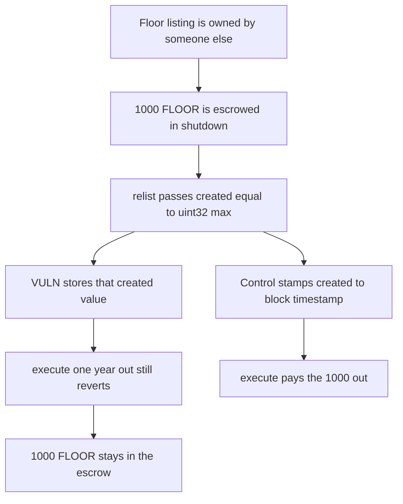

# A Flayer relist with created set to uint32.max blocks collection shutdown and locks 1000 floor tokens

> **Vulnerability classes:** vuln/dos/frozen-funds · vuln/logic/missing-check

<!-- non-defihacklabs -->
<!-- source-auditvault: https://github.com/Auditware/AuditVault/blob/main/findings/41742-h-4-in-the-listingssolrelist-function-listingcreated-is-not.md -->
<!-- date: 2024-08 -->

## Key info

| Field | Value |
|---|---|
| **Loss** | 1000 FLOOR remains in CollectionShutdown. `execute` reverts because `created` is 4294967295 |
| **Vulnerable contract** | `Listings.relist` |
| **Attacker EOA** | `0x1111111111111111111111111111111111111111` |
| **Attack contract** | `Exploit` at `0x15452ec016c4dc8c549e7fe6ff4b26324ea8b7a4` |
| **Attack tx** | `Exploit.run()` |
| **Chain / block / date** | Ethereum model · block 0 · 2024-08 |
| **Compiler** | solc 0.8.27, cancun, via IR |
| **Bug class** | `listing.created` is copied from the caller instead of `block.timestamp` |

## TL;DR

`relist` stores the `Listing` from calldata. A relister who is not the current owner sets `created` to `uint32.max` and `duration` to 30 days. Collection shutdown, evaluated a year past the current timestamp, still sees a live listing and reverts. 1000 floor tokens escrowed for that shutdown stay in the contract. Stamping `created = block.timestamp` makes the same call pay the 1000 out.

## Background

Sherlock's August 2024 Flayer contest, issue 164, reported by ydlee and others. `Listings.relist` was supposed to refresh `listing.created` to `block.timestamp`. It stored the struct the caller passed. The judging PoC showed `created` of 4294967295 where the test expected the current timestamp. `CollectionShutdown.execute` then treats `_hasListings` as permanently true.

## The vulnerable code

```solidity
Listing memory oldListing = listings[tokenId];
if (oldListing.owner == msg.sender) revert("CallerIsAlreadyOwner");
// @> VULN: listing.created is stored from the caller and is not overwritten with block.timestamp
if (oldListing.owner == address(0)) revert("ListingNotAvailable");
listings[tokenId] = listing;
```

The stored `created` is `uint40(type(uint32).max)`, which is 4294967295. `Shutdown.execute` requires `created + duration <= block.timestamp + 365 days`. That sum is about 4.29e9. A year from the current block is not enough.

`ListingsFixed.relist` overwrites `created` with `uint40(block.timestamp)` before storing the struct. `ShutdownFixed.execute` then transfers the full escrow.

## Root cause

`created` is an input, not a clock. Shutdown's liveness check trusts it. A future `created` never expires inside the horizon shutdown uses, so an illiquid collection cannot be wound down.

## Preconditions

- A live floor listing exists and is owned by someone else. This run seeds token 1 to `0xB0B`.
- The caller is not that owner, so `CallerIsAlreadyOwner` does not fire.
- 1000 floor tokens have been moved into the shutdown escrow, which is the inventory an illiquid collection would pay out.
- The relister passes `created = uint32.max` and a 30 day duration.

## Attack walkthrough

1. Seed the floor listing and transfer 1000 FLOOR into shutdown.
2. `relist` with `created` set to `uint32.max`.
3. The stored value reads back as 4294967295.
4. `execute` computes a one-year horizon and reverts with `live listing`.
5. Shutdown still holds 1000. The caller holds 0.
6. The fixed relist stores `block.timestamp`. The same execute pays 1000 back to the caller and empties the escrow.

## Diagrams



## Impact

Collection shutdown cannot run. The 1000 floor tokens that were escrowed for holders of an illiquid collection stay in `CollectionShutdown`. The fixed timestamp lets that call pay them out in full.

## Remediation

After validating the new listing, set `_listings[collection][tokenId].created = uint40(block.timestamp)`, which is the line the Sherlock report adds.

## How to reproduce

```bash
cd 41742-h-4-in-the-listingssolrelist-function-listingcreated-is-not_exp
forge test -vv
```

`test_exploit_future_created_blocks_shutdown` asserts `created` is `uint32.max`, execute reverts, and shutdown holds 1000. `test_control_timestamp_created_pays_the_escrow` asserts `created` is `block.timestamp` and the caller receives 1000. Captured output is `output.txt`.

## Sources

- AuditVault finding: https://github.com/Auditware/AuditVault/blob/main/findings/41742-h-4-in-the-listingssolrelist-function-listingcreated-is-not.md
- Sherlock judging issue 164: https://github.com/sherlock-audit/2024-08-flayer-judging/issues/164
