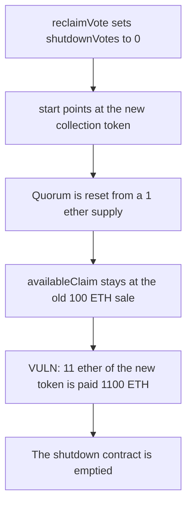

# Flayer: a second collection shutdown reuses the old sale and pays out 1100 ETH

> **Vulnerability classes:** vuln/logic/state-update · vuln/logic/missing-check

<!-- non-defihacklabs -->
<!-- source-auditvault: https://github.com/Auditware/AuditVault/blob/main/findings/41743-h-5-stale-shutdown-params-can-be-reused-to-drain-all-funds-f.md -->
<!-- date: 2024-08 -->

## Key info

| Field | Value |
|---|---|
| **Loss** | 1100 ETH is paid to the attacker. The shutdown contract is emptied |
| **Vulnerable contract** | `CollectionShutdown.voteAndClaim` |
| **Attacker EOA** | `0x0000000000000000000000000000000000417431` |
| **Attack contract** | `Exploit` |
| **Attack tx** | `Exploit.run()` |
| **Chain / block / date** | Ethereum model · block 0 · 2024-08 |
| **Compiler** | solc 0.8.27, cancun, via IR |
| **Bug class** | `start` keeps `availableClaim` from the previous shutdown and resets quorum from the new token's tiny supply |

## TL;DR

`execute` clears `canExecute`, so `reclaimVote` can still run and set `shutdownVotes` back to 0. `start` is then allowed again. It points `collectionToken` at the new token and sets `quorumVotes` from that token's 1 ether supply, but it writes the old struct back, so `availableClaim` stays 100 ether and the sweeper pool stays set. `voteAndClaim` pays `100 ether * 11 ether / 1 ether = 1100 ether`. Clearing `availableClaim` and the sweeper pool on the second start makes the claim revert, and the 1100 ETH stays put.

## Background

Sherlock's August 2024 Flayer contest, issue 173 (H-5), reported by 0xc0ffEE. Shutdown params are keyed by the ERC-721 address. A new collection token for the same ERC-721 reuses the struct. The report's PoC deals the contract 1000 ether, records a 100 ether sale, and shows a claimant with 11 ether of the new token receiving 1100 ether.

## The vulnerable code

```solidity
params.collectionToken.burnFrom(msg.sender, userVotes);
// @> VULN: availableClaim is the previous sale and quorumVotes was reset from the new 1 ether supply
uint256 amount = params.availableClaim * userVotes / (params.quorumVotes * ONE_HUNDRED_PERCENT / SHUTDOWN_QUORUM_PERCENT);
lastPayout = amount;
eth.transfer(msg.sender, amount);
```

`ONE_HUNDRED_PERCENT` is 100 and `SHUTDOWN_QUORUM_PERCENT` is 50. After the second start, `quorumVotes` is 0.5 ether, so the denominator is 1 ether.

## Root cause

`reclaimVote` only refuses to run when `canExecute` is true, and `execute` sets that flag back to false. `start` copies the stored struct, replaces the token and the quorum, and stores the copy. `availableClaim` and `sweeperPool` survive. The claim formula then mixes the old sale with the new token's balance and the new, much smaller quorum.

## Preconditions

- A finished shutdown has `availableClaim` of 100 ether, a nonzero sweeper pool, `canExecute == false`, and `shutdownVotes` of 1 ether.
- The contract holds 1100 ETH: the 100 ether sale plus 1000 ether that was already there.
- The attacker can create a new collection token for the same ERC-721 and mint 1 ether, then 11 ether, of it.

## Attack walkthrough

1. `reclaimVote` subtracts the 1 ether vote. `shutdownVotes` is 0.
2. The locker deploys a new collection token. The attacker mints 1 ether, approves, and calls `start`.
3. `start` sets `quorumVotes` from the 1 ether supply and leaves `availableClaim` at 100 ether.
4. The attacker mints 11 ether more and calls `voteAndClaim`.
5. The payout is 1100 ETH. The contract balance is 0 and the attacker holds 1100 ETH.
6. The control clears `availableClaim` and `sweeperPool` inside `start`. `voteAndClaim` reverts and the 1100 ETH remains in the contract.

## Diagrams


