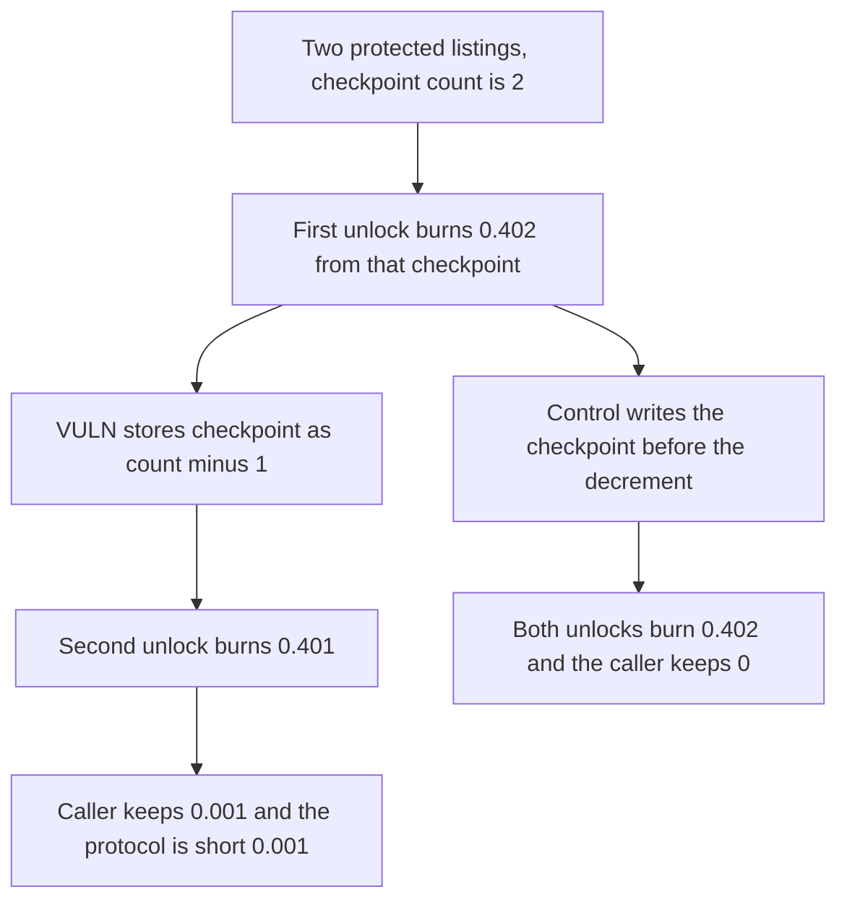

# Flayer protected unlocks get cheaper after the listing count is checkpointed too late

> **Vulnerability classes:** vuln/logic/fee-calculation · vuln/logic/incorrect-order-of-operations

<!-- non-defihacklabs -->
<!-- source-auditvault: https://github.com/Auditware/AuditVault/blob/main/findings/41745-h-7-user-can-pay-less-protected-listing-fees-sherlock-flayer.md -->
<!-- date: 2024-08 -->

## Key info

| Field | Value |
|---|---|
| **Loss** | 0.001 collection tokens kept on the second unlock. Fair charge for both listings is 0.804. The protocol receives 0.803 |
| **Vulnerable contract** | `ProtectedListings.unlockProtectedListing` |
| **Attacker EOA** | `0x1111111111111111111111111111111111111111` |
| **Attack contract** | `Exploit` at `0x15452ec016c4dc8c549e7fe6ff4b26324ea8b7a4` |
| **Attack tx** | `Exploit.run()` |
| **Chain / block / date** | Ethereum model · block 0 · 2024-08 |
| **Compiler** | solc 0.8.27, cancun, via IR |
| **Bug class** | Utilization checkpoint is written after `listingCount` has already decreased |

## TL;DR

`unlockProtectedListing` burns the fee from the current checkpoint, then calls `dropAndCheckpoint`, which stores `count - 1`. The next protected listing in the same collection is priced off that lower count. Two listings that should each cost 0.402 cost 0.402 and 0.401. The caller keeps 0.001 of the 0.804 they funded.

## Background

Sherlock's August 2024 Flayer contest, issue 243, reported by jsmi and dany.armstrong90. `ProtectedListings.unlockProtectedListing` decremented `listingCount` and only afterwards wrote the utilization checkpoint that `unlockPrice` reads. Unlocking several protected listings in one collection made every unlock after the first cheaper than the first.

## The vulnerable code

```solidity
feesTaken += fee;
delete protectedListings[_tokenId];
listingCount = this.dropAndCheckpoint(listingCount);
// ...
// @> VULN: checkpointCount is stored as count - 1, the listing count after this unlock
require(msg.sender == address(this), "self");
next = count - 1;
checkpointCount = next;
```

`unlockPrice` is `0.4 ether + checkpointCount * 0.001 ether`. With two listings the first call still sees checkpoint 2 and burns 0.402. The checkpoint is then stored as 1, so the second call burns 0.401.

Writing the checkpoint before the decrement, which is what `ProtectedListingsFixed` does, charges 0.402 twice.

## Root cause

The fee for a protected listing is a function of how many protected listings the collection still has. That count is updated, and the checkpoint that later reads consume is taken from the updated count, before the next listing is priced. Every subsequent unlock in the batch is one `PER_LISTING` cheaper than the listing that was just closed.

## Preconditions

- At least two protected listings exist in the same collection. This run opens exactly two, both owned by the caller.
- The caller holds 0.804 of the collection token, which is the fair fee for both unlocks at the original count.
- Auto-checkpointing uses `listingCount` with no separate utilization snapshot from before the decrement.

## Attack walkthrough

1. `createTwo` sets `listingCount` and `checkpointCount` to 2.
2. The caller mints and approves 0.804 and unlocks token 0. The fee is 0.402.
3. `dropAndCheckpoint` stores checkpoint 1.
4. Token 1 unlocks at 0.401.
5. The caller still holds 0.001. `feesTaken` is 0.803.
6. The fixed contract checkpoints first. Both fees are 0.402 and the caller keeps 0.

## Diagrams



## Impact

The collection's fee sink is underpaid by 0.001 token for every extra protected listing unlocked after the first in the same checkpoint window. Here the shortfall is 0.001 on a 0.804 fair charge. The tokens stay with the lister instead of being burned as fees.

## Remediation

Write the utilization checkpoint, then decrement `listingCount`. That is the order in `ProtectedListingsFixed`, and it makes both unlocks cost 0.402.

## How to reproduce

```bash
cd 41745-h-7-user-can-pay-less-protected-listing-fees-sherlock-flayer_exp
forge test -vv
```

`test_exploit_second_unlock_pays_less_fee` asserts fees 0.402 and 0.401 and a 0.001 balance left on the caller. `test_control_checkpoint_before_decrement_charges_both` asserts both fees are 0.402 and the caller keeps nothing. Captured output is `output.txt`.

## Sources

- AuditVault finding: https://github.com/Auditware/AuditVault/blob/main/findings/41745-h-7-user-can-pay-less-protected-listing-fees-sherlock-flayer.md
- Sherlock judging issue 243: https://github.com/sherlock-audit/2024-08-flayer-judging/issues/243
