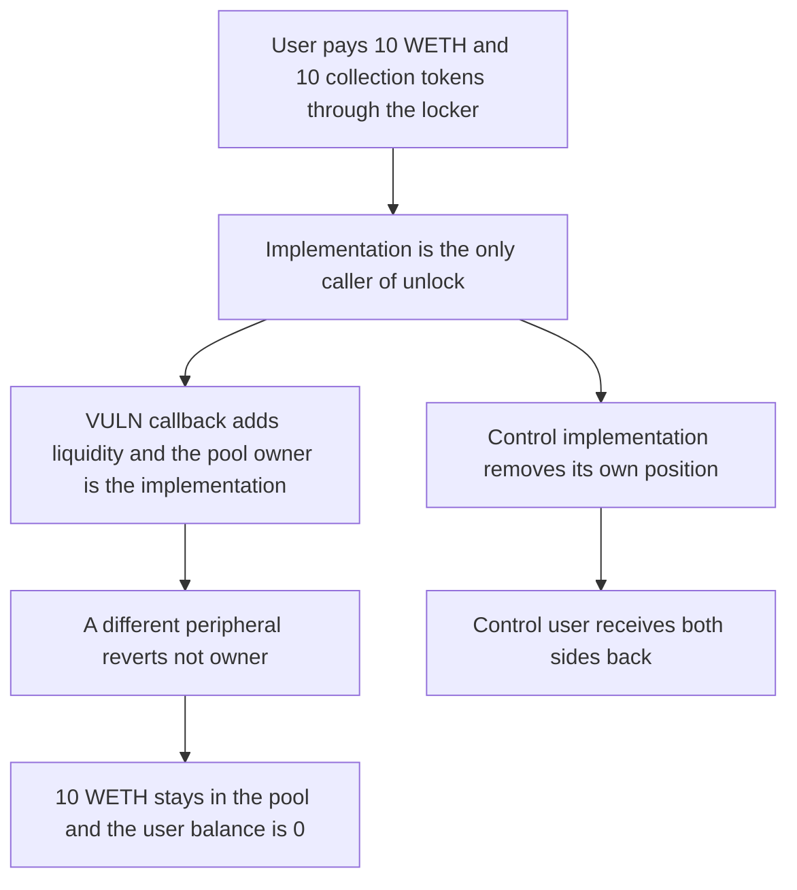

# Flayer: collection initializer liquidity is owned by the implementation and cannot be removed

> **Vulnerability classes:** vuln/dos/frozen-funds · vuln/logic/missing-check

<!-- non-defihacklabs -->
<!-- source-auditvault: https://github.com/Auditware/AuditVault/blob/main/findings/41746-h-8-liquidity-provided-when-initializing-a-collection-in-loc.md -->
<!-- date: 2024-08 -->

## Key info

| Field | Value |
|---|---|
| **Loss** | 10 WETH and 10 collection tokens left in the pool. The depositor's balances are 0 |
| **Vulnerable contract** | `UniswapImplementation.initializeCollection` |
| **Attacker EOA** | `0x1111111111111111111111111111111111111111` |
| **Attack contract** | `Exploit` |
| **Attack tx** | `Exploit.run()` |
| **Chain / block / date** | Ethereum model · block 0 · 2024-08 |
| **Compiler** | solc 0.8.27, cancun, via IR |
| **Bug class** | The only `PoolManager.unlock` adds liquidity credited to the implementation |

## TL;DR

Initializing a collection is the only call to `PoolManager.unlock`. The callback adds liquidity, and the pool records `msg.sender` as the owner. That sender is the implementation, not the user who paid. A different peripheral cannot remove the position. 10 WETH and 10 collection tokens stay in the pool. An implementation that removes liquidity itself, because it is the recorded owner, returns both sides to the user.

## Background

Sherlock's August 2024 Flayer contest, issue 248 (H-8), reported by Feder and several duplicates. Uniswap v4 credits a liquidity position to the contract that calls `modifyLiquidity`. The implementation never calls `unlock` again, and the callback casts the delta so it can only be positive.

## The vulnerable code

```solidity
function initializeCollection(uint256 _amount0, uint256 _amount1) external {
    if (msg.sender != locker) revert CallerIsNotLocker();
    weth.approve(address(pool), _amount0);
    col.approve(address(pool), _amount1);
    // @> VULN: the only PoolManager.unlock. Liquidity is credited to this contract and never removed
    pool.unlock(abi.encode(_amount0, _amount1));
}
```

Inside the callback the delta is `int256(uint256(amount0))`, the same positive-only cast the report shows at `liquidityDelta: int(uint(params.liquidityDelta))`.

## Root cause

The position owner is the peripheral that calls `modifyLiquidity`. The user has no function that makes the implementation unlock the pool with a negative delta. Another contract's `modifyLiquidity` looks up a different owner and reverts.

## Preconditions

- The user holds 10 WETH and 10 collection tokens and approves the locker.
- `initializeCollection` is the only unlock path.
- The pool records `liquidityOf[msg.sender]`.

## Attack walkthrough

1. The user calls `Locker.initializeCollection(10 ether, 10 ether)`.
2. The locker forwards both tokens to the implementation and the implementation calls `unlock`.
3. The callback adds liquidity. `liquidityOf[implementation]` becomes 10 ether.
4. A second peripheral calls `modifyLiquidity` with a negative delta and reverts `not owner`.
5. The pool still holds 10 WETH and 10 collection tokens. The user's balances are 0.
6. The control implementation calls `modifyLiquidity` itself and forwards both sides back. The pool ends empty.

## Diagrams



## Impact

The initializer loses the entire deposit: 10 WETH plus the collection side. There is no later function on the implementation that can unlock the pool for a withdrawal. The control returns both balances in full.

## Remediation

Remember the initializer, allow a negative `liquidityDelta`, and add a remove function that `unlock`s and forwards the tokens to that user. That is the mitigation in issue 248.

## How to reproduce

```bash
cd 41746-h-8-liquidity-provided-when-initializing-a-collection-in-loc_exp
forge test -vv
```

`test_exploit_initializer_liquidity_stays_in_the_pool` asserts 10 WETH and 10 collection tokens in the pool and zero on the user. `test_control_same_caller_can_remove_the_liquidity` asserts both balances return. Captured output is `output.txt`.

## Sources

- AuditVault finding: https://github.com/Auditware/AuditVault/blob/main/findings/41746-h-8-liquidity-provided-when-initializing-a-collection-in-loc.md
- Sherlock issue 248: https://github.com/sherlock-audit/2024-08-flayer-judging/issues/248
