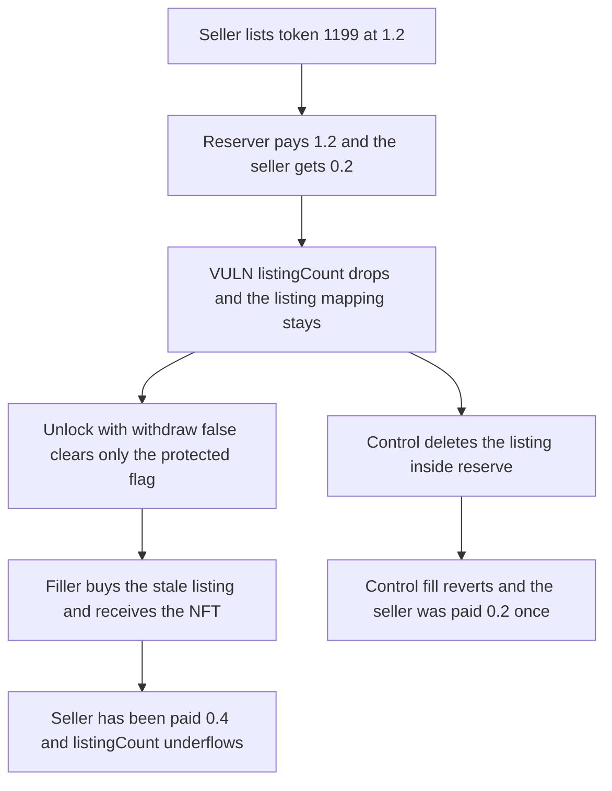

# Reserve leaves the listing in place, so the NFT is sold again and the seller is paid twice

> **Vulnerability classes:** vuln/logic/state-update · vuln/logic/missing-check

<!-- non-defihacklabs -->
<!-- source-auditvault: https://github.com/Auditware/AuditVault/blob/main/findings/41747-h-9-listing-mapping-not-deleted-when-calling-listingsreserv.md -->
<!-- date: 2024-08 -->

## Key info

| Field | Value |
|---|---|
| **Loss** | Seller receives 0.4 collection tokens, two 0.2 premiums. The reserver pays 1.2 and does not receive the NFT. `listingCount` underflows |
| **Vulnerable contract** | `Listings.reserve` |
| **Attacker EOA** | `0x9d042fd3931656228c041cfd32bdb7395e1332e9` (the filler) |
| **Attack contract** | `Exploit` |
| **Attack tx** | `Exploit.run()` |
| **Chain / block / date** | Ethereum model · block 0 · 2024-08 |
| **Compiler** | solc 0.8.27, cancun, via IR |
| **Bug class** | `reserve` pays the seller and decrements `listingCount` without deleting `_listings` |

## TL;DR

A seller lists token 1199 at 1.2x a floor of 1. `reserve` pays the 0.2 premium to the seller, pulls the 1.0 floor, and sets a protected flag. It does not delete `_listings[tokenId]`. `unlockProtectedListing(tokenId, false)` clears the flag and leaves the NFT in the locker. `fillListings` still sees the seller's listing, pays the seller another 0.2, and delivers the NFT to the filler. The reserver's balance falls from 10 to 8.8 and they do not own the token. `listingCount` is decremented twice from 1 and wraps to `2^256 - 1`. Deleting the listing inside `reserve` makes the second fill revert, and the seller is paid 0.2 once.

## Background

Sherlock's August 2024 Flayer contest, issue 252 (H-9). `getListingPrice` checks the protected listing first, so the stale entry is hidden only while that flag is set. `unlockProtectedListing` allows `withdraw = false`, which is what puts the NFT back on the open listing without returning it to the reserver.

## The vulnerable code

```solidity
protected[address(nft)][tokenId] = true;
reserver[address(nft)][tokenId] = msg.sender;
unchecked {
    // @> VULN: _listings[tokenId] is not deleted, so the listing is still fillable after the protected one is lifted
    listingCount[address(nft)] -= 1;
}
```

`_fillListing` and `cancelListing` delete the mapping. `reserve` does not.

## Root cause

The protected listing and the original listing are separate state. Clearing the protected flag does not clear the original listing, and the NFT is still in the locker because the reserver asked not to withdraw it. `fillListings` has no other guard.

## Preconditions

- Token 1199 is listed by the seller at floor multiple 120. Floor is 1, so the price is 1.2.
- The reserver pays that 1.2 through `reserve`.
- The reserver later calls `unlockProtectedListing` with `withdraw = false`.
- A third party calls `fillListings` for the same token id.

## Attack walkthrough

1. The seller lists token 1199. The NFT moves to the locker. `listingCount` is 1.
2. The reserver calls `reserve`. The seller receives 0.2. The reserver's balance goes from 10 to 8.8. `listingCount` becomes 0. The mapping is unchanged.
3. The reserver unlocks with `withdraw = false`. The protected flag is cleared. The NFT stays in the locker.
4. The filler calls `fillListings`, pays 1.2, and receives the NFT. The seller receives another 0.2, for 0.4 total.
5. `listingCount` underflows to `type(uint256).max`.
6. The control deletes the listing in `reserve`. The same fill reverts with `"list"`, and the seller holds 0.2.

## Diagrams



## Impact

The reserver pays 1.2 collection tokens and does not receive the NFT. The filler pays 1.2 and does receive it. The seller is paid the 0.2 premium on both transactions, 0.4 in total, for a single listing. `listingCount` wraps, so a later check that treats zero as "no listings" is wrong in the other direction: the counter is max, not zero, after one stale fill, and a second collection can be driven through the same wrap.

## Remediation

Delete `_listings[collection][tokenId]` inside `reserve` when the old listing has an owner, in the same place `_fillListing` and `cancelListing` already delete it.

## How to reproduce

```bash
cd 41747-h-9-listing-mapping-not-deleted-when-calling-listingsreserv_exp
forge test -vv
```

`test_exploit_stale_listing_pays_seller_twice` asserts the filler owns the NFT, the seller holds 0.4, the reserver holds 8.8, and `listingCount` is `type(uint256).max`. `test_control_deleted_listing_cannot_be_filled` asserts the fill reverts and the seller holds 0.2. Captured output is `output.txt`.

## Sources

- AuditVault finding: https://github.com/Auditware/AuditVault/blob/main/findings/41747-h-9-listing-mapping-not-deleted-when-calling-listingsreserv.md
- Sherlock issue 252: https://github.com/sherlock-audit/2024-08-flayer-judging/issues/252
