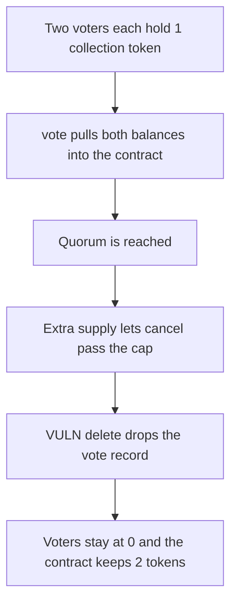

# Flayer: cancelling a collection shutdown does not return the votes

> **Vulnerability classes:** `vuln/dos/frozen-funds` · `vuln/logic/missing-check`

<!-- non-defihacklabs -->
<!-- source-auditvault: https://github.com/Auditware/AuditVault/blob/main/findings/41748-h-10-the-users-who-voted-for-collection-shutdown-will-lose-t.md -->
<!-- date: 2024-08 -->

## Key info

| Field | Value |
|---|---|
| **Loss** | Two voters lose 1 collection token each. The shutdown contract keeps both |
| **Vulnerable contract** | `CollectionShutdown.cancel` |
| **Attacker EOA** | `0x1111111111111111111111111111111111111111` |
| **Attack contract** | `Exploit` |
| **Attack tx** | `Exploit.run()` |
| **Chain / block / date** | Ethereum model · local · 2024-08 |
| **Compiler** | solc 0.8.27, cancun |
| **Bug class** | State deleted without refunding escrowed votes |

## TL;DR

`_vote` pulls a voter's entire collection-token balance into `CollectionShutdown`. Once quorum is reached and total supply grows past `MAX_SHUTDOWN_TOKENS`, `cancel()` deletes the shutdown record and emits nothing back. Both voters stay at 0. The contract still holds 2 tokens.

## Background

Sherlock contest `2024-08-flayer`, issue 261, reported by g and many others. The judging proof mints extra supply so `cancel` passes the total-supply check, then logs both voter balances as 0.

## The vulnerable code

```solidity
params.collectionToken.transferFrom(msg.sender, address(this), userVotes);
// ...
delete _collectionParams[_collection]; // @> VULN: vote escrow is deleted and never refunded
```

The report's fix records the voter list and transfers `shutdownVoters[collection][voter]` back before the delete.

## Root cause

The escrow is recorded in `shutdownVoters`, but `cancel` only deletes `_collectionParams`. There is no loop that pays the voters.

## Preconditions

- Two holders vote with 1 token each, so quorum is met.
- Someone mints one more token so `totalSupply` is above `MAX_SHUTDOWN_TOKENS`.
- `cancel` is called.

## Attack walkthrough

1. Voter 1 and voter 2 each receive 1 collection token. A third token is minted to another address.
2. Each vote transfers the voter's full balance into the shutdown contract.
3. `canExecute` becomes true.
4. `cancel` sees supply 3 above the cap of 2 and deletes the record.
5. Both voter balances are 0. The contract balance is 2.

## Diagrams



## Impact

Each voter loses the collection tokens they escrowed. In this run that is 1 token per voter, 2 tokens held by `CollectionShutdown` after the shutdown can no longer execute. The control `cancelFixed` returns both tokens and leaves the contract at 0.

## Remediation

Track voters and, inside `cancel`, transfer each recorded vote back before deleting the shutdown state, as recommended on issue 261.

## How to reproduce

```bash
cd 41748-h-10-the-users-who-voted-for-collection-shutdown-will-lose-t_exp
forge test -vv
```

`test_exploit_cancel_keeps_both_votes` asserts both voters at 0 and the contract at 2 ether. `test_control_cancel_refunds_voters` asserts both voters back at 1 ether. Captured output is `output.txt`.

## Sources

- AuditVault finding: https://github.com/Auditware/AuditVault/blob/main/findings/41748-h-10-the-users-who-voted-for-collection-shutdown-will-lose-t.md
- Sherlock judging: https://github.com/sherlock-audit/2024-08-flayer-judging/issues/261
- `cancel`: https://github.com/sherlock-audit/2024-08-flayer/blob/main/flayer/src/contracts/utils/CollectionShutdown.sol#L390-L405
- `_vote`: https://github.com/sherlock-audit/2024-08-flayer/blob/main/flayer/src/contracts/utils/CollectionShutdown.sol#L191-L214
