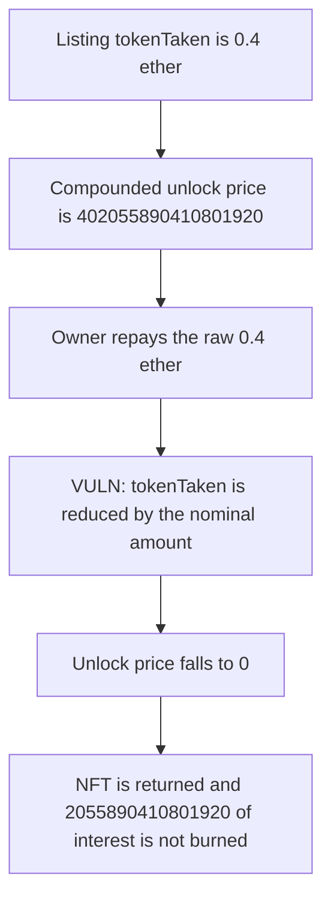

# Flayer: a protected listing is unlocked for the raw principal and the compounded fee is never paid

> **Vulnerability classes:** vuln/logic/fee-calculation · vuln/defi/fee-manipulation

<!-- non-defihacklabs -->
<!-- source-auditvault: https://github.com/Auditware/AuditVault/blob/main/findings/41749-h-11-user-can-unlock-protected-listing-without-paying-any-fe.md -->
<!-- date: 2024-08 -->

## Key info

| Field | Value |
|---|---|
| **Loss** | 2055890410801920 of collection-token interest is not burned. The NFT is returned after a payment of 0.4 ether |
| **Vulnerable contract** | `ProtectedListings.adjustPosition` |
| **Attacker EOA** | `0x0000000000000000000000000000000000417491` (the listing owner) |
| **Attack contract** | `Exploit` |
| **Attack tx** | `Exploit.run()` |
| **Chain / block / date** | Ethereum model · block 0 · 2024-08 |
| **Compiler** | solc 0.8.27, cancun, via IR |
| **Bug class** | Nominal repayment zeroes `tokenTaken` and skips the compounded unlock fee |

## TL;DR

`adjustPosition` subtracts the caller's nominal repayment from `tokenTaken` and never divides by the compounded checkpoint factor. A listing that took 0.4 ether has an unlock price of 402055890410801920 after the stored factor is applied. Paying 0.4 ether sets `tokenTaken` to 0, so `unlockProtectedListing` burns a fee of 0 and returns the NFT. The unpaid interest is 2055890410801920. Dividing the repayment by the factor leaves a nonzero price.

## Background

Sherlock's August 2024 Flayer contest, issue 269 (H-11). `unlockPrice` compounds `tokenTaken` from the listing checkpoint to the current checkpoint. `adjustPosition` updates `tokenTaken` as if that compound factor were 1. The report's PoC warps seven days and shows the price falling from 402055890410801920 to 0.

## The vulnerable code

```solidity
collectionToken.transferFrom(msg.sender, address(this), absAmount * 10 ** collectionToken.denomination());
paid = absAmount * 10 ** collectionToken.denomination();
// @> VULN: tokenTaken is reduced by the nominal amount, not amount/compoundedFactor
_protectedListings[_collection][_tokenId].tokenTaken -= uint96(absAmount);
```

The checkpoints used here are the ones that reproduce the report's price: factor 1e18 at the start and 1005139726027004800 afterwards. `compound` returns `principle * factor / 1e18`.

## Root cause

Health and unlock price both read the compounded `tokenTaken`. The debt adjustment writes the uncompounded amount. Once `tokenTaken` is 0, every later read of the price is 0, including the burn in `unlockProtectedListing`.

## Preconditions

- A protected listing has `tokenTaken` of 0.4 ether and the report's compounded factor.
- `MAX_PROTECTED_TOKEN_AMOUNT` is 0.95 ether, so repaying 0.4 ether through `adjustPosition` is not rejected as a full repay.
- The listings contract holds the 0.6 ether of collection tokens that were not taken, and the owner holds the 0.4 ether that was taken.

## Attack walkthrough

1. `unlockPrice` returns 402055890410801920.
2. The owner approves and calls `adjustPosition` with -0.4 ether. The contract pulls exactly 0.4 ether.
3. `tokenTaken` becomes 0. The next `unlockPrice` is 0.
4. `unlockProtectedListing` burns a fee of 0 and sends the NFT back to the owner.
5. The control divides 0.4 ether by the factor before subtracting. `tokenTaken` and `unlockPrice` both stay above 0, and the NFT is not released.

## Diagrams


