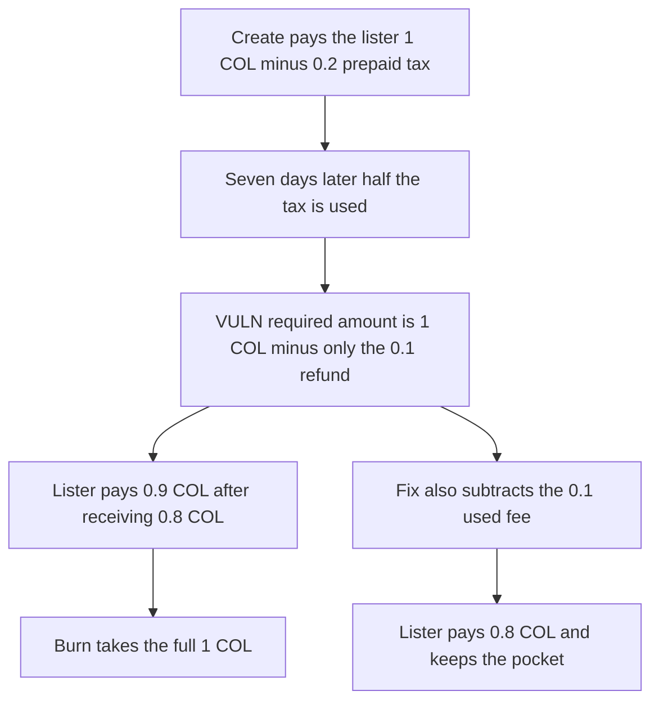

# Flayer: cancelListings charges the used listing tax a second time

> **Vulnerability classes:** `vuln/logic/fee-calculation` · `vuln/logic/wrong-condition`

<!-- non-defihacklabs -->
<!-- source-auditvault: https://github.com/Auditware/AuditVault/blob/main/findings/41761-h-23-lister-is-overpaying-during-the-cancel-of-his-listing-o.md -->
<!-- date: 2024-08 -->

## Key info

| Field | Value |
|---|---|
| **Loss** | 0.1 COL paid twice on one listing. The burn takes the full 1 COL |
| **Vulnerable contract** | `Listings.cancelListings` |
| **Attacker EOA** | `0x1111111111111111111111111111111111111111` (the lister) |
| **Attack contract** | `Exploit` |
| **Attack tx** | `Exploit.run()` |
| **Chain / block / date** | Ethereum model · block 0 · 2024-08 |
| **Compiler** | solc 0.8.27, cancun, via IR |
| **Bug class** | Cancel subtracts only the unused tax from the 1 COL the lister must return |

## TL;DR

Creating a Flayer listing pays the lister `1 COL - prepaidTax`. Cancelling it asks for `1 COL - unusedTax` back. Prepaid tax is unused plus used, so the lister must fund the used slice a second time, out of pocket. On a listing that is halfway through a 14-day term, prepaid tax is 0.2 COL, the refund is 0.1 COL, and the lister is charged 0.9 COL after only ever receiving 0.8 COL. The contract then burns the full 1 COL.

## The vulnerable code

```solidity
uint256 requiredAmount = ((1 ether * _tokenIds.length) * 10 ** collectionToken.denomination()) - refund; // @> VULN
payTaxWithEscrow(address(collectionToken), requiredAmount, _payTaxWithEscrow);
collectionToken.burn(requiredAmount + refund);
```

The judging report's fix also subtracts `fees`, the tax already consumed:

```diff
- uint requiredAmount = ((1 ether * _tokenIds.length) * 10 ** collectionToken.denomination()) - refund;
+ uint requiredAmount = ((1 ether * _tokenIds.length) * 10 ** collectionToken.denomination()) - refund - fees;
```

## Root cause

`_resolveListingTax` splits the prepaid tax into `refund` (time left) and `fees` (time used). `cancelListings` only subtracts `refund` from the 1 COL unit that was minted against the NFT. The used fee was already kept back at create time. Charging it again, then burning `requiredAmount + refund`, destroys that fee instead of treating it as already paid.

## Preconditions

- One liquid listing, duration 14 days, created 7 days ago, so it has not rolled into a dutch listing.
- Tax calculator returns 0.2 COL for that listing. Denomination is 0.
- The 0.2 COL withheld at create sits on `Listings`. The lister holds the 0.8 COL they received, plus 0.1 COL of their own.

## Attack walkthrough

1. The listing record is the one `createListings` would have stored a week earlier.
2. `getListingTaxRequired` returns 0.2 COL. Elapsed time is half the duration, so refund is 0.1 COL and fees are 0.1 COL.
3. `requiredAmount` is 0.9 COL. `payTaxWithEscrow` pulls all of it from the lister.
4. `burn(requiredAmount + refund)` burns 1 COL. The fee sink still receives the original 0.1 COL withholding.
5. The lister's balance is 0. A cancel that subtracted `fees` would have pulled 0.8 COL and left the 0.1 COL pocket.

## Diagrams



## Impact

The lister loses 0.1 COL, the tax they already paid by never receiving it, every time they cancel a listing that has consumed some of its prepaid tax. The burned amount is the whole 1 COL, including that used slice. In this run the burn address holds 1 COL and the lister's balance is 0.

## How to reproduce

```bash
cd 41761-h-23-lister-is-overpaying-during-the-cancel-of-his-listing-o_exp
forge test -vv
```

`test_cancel_charges_used_tax_twice` warps to a timestamp past 14 days, runs the exploit, and checks a 0.9 COL pull, a 0.1 COL fee, an empty lister, and a 1 COL burn.

## Sources

- AuditVault finding: https://github.com/Auditware/AuditVault/blob/main/findings/41761-h-23-lister-is-overpaying-during-the-cancel-of-his-listing-o.md
- Sherlock judging issue 705: https://github.com/sherlock-audit/2024-08-flayer-judging/issues/705
- Blamed function: https://github.com/sherlock-audit/2024-08-flayer/blob/0ec252cf9ef0f3470191dcf8318f6835f5ef688c/flayer/src/contracts/Listings.sol#L414
