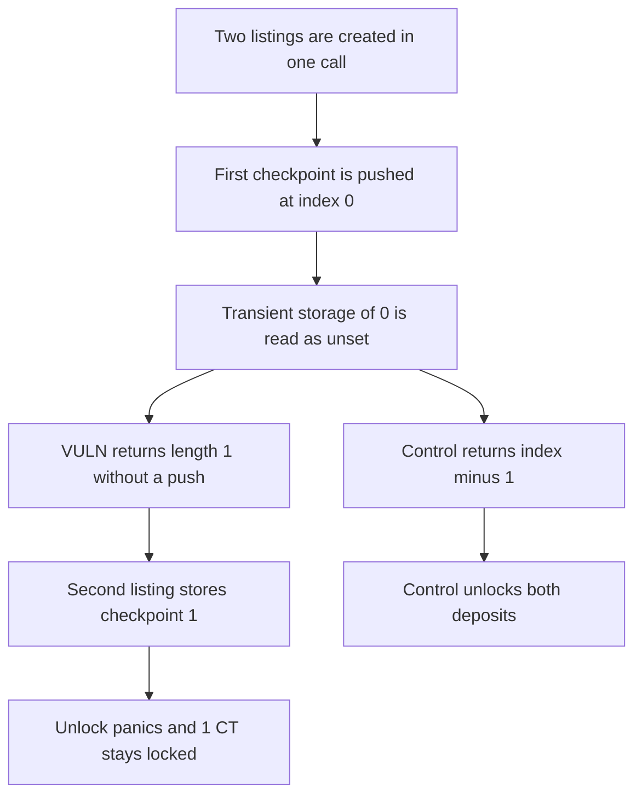

# The second same-block listing stores checkpoint 1 and locks 1 CT

> **Vulnerability classes:** vuln/logic/state-update · vuln/dos/frozen-funds

<!-- non-defihacklabs -->
<!-- source-auditvault: https://github.com/Auditware/AuditVault/blob/main/findings/41762-h-24-incorrect-index-handling-in-checkpoint-creation-leads-t.md -->
<!-- date: 2024-08 -->

## Key info

| Field | Value |
|---|---|
| **Loss** | 1 CT locked in ProtectedListings. Unlock of the second listing reverts on a missing checkpoint |
| **Vulnerable contract** | `ProtectedListings._createCheckpoint` |
| **Attacker EOA** | `0x1111111111111111111111111111111111111111` |
| **Attack contract** | `Exploit` |
| **Attack tx** | `Exploit.run()` |
| **Chain / block / date** | Ethereum model · block 0 · 2024-08 |
| **Compiler** | solc 0.8.27, cancun, via IR |
| **Bug class** | Same-timestamp checkpoint returns the array length instead of the updated index |

## TL;DR

`_createCheckpoint` returns `index_`, the array length, when the new checkpoint has the same timestamp as the last one and no element was pushed. The first listing in a batch gets index 0. That 0 is stored in transient storage, which the next iteration treats as unset, so `_createCheckpoint` runs again and returns 1. Only index 0 exists. Unlock of the second listing panics and its 1 CT stays in the contract. Returning `index_ - 1` lets both listings unlock.

## Background

Sherlock's August 2024 Flayer contest, issue 732 (H-24). `ProtectedListings.createListings` caches the checkpoint index in transient storage. A return value of 0 is indistinguishable from "not set", so a second listing for the same collection in the same transaction creates the bad index. `unlockPrice` then reads `collectionCheckpoints[listing.checkpoint]` and reverts out of bounds.

## The vulnerable code

```solidity
if (checkpoint.timestamp == collectionCheckpoints[_collection][index_ - 1].timestamp) {
    collectionCheckpoints[_collection][index_ - 1].compoundedFactor = checkpoint.compoundedFactor;
    // @> VULN: returns the length even though no new checkpoint was pushed
    return index_;
}
```

The fix in the report is `return index_ - 1`.

## Root cause

The early return uses the length captured before the update. Combined with `if (checkpointIndex == 0)` in `createListings`, the first listing's legitimate index 0 forces a second call, and that call hands back an index that was never pushed.

## Preconditions

- The collection has no checkpoints yet.
- Two listings for that collection are created in one call, so both see the same `block.timestamp`.
- Each listing deposits 1 CT.

## Attack walkthrough

1. `createListings` runs with two listings.
2. The empty-array path pushes checkpoint 0 and returns 0. Transient storage stores 0.
3. The second iteration calls `_createCheckpoint` again. The timestamp matches, nothing is pushed, and the function returns 1.
4. The first listing unlocks and returns its 1 CT.
5. Unlock of token 2 reads index 1, panics, and the other 1 CT remains in the contract.

## Diagrams



## Impact

The second listing's 1 CT cannot be unlocked. `checkpointLength` is 1 and the stored index is 1, so every later read of that checkpoint reverts. The first listing is unaffected and its 1 CT comes back. The fixed return value stores 0 for both listings and both deposits are withdrawn.

## Remediation

On the same-timestamp branch, return `index_ - 1`. The judging diff is that one change.

## How to reproduce

```bash
cd 41762-h-24-incorrect-index-handling-in-checkpoint-creation-leads-t_exp
forge test -vv
```

`test_exploit_second_listing_checkpoint_locks_one_ct` asserts indexes 0 and 1, a checkpoint length of 1, a successful first unlock, a reverted second unlock, and 1 CT left in the contract. `test_control_same_timestamp_returns_the_existing_index` asserts both listings return 1 CT and the contract is empty. Captured output is `output.txt`.

## Sources

- AuditVault finding: https://github.com/Auditware/AuditVault/blob/main/findings/41762-h-24-incorrect-index-handling-in-checkpoint-creation-leads-t.md
- Sherlock judging issue 732: https://github.com/sherlock-audit/2024-08-flayer-judging/issues/732
- Blamed function: `ProtectedListings._createCheckpoint`
