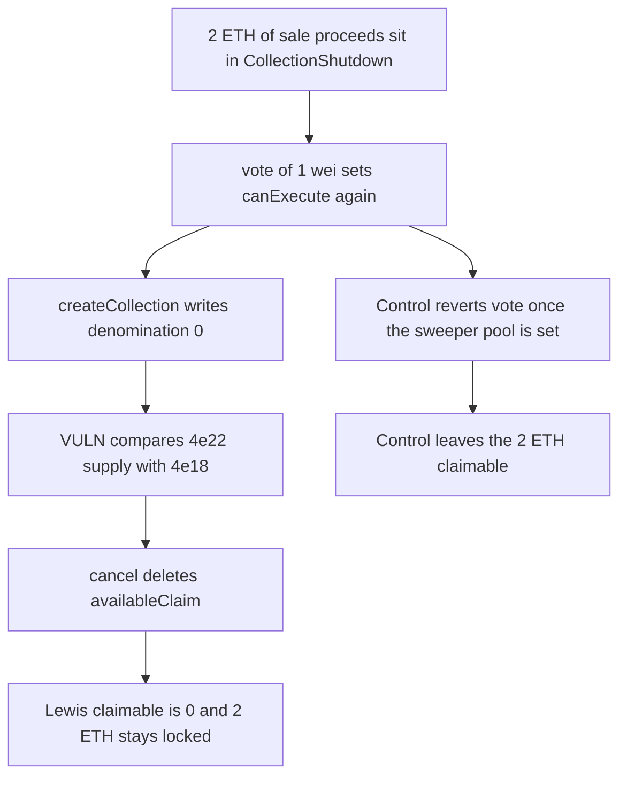

# A 1 wei vote after shutdown lets cancel wipe Lewis's 2 ETH claim

> **Vulnerability classes:** vuln/logic/missing-check · vuln/dos/frozen-funds

<!-- non-defihacklabs -->
<!-- source-auditvault: https://github.com/Auditware/AuditVault/blob/main/findings/41763-h-25-the-attacker-will-prevent-eligible-users-from-claiming.md -->
<!-- date: 2024-08 -->

## Key info

| Field | Value |
|---|---|
| **Loss** | 2 ETH of Sudoswap sale proceeds locked in CollectionShutdown. Lewis's claimable balance becomes 0 |
| **Vulnerable contract** | `CollectionShutdown.cancel` and `CollectionShutdown.vote` |
| **Attacker EOA** | `0x1111111111111111111111111111111111111111` |
| **Attack contract** | `Exploit` |
| **Attack tx** | `Exploit.run()` |
| **Chain / block / date** | Ethereum model · block 0 · 2024-08 |
| **Compiler** | solc 0.8.27, cancun, via IR |
| **Bug class** | Post-execution vote plus a cancel check that reads the live denomination |

## TL;DR

`vote` does not stop once the sweeper pool is set, so 1 wei of collection tokens turns `canExecute` back on. `cancel` then compares the old token's total supply with `MAX_SHUTDOWN_TOKENS * 10 ** locker.collectionToken().denomination()`. Recreating the collection at denomination 0 makes `4e22 <= 4e18` false, and `cancel` deletes `availableClaim`. The 2 ETH stays in the contract. The fixed vote reverts after execution and Lewis can still claim the 2 ETH.

## Background

Sherlock's August 2024 Flayer contest, issue 742 (H-25). After a collection shutdown is executed and Sudoswap has sold the NFTs, a holder who never voted can call `vote`, recreate the collection at a lower denomination, and `cancel`. The report's numbers are a supply of 4 collection tokens at denomination 4, quorum already met by Lewis, and 2 ETH of proceeds.

## The vulnerable code

```solidity
uint256 denom = locker.collectionToken(_collection).denomination();
// @> VULN: total supply is compared with the live locker denomination, not the token that was voted
if (params.collectionToken.totalSupply() <= MAX_SHUTDOWN_TOKENS * 10 ** denom) {
    revert("InsufficientTotalSupplyToCancel");
}
delete _collectionParams[_collection];
```

`vote` also lacks the `sweeperPool != address(0)` revert that the fix adds.

## Root cause

Two checks are wrong. `vote` treats a finished shutdown as still open, and `cancel` scales `MAX_SHUTDOWN_TOKENS` by a denomination the attacker can replace. At denomination 0 the supply check that should block cancel does not fire, and `delete` clears the claim.

## Preconditions

- Lewis has already voted 2e22 tokens, quorum is met, and the shutdown was executed. `canExecute` is false and `sweeperPool` is set.
- The collection token supply is 4e22 and its original denomination is 4.
- The attacker holds 1 wei of that token.
- 2 ETH of sale proceeds are delivered into the shutdown contract.

## Attack walkthrough

1. `creditProceeds` pulls 2 ETH in and sets `availableClaim`.
2. The attacker votes 1 wei. `shutdownVotes` is already at quorum, so `canExecute` becomes true.
3. `createCollection` sets the locker denomination to 0.
4. `cancel` evaluates `4e22 <= 4e18 * 10**0`, which is false, and deletes the params.
5. `claimable` for Lewis is 0. The contract still holds 2 ETH.

## Diagrams



## Impact

Lewis cannot claim the 2 ETH. The balance remains in `CollectionShutdown` with `availableClaim` deleted, so no later claim pays it out. The fixed `vote` reverts because the sweeper pool is already set, and `claimable` for Lewis stays 2 ETH.

## Remediation

Revert in `vote` when `sweeperPool` is set, and scale the cancel check by `params.collectionToken.denomination()` instead of the live locker token. Both changes are in the judging report.

## How to reproduce

```bash
cd 41763-h-25-the-attacker-will-prevent-eligible-users-from-claiming_exp
forge test -vv
```

`test_exploit_cancel_locks_lewis_sale_proceeds` asserts the shutdown holds 2 ETH and Lewis's claim is 0. `test_control_executed_shutdown_cannot_be_revoted` asserts the fixed vote reverts and the claimable amount is still 2 ETH. Captured output is `output.txt`.

## Sources

- AuditVault finding: https://github.com/Auditware/AuditVault/blob/main/findings/41763-h-25-the-attacker-will-prevent-eligible-users-from-claiming.md
- Sherlock judging issue 742: https://github.com/sherlock-audit/2024-08-flayer-judging/issues/742
- Blamed functions: `CollectionShutdown.vote` and `CollectionShutdown.cancel`
