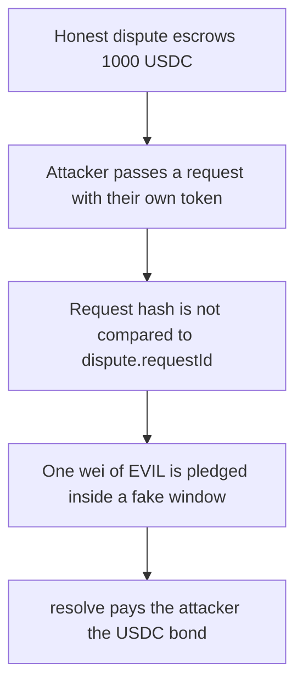

# Prophet — a pledge can name its own bond token and still take the USDC dispute bond

> **Vulnerability classes:** `vuln/input-validation/missing` · `vuln/logic/missing-validation`

> **Reproduction:** a self-contained Foundry PoC that compiles and runs offline
> with only `forge-std` — no fork and no RPC. Trace: [output.txt](output.txt).
> PoC: [test/41793-arbitrary-request-data-can-be-provided-to-module-functions-i_exp.sol](test/41793-arbitrary-request-data-can-be-provided-to-module-functions-i_exp.sol).

<!-- non-defihacklabs -->
<!-- source-auditvault: https://github.com/Auditware/AuditVault/blob/main/findings/41793-arbitrary-request-data-can-be-provided-to-module-functions-i.md -->
<!-- date: 2024-05 -->

---

## Key info

| | |
|---|---|
| **Impact** | **HIGH** — 1 wei of an attacker token wins the dispute and takes the proposer's **1,000 USDC** |
| **Protocol** | Wonderland Prophet, `BondEscalationResolutionModule.pledge` |
| **Vulnerable code** | deadline and bond token are read from the caller request, which is not compared to `dispute.requestId` |
| **Bug class** | Module validation trusts attacker-supplied request data |
| **Finding** | Trail of Bits — Wonderland Prophet, May 2024 · id 41793 |
| **Report** | [Trail of Bits review](https://github.com/trailofbits/publications/blob/master/reviews/2024-05-wonderland-prophet-securityreview.pdf) |
| **Source** | [AuditVault finding](https://github.com/Auditware/AuditVault/blob/main/findings/41793-arbitrary-request-data-can-be-provided-to-module-functions-i.md) |
| **Compiler** | solc 0.8.27, cancun, via IR |

---

## TL;DR

`pledgeAgainstDispute` checks that the dispute argument matches the stored dispute, then decodes the bond token and the pledging deadline from a separate `request` argument. It never hashes that request and compares it to `dispute.requestId`.

The honest request's deadline has already passed. The attacker passes their own ERC-20 and a deadline that is still open, pledges 1 wei, and `resolve` pays them the 1,000 USDC that was bonded on the dispute. A fixed module reverts with `request mismatch` before any token moves.

## The vulnerable code

```solidity
require(supplied.requestId == dispute.requestId, "dispute");
Request memory params = request;
uint256 deadline = ESCALATION_START + params.timeUntilDeadline; // @> VULN
ERC20(params.bondToken).transferFrom(msg.sender, address(this), amount);
activeToken = params.bondToken;
```

```diff
 Request memory params = request;
+bytes32 got = keccak256(abi.encode(params));
+require(got == dispute.requestId, "request mismatch");
 uint256 deadline = ESCALATION_START + params.timeUntilDeadline;
```

## Attack walkthrough

1. The module holds 1,000 USDC posted for the honest pricing request. Escalation started at timestamp 1, so the real window is over.
2. The attacker builds a request whose id does not match, whose bond token is EVIL, and whose `timeUntilDeadline` is `block.timestamp`.
3. `pledgeAgainstDispute` accepts it. The deadline check uses the fake window. `transferFrom` pulls 1 wei of EVIL.
4. `activeToken` is now EVIL and the against-side leads.
5. `resolve` sends the USDC pot to the caller.

## Diagrams



## Impact

Anyone can out-pledge a dispute with a token they minted and take the honest side's bond. Here that bond is 1,000 USDC, paid for 1 wei of EVIL. The same missing check is what the review flags on the other resolution modules.

## Sources

- [AuditVault 41793](https://github.com/Auditware/AuditVault/blob/main/findings/41793-arbitrary-request-data-can-be-provided-to-module-functions-i.md)
- [Trail of Bits, Wonderland Prophet, May 2024](https://github.com/trailofbits/publications/blob/master/reviews/2024-05-wonderland-prophet-securityreview.pdf)
- Blamed function: `BondEscalationResolutionModule._pledge`, as quoted in that review
