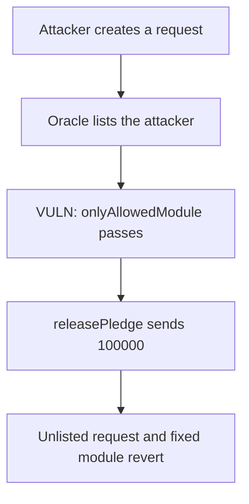

# BondEscalationAccounting — a self-created request drains the pledge escrow

> **Vulnerability classes:** `vuln/access-control/missing-auth` · `vuln/access-control/broken-logic`

<!-- non-defihacklabs -->
<!-- source-auditvault: https://github.com/Auditware/AuditVault/blob/main/findings/41794-ineective-access-control-can-lead-to-user-funds-being-stolen.md -->
<!-- date: 2024-05 -->

## Key info

| | |
|---|---|
| **Protocol** | Wonderland Prophet |
| **Finding** | Trail of Bits, AuditVault 41794 |
| **Vulnerable code** | `onlyAllowedModule` |
| **Harm** | The caller takes 100000 USDC of pledges. An unlisted request and a fixed module both revert. |
| **Chain** | local synthetic |

## TL;DR

`onlyAllowedModule` asks the oracle whether `msg.sender` is a module on the request. Anyone can create a request and list their own address. `releasePledge` then treats that caller as authorized and transfers the dispute's pledge escrow. A request that lists someone else reverts. An accounting contract that accepts only one fixed module also reverts, and its 100000 stays put.

## The vulnerable code

```solidity
modifier onlyAllowedModule(bytes32 _requestId) {
    if (!ORACLE.allowedModule(_requestId, msg.sender)) revert AccountingExtension_UnauthorizedModule();
    _;
}
```

`allowedModule` is true when the address was stored on that request. `createRequest` is permissionless.

## Root cause

The modifier proves only that the caller wrote themselves onto some request. It does not prove that the caller is the dispute module the pledgers used.

## Preconditions

The accounting contract holds 100000 of pledged tokens. The attacker creates a request id and passes their own address as the module. `releasePledge` is external and guarded only by `onlyAllowedModule`.

## Attack walkthrough

1. The attacker calls `createRequest` with their own address.
2. `allowedModule` returns true for that pair.
3. `releasePledge` runs the modifier, passes, and transfers 100000 to the attacker.
4. The same function with a request that lists a different module reverts.
5. The control accounting accepts only one hardcoded module. The call reverts and the 100000 remains.

## Diagrams



## Impact

Pledgers lose the 100000 USDC held for the dispute. The attacker receives it in one call. Requests that do not list the attacker, and a module allowlist of one address, do not pay.

## Remediation

Do not derive module authorization from a request anyone can create. Pin the module addresses at deployment, as the review recommends.

## How to reproduce

```bash
cd 41794-ineective-access-control-can-lead-to-user-funds-being-stolen_exp
forge test -vv
```

## Sources

- AuditVault finding: https://github.com/Auditware/AuditVault/blob/main/findings/41794-ineective-access-control-can-lead-to-user-funds-being-stolen.md
- Trail of Bits review: https://github.com/trailofbits/publications/blob/master/reviews/2024-05-wonderland-prophet-securityreview.pdf
