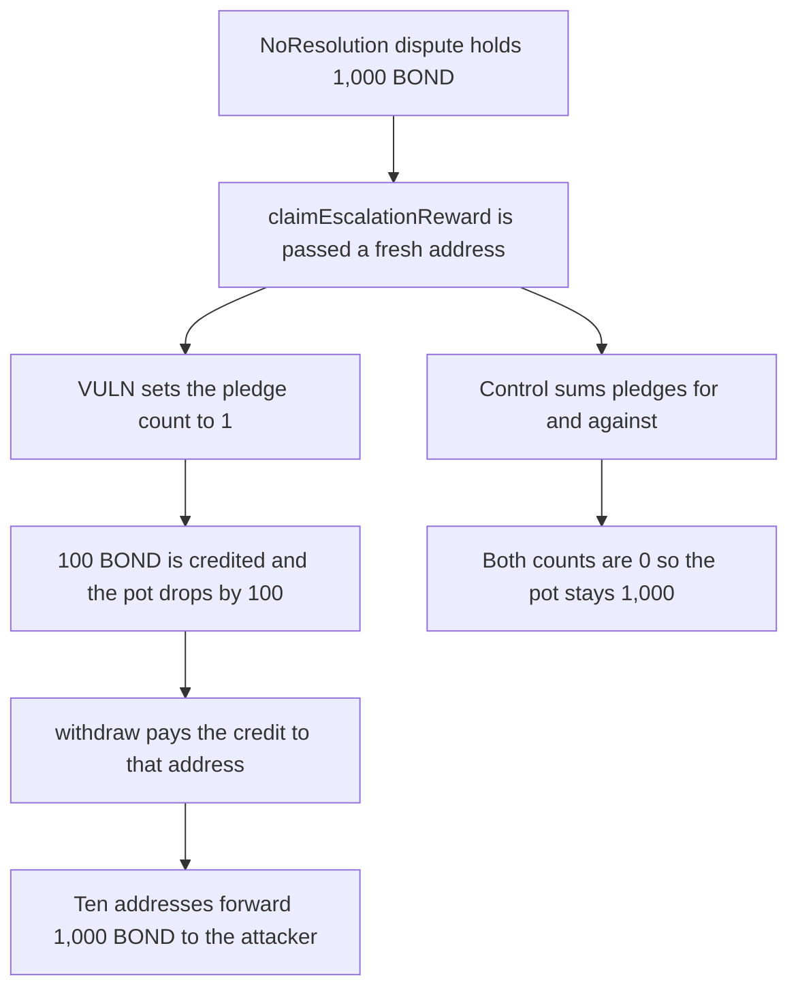

# Prophet: ten addresses that never pledged drain a 1,000 BOND NoResolution pot

> **Vulnerability classes:** `vuln/logic/missing-check` · `vuln/access-control/missing-auth`

<!-- non-defihacklabs -->
<!-- source-auditvault: https://github.com/Auditware/AuditVault/blob/main/findings/41798-dispute-pledges-for-a-noresolution-dispute-can-be-stolen-by.md -->
<!-- date: 2024-05 -->

## Key info

| Field | Value |
|---|---|
| **Loss** | 1,000 BOND. Each of 10 addresses receives one 100 BOND pledge without having pledged |
| **Vulnerable contract** | `BondEscalationAccounting.claimEscalationReward` |
| **Attacker EOA** | `0x000000000000000000000000000000000000a346` |
| **Attack contract** | `Exploit` |
| **Attack tx** | `Exploit.run()` |
| **Chain / block / date** | Ethereum model · block 0 · 2024-05 |
| **Compiler** | solc 0.8.27, cancun, via IR |
| **Bug class** | NoResolution hardcodes the pledge count to 1 for any address |

## TL;DR

When a dispute status is `NoResolution`, `claimEscalationReward` sets `_numberOfPledges` to 1 and credits `amountPerPledger` to whatever address the caller passes. The address does not need a pledge for or against the request. Ten fresh contracts each take 100 BOND and forward it. The accounting contract is left with 0. The control counts real pledges, both of which are 0, and pays nothing.

## Background

Trail of Bits' May 2024 review of Wonderland Prophet, by Tjaden Hess. `BondEscalationAccounting` lets pledgers withdraw after an escalated dispute resolves. The report's scenario is 1,000 tokens pledged and 100 per account. Eve creates 10 accounts and claims once for each.

## The vulnerable code

```solidity
if (_status == IOracle.DisputeStatus.NoResolution) {
    // @> VULN: NoResolution credits one pledge to any address, pledged or not
    _numberOfPledges = 1;
} else {
    _numberOfPledges = _status == IOracle.DisputeStatus.Won
        ? _result.bondEscalationModule.pledgesForDispute(_requestId, _pledger)
        : _result.bondEscalationModule.pledgesAgainstDispute(_requestId, _pledger);
}
```

The credit and the pot update use that count:

```solidity
uint256 _claimAmount = _amountPerPledger * _numberOfPledges;
balanceOf[_pledger][_token] += _claimAmount;
unchecked {
    pledges[_disputeId][_token] -= _claimAmount;
}
```

## Root cause

The NoResolution branch ignores `pledgesForDispute` and `pledgesAgainstDispute`. Any unused address is treated as a pledger of exactly one unit. `pledgerClaimed` only stops the same address from claiming twice.

## Preconditions

- An escalation result exists. `amountPerPledger` is 100 BOND and the token is set, so the empty-result revert does not fire.
- The oracle status for the dispute is `NoResolution`.
- The accounting contract holds 1,000 BOND and `pledges[dispute][token]` is 1,000.
- The caller is not a module or a real pledger.

## Attack walkthrough

1. The pot is 1,000 BOND. Ten sock contracts have never pledged.
2. Each sock calls `claimEscalationReward` with itself as the pledger.
3. The status is NoResolution, so the pledge count is forced to 1 and 100 BOND is credited.
4. `withdraw` pays that credit and the sock forwards it to the attacker.
5. After ten calls the attacker holds 1,000 BOND and the pot is 0.
6. The control adds `pledgesForDispute` and `pledgesAgainstDispute`. Both are 0, so the same call pays nothing and the pot stays 1,000.

## Diagrams



## Impact

Anyone can drain the pledge tokens for a NoResolution dispute. In this run the attacker receives the entire 1,000 BOND. Real pledgers are left with a claim against an empty balance. The control pays the attacker 0.

## Remediation

On NoResolution, set the pledge count from `pledgesForDispute` plus `pledgesAgainstDispute` for that address, which is the short-term fix in the Trail of Bits report. An address that never pledged then receives 0.

## How to reproduce

```bash
cd 41798-dispute-pledges-for-a-noresolution-dispute-can-be-stolen-by_exp
forge test -vv
```

`test_exploit_ten_addresses_drain_1000_pledges` asserts the attacker holds 1,000 BOND and the accounting balance is 0. `test_control_zero_pledges_pay_nothing` asserts a zero-pledge claim leaves the 1,000 BOND pot in place. Captured output is `output.txt`.

## Sources

- AuditVault finding: https://github.com/Auditware/AuditVault/blob/main/findings/41798-dispute-pledges-for-a-noresolution-dispute-can-be-stolen-by.md
- Trail of Bits review: https://github.com/trailofbits/publications/blob/master/reviews/2024-05-wonderland-prophet-securityreview.pdf
