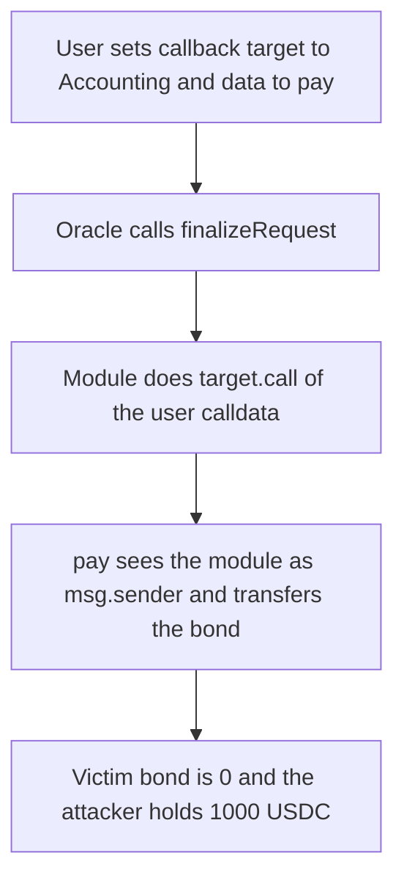

# Wonderland Prophet: the callback module spends another user's bond

> **Vulnerability classes:** `vuln/access-control/missing-auth`

<!-- non-defihacklabs -->
<!-- source-auditvault: https://github.com/Auditware/AuditVault/blob/main/findings/41800-use-of-low-level-calls-can-compromise-access-control-trailof.md -->
<!-- date: 2024-05 -->

## Key info

| Field | Value |
|---|---|
| **Loss** | 1000 USDC of the victim's bond transferred to the attacker |
| **Vulnerable contract** | `CallbackModule.finalizeRequest` |
| **Attacker EOA** | `0x1111111111111111111111111111111111111111` |
| **Attack contract** | `Exploit` |
| **Attack tx** | `Exploit.run()` |
| **Chain / block / date** | Local synthetic · 2024-05 |
| **Compiler** | solc 0.8.27, cancun, via IR |
| **Bug class** | Privileged module performs a user-chosen low-level call |

## TL;DR

`finalizeRequest` is `onlyOracle` and then executes `_params.target.call(_params.data)`. The module is the only address allowed to call `Accounting.pay`. A request whose callback target is Accounting and whose calldata is `pay(victim, attacker, 1000)` moves the victim's bond to the attacker when the oracle finalizes. A direct `pay` from the attacker reverts with `onlyAllowedModule`. A fixed callback that only pings a notifier leaves the bond in place.

## The vulnerable code

```solidity
function finalizeRequest(bytes calldata finalityModuleData) external onlyOracle {
    RequestParameters memory _params = decodeRequestData(finalityModuleData);
    _params.target.call(_params.data); // @> VULN
}
```

```solidity
function pay(address from, address to, uint256 amount) external {
    require(msg.sender == allowedModule, "onlyAllowedModule");
    bonded[from] -= amount;
    token.transfer(to, amount);
}
```

## Root cause

The callback target and calldata are chosen by the requester, but the call runs with the module's privilege. `onlyAllowedModule` checks `msg.sender`, which is the module, not the user who wrote the calldata.

## Preconditions

- Accounting records a bond for the victim and holds the tokens (1000 USDC).
- `allowedModule` is the callback module.
- The oracle finalizes a request whose `finalityModuleData` decodes to that target and calldata. The report's scenario is a protocol that lets the end user set the callback.

## Attack walkthrough

1. The attacker builds `pay(victim, attacker, 1000)` and wraps it as `(accounting, data)`.
2. The oracle calls `finalizeRequest`. `onlyOracle` passes.
3. `target.call(data)` enters `pay`. `msg.sender` is the module, so `onlyAllowedModule` passes.
4. The victim's bond goes to 0. The attacker holds 1000 USDC. Accounting's token balance is 0.

## Diagrams



## Impact

Any user bond the module is allowed to pay can be redirected. This run moves the full 1000 USDC bond. The same authority can reach other `onlyAllowedModule` functions; the report names dispute-status updates on the oracle as a second sink.

## How to reproduce

```bash
cd 41800-use-of-low-level-calls-can-compromise-access-control-trailof_exp
forge test -vv
```

## Sources

- AuditVault finding: https://github.com/Auditware/AuditVault/blob/main/findings/41800-use-of-low-level-calls-can-compromise-access-control-trailof.md
- Report: https://github.com/trailofbits/publications/blob/master/reviews/2024-05-wonderland-prophet-securityreview.pdf
- Blamed line: `CallbackModule.finalizeRequest` low-level call, figure 11.1 of that review
