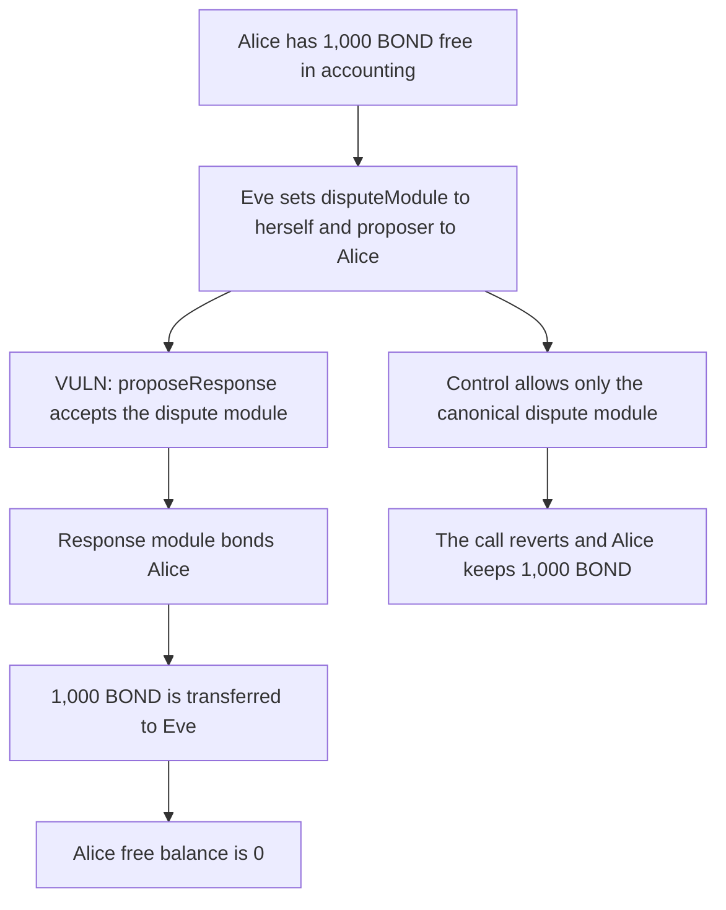

# Prophet: Eve's dispute module bonds Alice's 1,000 BOND without her call

> **Vulnerability classes:** `vuln/access-control/missing-auth` · `vuln/logic/missing-check`

<!-- non-defihacklabs -->
<!-- source-auditvault: https://github.com/Auditware/AuditVault/blob/main/findings/41804-a-users-balance-can-be-bonded-against-their-will-trailofbits.md -->
<!-- date: 2024-05 -->

## Key info

| Field | Value |
|---|---|
| **Loss** | 1,000 BOND. Alice's free balance goes to 0 and Eve holds the tokens |
| **Vulnerable contract** | `Oracle.proposeResponse` |
| **Attacker EOA** | `0x000000000000000000000000000000000000a34c` |
| **Attack contract** | `Exploit` |
| **Attack tx** | `Exploit.run()` |
| **Chain / block / date** | Ethereum model · block 0 · 2024-05 |
| **Compiler** | solc 0.8.27, cancun, via IR |
| **Bug class** | The request's dispute module may name any proposer and bond that balance |

## TL;DR

`proposeResponse` accepts the caller when `msg.sender` is the request's dispute module, even if the proposer is someone else. Eve builds a request whose dispute module is herself and whose response names Alice. The shared response module bonds Alice's deposited balance and transfers 1,000 BOND to Eve. Alice's free balance is 0. The control only allows a canonical dispute module, so the same call reverts and Alice keeps the 1,000.

## Background

Trail of Bits' May 2024 review of Wonderland Prophet, by Tjaden Hess. A user who has deposited tokens for a response approves the response module to bond that balance. `Oracle.proposeResponse` lets the dispute module of the request supply an arbitrary proposer. Anyone can create a request that reuses the response module and sets the dispute module to their own address.

## The vulnerable code

```solidity
_responseId = _validateResponse(_request, _response);
// @> VULN: the request's dispute module may bond any proposer, not only msg.sender
if (msg.sender != _response.proposer && msg.sender != address(_request.disputeModule)) {
    revert Oracle_InvalidResponseBody();
}
```

The module is then told to propose, and it bonds `_response.proposer`:

```solidity
IResponseModule(_request.responseModule).propose(_request, _response, msg.sender);
```

```solidity
amt = freeBalance[user];
freeBalance[user] = 0;
bonded[user] += amt;
require(token.transfer(recipient, amt), "bond");
```

## Root cause

The caller check treats `request.disputeModule` as an authorized speaker for any proposer. The dispute module is a field of the request, and request creation is not restricted to an allowlist. The response module bonds the proposer named in the response, not the caller.

## Preconditions

- Alice has 1,000 BOND credited in the accounting contract. The tokens sit in that contract.
- The response module is allowed to call `accounting.bond`.
- Eve can build a request that points `responseModule` at that module and `disputeModule` at herself.
- The response id has not been used and the request is not finalized.

## Attack walkthrough

1. Eve's request sets the dispute module to her contract and the response module to the shared module.
2. The response proposer is Alice. Alice's free balance is still 1,000.
3. Eve calls `proposeResponse`. She is not Alice, but she is the dispute module, so the check does not revert.
4. The module calls `bond(Alice, Eve)`.
5. Accounting zeros Alice's free balance, records a 1,000 bond, and transfers the 1,000 BOND to Eve.
6. The control rejects any dispute module other than the canonical one. Alice's 1,000 BOND stays free in accounting.

## Diagrams



## Impact

Eve receives Alice's 1,000 BOND. Alice cannot withdraw, because her free balance is 0 and the tokens have left the accounting contract. The bond was taken for a request Alice did not propose. The control leaves the 1,000 BOND in accounting and Eve's balance at 0.

## Remediation

Do not accept an arbitrary `disputeModule` from the request. Restrict each oracle to an allowlisted set of modules, which is the short-term fix in the Trail of Bits report. The caller may bond only their own proposer address unless the caller is that allowlisted module.

## How to reproduce

```bash
cd 41804-a-users-balance-can-be-bonded-against-their-will-trailofbits_exp
forge test -vv
```

`test_exploit_bonds_alice_1000_without_consent` asserts Alice's free balance is 0, her bonded record is 1,000, and the attacker holds 1,000 BOND. `test_control_unknown_dispute_module_cannot_bond_alice` asserts the allowlisted oracle reverts and Alice still has 1,000 free. Captured output is `output.txt`.

## Sources

- AuditVault finding: https://github.com/Auditware/AuditVault/blob/main/findings/41804-a-users-balance-can-be-bonded-against-their-will-trailofbits.md
- Trail of Bits review: https://github.com/trailofbits/publications/blob/master/reviews/2024-05-wonderland-prophet-securityreview.pdf
