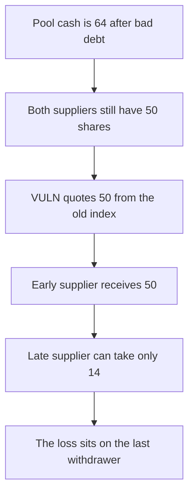

# ZeroLend: the first supplier withdraws 50 after bad debt and the other is left with 14

> **Vulnerability classes:** vuln/logic/state-update · vuln/logic/liquidation-logic

<!-- non-defihacklabs -->
<!-- source-auditvault: https://github.com/Auditware/AuditVault/blob/main/findings/41817-h-7-when-bad-debt-is-accumulated-the-loss-is-not-shared-amon.md -->
<!-- date: 2024-06 -->

## Key info

| Field | Value |
|---|---|
| **Loss** | Early supplier receives 50 TB from a pool that only has 64 left. The other supplier receives 14 |
| **Vulnerable contract** | `Pool.withdrawSimple` |
| **Attacker EOA** | `0x4181700000000000000000000000000000000001` |
| **Attack contract** | `Exploit` |
| **Attack tx** | `Exploit.run()` |
| **Chain / block / date** | Ethereum model · block 0 · 2024-06 |
| **Compiler** | solc 0.8.27, cancun, via IR |
| **Bug class** | Withdrawal value is `shares * liquidityIndex` and the index ignores bad debt |

## TL;DR

Two suppliers each hold 50 shares. A liquidation leaves 64 TB in the pool instead of 100. `withdrawSimple` still quotes `shares * liquidityIndex` with the index at 1.0, so the first supplier takes 50 and the second can take only the remaining 14. A socialized index of 0.64 pays 32 to each.

## Background

Sherlock's June 2024 ZeroLend One contest, issue 275, reported by Nihavent and others. The pool's `SupplyLogic` withdrawal uses the liquidity index and does not write the unpaid borrow back into every supplier's claim.

## The vulnerable code

```solidity
uint256 shares = aToken[asset][to];
// @> VULN: assets are shares * liquidityIndex, which still prices deposits as if the bad debt did not exist
uint256 maxAssets = shares * liquidityIndex[asset] / RAY;
require(amount <= maxAssets, "max");
```

`RAY` is `1e27` and the index is still `1e27`, so 50 shares quote 50 TB while the contract holds 64.

## Root cause

Bad debt reduces cash and does not reduce `liquidityIndex`. The first withdrawal is paid at the pre-loss rate.

## Preconditions

- Two suppliers have equal 50-share claims.
- Pool cash is 64 TB, the amount repaid in the bad-debt liquidation from the report.

## Attack walkthrough

1. The early supplier withdraws 50. The max check passes because the index is still 1.
2. The transfer sends 50. 14 TB remains.
3. A withdrawal of 50 for the late supplier reverts on cash. A withdrawal of 14 succeeds.
4. Balances are 50 and 14. The fixed pool sets the index to `64/100` and both receive 32.

## Diagrams


