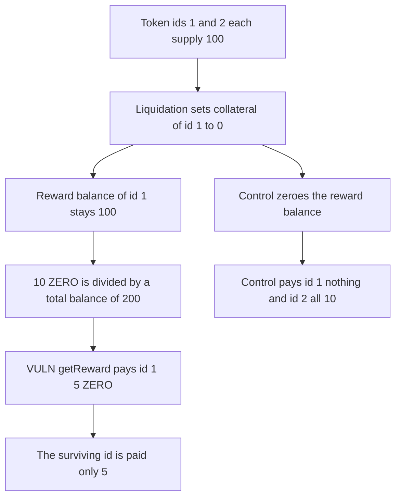

# A liquidated NFT keeps its reward weight and is paid 5 ZERO after collateral is wiped

> **Vulnerability classes:** vuln/logic/reward-calculation · vuln/logic/missing-check

<!-- non-defihacklabs -->
<!-- source-auditvault: https://github.com/Auditware/AuditVault/blob/main/findings/41818-h-8-liquidated-positions-will-still-accrue-rewards-after-bei.md -->
<!-- date: 2024-06 -->

## Key info

| Field | Value |
|---|---|
| **Loss** | 5 ZERO paid to token id 1 after its collateral is 0. The honest position is paid only half of a 10 ZERO distribution |
| **Vulnerable contract** | `NFTRewards.getReward` / `earned` |
| **Attacker EOA** | `0x36daa8b0a0031321aa1457e0ac5cdf3d56382fe1` (the liquidated user) |
| **Attack contract** | `Exploit` |
| **Attack tx** | `Exploit.run()` |
| **Chain / block / date** | Ethereum model · block 0 · 2024-06 |
| **Compiler** | solc 0.8.27, cancun, via IR |
| **Bug class** | Liquidation never clears the masterchef balance used by `earned` |

## TL;DR

`earned` pays `_balances[tokenId] * rewardPerToken / 1e18`. Liquidation sets `collateral[tokenId]` to 0 and leaves `_balances` and `totalBalance` alone. Two positions of 100, then a 10 ZERO distribution, still split 5 and 5. Token id 1 collects 5 ZERO with no collateral. Clearing the balance on liquidation pays that user 0 and pays the surviving position all 10.

## Background

Sherlock's June 2024 ZeroLend One contest, issue 312 (H-8). `NFTRewardsDistributor.earned` is the masterchef view. The judging report's proof warps 14 days. This model applies the same index update inside `notifyRewardAmount`, so the missing balance update is visible in one transaction without a time jump.

## The vulnerable code

```solidity
function liquidate(uint256 tokenId, bytes32 assetHash) external {
    collateral[tokenId] = 0;
    assetHash;
}

function getReward(uint256 tokenId, bytes32 assetHash, address to) external returns (uint256 amt) {
    amt = earned(tokenId, assetHash);
    userRewardPerTokenPaid[tokenId][assetHash] = rewardPerTokenStored[assetHash];
    rewards[tokenId][assetHash] = 0;
    // @> VULN: earned() still multiplies the pre-liquidation balance, so a wiped position is paid
    require(reward.transfer(to, amt), "pay");
}
```

`earned` is the report's formula: balance times the index delta, divided by 1e18, plus stored rewards.

## Root cause

The reward weight and the collateral are different variables. Liquidation writes one and not the other. `notifyRewardAmount` divides by `totalBalance`, which still includes the wiped position, and `earned` multiplies by the same stale balance.

## Preconditions

- Token id 1 and token id 2 each have a reward balance of 100.
- Token id 1 is liquidated. Collateral becomes 0. The reward balance stays 100.
- 10 ZERO is notified after that liquidation.

## Attack walkthrough

1. Supply 100 on token id 1 and 100 on token id 2.
2. Liquidate token id 1. Collateral is 0. The balance is still 100.
3. Notify 10 ZERO. The index moves by `10e18 * 1e18 / 200e18`.
4. `earned(1)` is 5. `getReward` transfers 5 ZERO to the liquidated user.
5. Token id 2 is also owed 5. It should have been owed 10.
6. The control subtracts the balance from `totalBalance` and zeroes it. The liquidated user is paid 0 and the survivor is paid 10.

## Diagrams



## Impact

The liquidated user receives 5 ZERO that was funded for open positions. The user who still has collateral receives 5 instead of 10. Every later distribution keeps paying the wiped token id until something else clears `_balances`.

## Remediation

On liquidation, subtract `_balances[tokenId]` from `totalBalance`, settle `earned` into `rewards` or zero it, and set the balance to 0 before the next index update.

## How to reproduce

```bash
cd 41818-h-8-liquidated-positions-will-still-accrue-rewards-after-bei_exp
forge test -vv
```

`test_exploit_liquidated_nft_is_paid_5_rewards` asserts a 5 ZERO claim, zero collateral, and a stale balance of 100. `test_control_clearing_balance_pays_liquidated_user_zero` asserts the liquidated id gets 0 and the other id gets 10. Captured output is `output.txt`.

## Sources

- AuditVault finding: https://github.com/Auditware/AuditVault/blob/main/findings/41818-h-8-liquidated-positions-will-still-accrue-rewards-after-bei.md
- Sherlock issue 312: https://github.com/sherlock-audit/2024-06-new-scope-judging/issues/312
