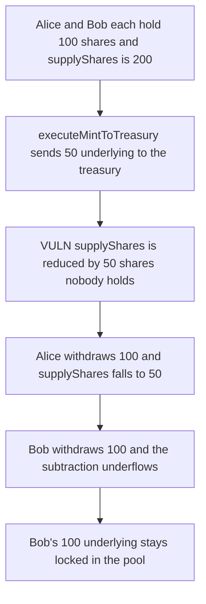

# ZeroLend: executeMintToTreasury burns shares the last withdrawer still holds

> **Vulnerability classes:** `vuln/logic/incorrect-state-transition` · `vuln/arithmetic/underflow`

<!-- non-defihacklabs -->
<!-- source-auditvault: https://github.com/Auditware/AuditVault/blob/main/findings/41819-h-9-function-executeminttotreasury-will-incorrectly-reduce-t.md -->
<!-- date: 2024-06 -->

## Key info

| Field | Value |
|---|---|
| **Loss** | 100 underlying locked. Bob's withdraw reverts |
| **Vulnerable contract** | `PoolLogic.executeMintToTreasury` |
| **Attacker EOA** | `0x1111111111111111111111111111111111111111` (Bob, the last supplier) |
| **Attack contract** | `Exploit` |
| **Attack tx** | `Exploit.run()` |
| **Chain / block / date** | Ethereum model · block 0 · 2024-06 |
| **Compiler** | solc 0.8.27, cancun, via IR |
| **Bug class** | supplyShares reduced for treasury shares that were never minted to a user |

## TL;DR

`executeMintToTreasury` transfers the accrued premium to the treasury and then subtracts `accruedToTreasuryShares` from `totalSupply.supplyShares`. Those shares were never added to anyone's `supplyBal`. Alice and Bob each hold 100 shares against 200 `supplyShares` and 250 underlying. After the call, `supplyShares` is 150. Alice can still withdraw 100. Bob's withdraw subtracts 100 from the remaining 50 and underflows. His 100 underlying stays in the pool.

## Background

Sherlock's June 2024 ZeroLend One contest, issue 375 (H-9), reported by imsrybr0 and others. `totalSupply.supplyShares` is supposed to equal the sum of `balances.supplyShares`. Premium taken on a flash loan increases `underlyingBalance` and `accruedToTreasuryShares` without minting shares to the treasury. The treasury mint then burns shares as if they existed. The suggested fix subtracts `amountToMint` from `underlyingBalance` instead.

## The vulnerable code

```solidity
asset.transfer(treasury, amountToMint);
totalSupply.supplyShares -= accrued; // @> VULN: burns shares that were never minted to a user
// FIX: totalSupply.underlyingBalance -= amountToMint;
```

`withdraw` then does `totalSupply.supplyShares -= shares` for the user. Once `supplyShares` is below the remaining users' balances, that subtraction underflows and the whole withdraw reverts.

```diff
- totalSupply.supplyShares -= accruedToTreasuryShares;
+ totalSupply.underlyingBalance -= amountToMint;
```

## Root cause

Treasury accrual is an amount of underlying, not a share balance. Burning it from `supplyShares` breaks the invariant that `supplyShares` is the sum of user balances. The last users in the withdrawal order are the ones who hit the underflow. Earlier users still fit under the reduced total.

## Preconditions

- Alice and Bob each have 100 `supplyBal`. `supplyShares` is 200.
- Underlying is 250. The extra 50 is premium counted in `underlyingBalance` and mirrored only by `accruedToTreasuryShares`.
- Normalized income is 1 ray, so 50 accrued shares mint 50 underlying.

## Attack walkthrough

1. `executeMintToTreasury` sends 50 underlying to the treasury and sets `supplyShares` to 150. Neither user's balance changes.
2. Alice withdraws 100. `supplyShares` becomes 50. She receives 100. The pool holds 100.
3. Bob withdraws 100. `supplyShares -= 100` underflows from 50. The call reverts.
4. Bob's `supplyBal` is still 100 and the pool still holds 100. `supplyShares` is 50, so the debit cannot succeed.
5. The control subtracts `underlyingBalance` instead. `supplyShares` stays 200, and Bob withdraws his 100. The pool ends empty.

## Diagrams



## Impact

Bob cannot withdraw. 100 underlying that backs his 100 shares stays in the pool, and every later attempt hits the same underflow. Alice was paid. The treasury received the 50 premium, which is the amount the function meant to move. The damage is the share burn, not that transfer. The fixed path pays Bob and leaves the pool empty.

## Remediation

Do not subtract `accruedToTreasuryShares` from `supplyShares`. Those shares were never minted. Subtract `amountToMint` from `underlyingBalance`, which is the diff in issue 375.

## How to reproduce

```bash
cd 41819-h-9-function-executeminttotreasury-will-incorrectly-reduce-t_exp
forge test -vv
```

`test_exploit_last_withdrawer_is_locked` asserts Bob's withdraw reverts, his balance is still 100, and the pool holds 100. `test_control_fix_lets_bob_withdraw` asserts the underlying subtraction lets Bob exit and empties the pool. Captured output is `output.txt`.

## Sources

- AuditVault finding: https://github.com/Auditware/AuditVault/blob/main/findings/41819-h-9-function-executeminttotreasury-will-incorrectly-reduce-t.md
- Sherlock issue 375: https://github.com/sherlock-audit/2024-06-new-scope-judging/issues/375
- Share accounting: https://github.com/sherlock-audit/2024-06-new-scope/blob/main/zerolend-one/contracts/core/pool/configuration/PositionBalanceConfiguration.sol#L94-L95
- Premium counted as underlying: https://github.com/sherlock-audit/2024-06-new-scope/blob/main/zerolend-one/contracts/core/pool/logic/FlashLoanLogic.sol#L118
