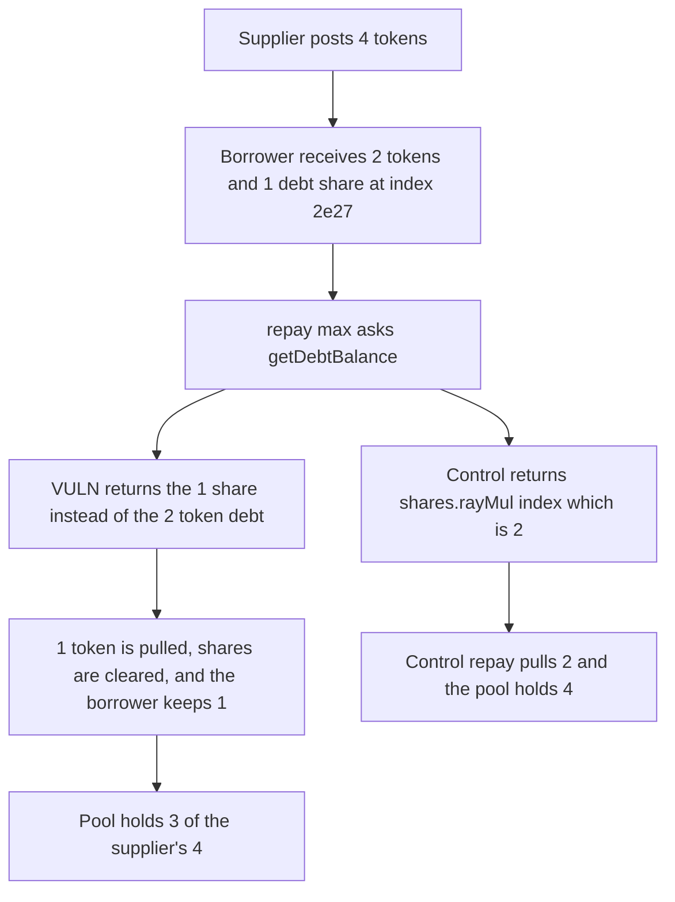

# ZeroLend: max repay clears a 2 token debt after paying 1 share

> **Vulnerability classes:** vuln/logic/price-calculation · vuln/logic/state-update

<!-- non-defihacklabs -->
<!-- source-auditvault: https://github.com/Auditware/AuditVault/blob/main/findings/41821-h-11-wrong-calculation-of-supplydebt-balance-of-a-position-d.md -->
<!-- date: 2024-06 -->

## Key info

| Field | Value |
|---|---|
| **Loss** | Borrower keeps 1 of 2 borrowed tokens. The supplier who posted 4 is left with 3 in the pool |
| **Vulnerable contract** | `PositionBalanceConfiguration.getDebtBalance` |
| **Attacker EOA** | `0x1111111111111111111111111111111111111111` |
| **Attack contract** | `Exploit` |
| **Attack tx** | `Exploit.run()` |
| **Chain / block / date** | Ethereum model · block 0 · 2024-06 |
| **Compiler** | solc 0.8.27, cancun, via IR |
| **Bug class** | Debt balance returns shares plus a delta instead of `shares.rayMul(index)` |

## TL;DR

`getDebtBalance` returns `debtShares + increase`. When the index equals `lastDebtLiquidtyIndex`, `increase` is 0, so the function returns the share amount. At index 2e27 a borrow of 2 tokens mints 1 share. The true asset debt is 2. `repay(type(uint256).max)` pulls the reported 1, zeroes the shares, and the borrower keeps 1 token. The supplier's 4 is now backed by 3. Returning `debtShares.rayMul(index)` makes the same repay pull 2 and restores the pool to 4.

## Background

Sherlock's June 2024 ZeroLend One contest, issue 473 (H-11), reported by DenTonylifer and many duplicates. The same shape is in `getSupplyBalance`. Callers including `executeRepay` treat the return value as an asset amount. The recommended fix is `return self.debtShares.rayMul(index)`.

## The vulnerable code

```solidity
function getDebtBalance(PositionBalance storage self, uint256 index) internal view returns (uint256 debt) {
    uint256 increase = self.debtShares.rayMul(index) - self.debtShares.rayMul(self.lastDebtLiquidtyIndex);
    // @> VULN: returns the share amount plus the delta, not the asset debt self.debtShares.rayMul(index)
    return self.debtShares + increase;
}
```

`repay` sets `amount = getDebtBalance(...)` when the caller passes `type(uint256).max`, then clears the shares if that amount is paid.

## Root cause

Shares and assets are added together. The asset value of a share is `shares.rayMul(index)`. Adding the interest delta to the raw share count does not reconstruct that product, and when the delta is zero the function returns the shares unchanged.

## Preconditions

- Liquidity index is 2e27.
- A supplier has posted 4 tokens.
- The borrower borrows 2 tokens, which mints 1 share, then repays with `type(uint256).max`.

## Attack walkthrough

1. The supplier's 4 tokens are pulled into the pool.
2. The borrower receives 2 tokens. `debtShares` is 1 and `lastDebtLiquidtyIndex` is 2e27.
3. `repay(max)` reads `getDebtBalance`. `increase` is 0. The return is 1.
4. The pool pulls 1 token and sets `debtShares` to 0. The position looks closed.
5. The borrower still holds 1 token. The pool holds 3 of the supplier's 4.
6. The control returns `shares.rayMul(index)`, which is 2. The repay pulls 2. The borrower holds 0 and the pool holds 4.

## Diagrams



## Impact

The borrower keeps 1 token that was borrowed against the supplier's liquidity, and the debt is marked repaid. The supplier can only be paid from the remaining 3. The control collects the full 2 and the supplier's 4 is intact.

## Remediation

Return `self.debtShares.rayMul(index)` and `self.supplyShares.rayMul(index)`, which is the diff in issue 473.

## How to reproduce

```bash
cd 41821-h-11-wrong-calculation-of-supplydebt-balance-of-a-position-d_exp
forge test -vv
```

`test_exploit_max_repay_clears_a_2_token_debt_for_1_token` asserts true debt 2, reported debt 1, and a pool balance of 3. `test_control_asset_debt_makes_max_repay_return_the_2` asserts a payment of 2 and a pool balance of 4. Captured output is `output.txt`.

## Sources

- AuditVault finding: https://github.com/Auditware/AuditVault/blob/main/findings/41821-h-11-wrong-calculation-of-supplydebt-balance-of-a-position-d.md
- Sherlock issue 473: https://github.com/sherlock-audit/2024-06-new-scope-judging/issues/473
