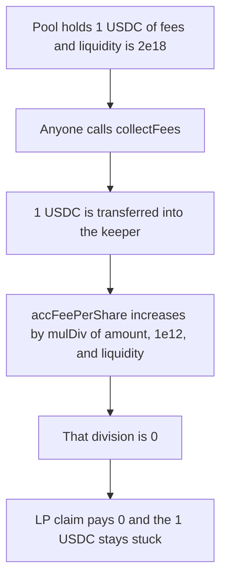

# TitanX Farms — 1 USDC of collected fees is credited as 0

> **Vulnerability classes:** vuln/arithmetic/precision-loss · vuln/arithmetic/rounding · vuln/logic/fee-calculation

> **Reproduction:** cheatcode-free local synthetic. `FarmKeeper.collectFees` keeps the audited `mulDiv(amount, SCALE_FACTOR, liquidity)` update. Full trace: [output.txt](output.txt). PoC: [test/41859-h-01-loss-of-fees-due-to-rounding-down-pashov-audit-group-no_exp.sol](test/41859-h-01-loss-of-fees-due-to-rounding-down-pashov-audit-group-no_exp.sol).

<!-- non-defihacklabs -->
<!-- source-auditvault: https://github.com/Auditware/AuditVault/blob/main/findings/41859-h-01-loss-of-fees-due-to-rounding-down-pashov-audit-group-no.md -->
<!-- date: 2024-10 -->

**AuditVault taxonomy:** `lang/solidity` · `sector/farm` · `sector/stable` · `platform/pashov` · `has/github` · `severity/high` · genome: `precision-loss` · `variant` · `fee-theft` · `integer-bounds`

## Key info

| | |
|---|---|
| **Protocol** | TitanX Farms |
| **Finding** | Pashov TitanX review H-01, AuditVault 41859 |
| **Vulnerable code** | `FarmKeeper._collectFees` |
| **Harm** | 1 USDC (1_000_000 units) is collected from the pool into the keeper. `accFeePerShare` increases by 0. The LP who owns the whole 2e18 liquidity position is paid 0. Shortfall is 1 USDC |
| **Chain** | local synthetic |

## TL;DR

Fee per share is `amount * 1e12 / liquidity`. USDC has 6 decimals, so a 1 USDC fee is `1e6`. Liquidity above `1e18` makes that product round to 0. `updateFarm` is permissionless, so anyone can collect the fee into the keeper at the moment it rounds away. The tokens leave the pool and no LP can claim them. Here the numbers are exactly the report's threshold: liquidity `2e18`, fee `1e6`, accrual `0`, claim `0`, shortfall `1_000_000`.

## The vulnerable code

Audited else branch (`dragon-software-devs/TitanX-Farms` @ `181af1ff`, `FarmKeeper._collectFees`). `Constants.SCALE_FACTOR` is `1e12`. The token is not a buy-and-burn input, so the fee is supposed to accrue to LPs:

```solidity
} else {
    // @> VULN: 1e6 * 1e12 / 2e18 rounds to 0, so the collected fee is not credited to LPs
    farm.accFeePerShareForToken0 += Math.mulDiv(amount0, Constants.SCALE_FACTOR, liquidity);
}
```

```solidity
// FIX: uint256 internal constant SCALE_FACTOR = 1e18;
// 1e6 * 1e18 / 2e18 = 500_000, and liquidity * acc / SCALE pays the 1e6 back.
```

The claim used by LPs is the usual per-share payout: `liquidity * accFeePerShare / SCALE_FACTOR`. With `acc` still 0 that payout is 0.

## Root cause

`1e12` is not enough magnitude for a 6-decimal token once liquidity exceeds `1e18`. The report's extreme is `1e6 * 1e12 / 1e38`, which is also 0. The same zero appears as soon as liquidity passes `1e18`: `1e6 * 1e12 / 2e18 = 1e18 / 2e18 = 0`. Collection and accrual are one function, so the tokens move even though the integer division credits nothing.

## Preconditions

The farm's liquidity is `2e18`, above the report's `1e18` line and far below the uint128 maximum. The collected token is 6-decimal USDC and is not flagged as a buy-and-burn input. A swap or donation has produced a `1e6` fee (1 USDC) sitting in the position. Anyone may call the update that collects it.

## Attack walkthrough

1. The input-token flag is false, so the LP branch will run.
2. The pool approves the keeper for 1_000_000.
3. `mulDiv(1_000_000, 1e12, 2e18)` is 0. That is the quote before the state change.
4. `collectFees` pulls 1_000_000 from the pool into the keeper.
5. `accFeePerShareForToken0` increases by 0.
6. The LP claim is `2e18 * 0 / 1e12 = 0`.
7. The keeper still holds 1_000_000. The pool holds 0. The shortfall is 1_000_000, which is the fee that should have been paid.

The control uses `SCALE_FACTOR = 1e18` on the same fee and the same liquidity. The accumulator becomes 500_000. The claim pays 1_000_000 and the keeper is left at 0.

## Diagrams



## Impact

Every collection that lands in this range deletes that fee for LPs. One call here destroys 1 USDC. Calling `updateFarm` whenever the pending fee is still a single USDC, which the report says anyone can do, repeats the loss for as long as liquidity stays above 1e18. The fees are not redirected to the caller. They sit in the keeper with an accumulator that will never pay them out.

## Remediation

Raise `SCALE_FACTOR` to `1e18`, which is the report's recommendation. With that scale the same 1 USDC and the same 2e18 liquidity accrue 500_000 per share and the full position claims 1_000_000. Skip the transfer when the per-share delta would be 0, so a dust fee stays in the position until it is large enough to count.

## How to reproduce

```bash
cd 41859-h-01-loss-of-fees-due-to-rounding-down-pashov-audit-group-no_exp
forge test -vv
```

## Sources

- AuditVault finding: https://github.com/Auditware/AuditVault/blob/main/findings/41859-h-01-loss-of-fees-due-to-rounding-down-pashov-audit-group-no.md
- Pashov report: https://github.com/pashov/audits/blob/master/team/md/TitanX-security-review.md
- Reviewed tree: https://github.com/dragon-software-devs/TitanX-Farms/tree/181af1ffd7a8bcfe57c0bdeadccabf1b709619a9
