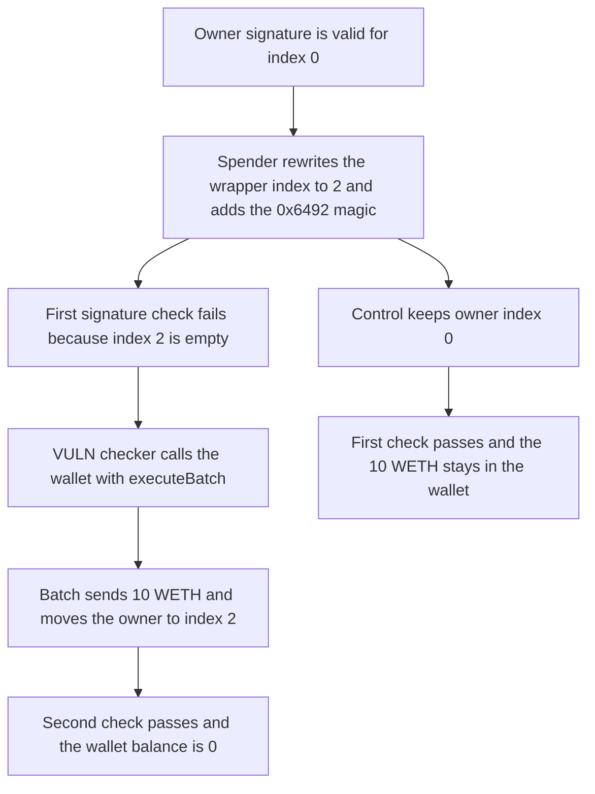

# An ERC-6492 spend approval calls the wallet and moves 10 WETH to the spender

> **Vulnerability classes:** vuln/auth/signature-validation · vuln/access-control/missing-auth

<!-- non-defihacklabs -->
<!-- source-auditvault: https://github.com/Auditware/AuditVault/blob/main/findings/41992-erc-6492-implementation-allows-draining-wallet-funds-by-mani.md -->
<!-- date: 2024-10 -->

## Key info

| Field | Value |
|---|---|
| **Loss** | 10 WETH leaves the smart wallet. Owner index 0 is cleared and the same owner is written at index 2 so the signature check passes |
| **Vulnerable contract** | `SpendPermissionManager.isValidERC6492SignatureNowAllowSideEffects` |
| **Attacker EOA** | `0xf6b3f03836b636109f09978f91cf46ebba64f3b2` (the spender) |
| **Attack contract** | `Exploit` |
| **Attack tx** | `Exploit.run()` |
| **Chain / block / date** | Ethereum model · block 0 · 2024-10 |
| **Compiler** | solc 0.8.27, cancun, via IR |
| **Bug class** | A 0x6492 wrapper with a rewritten owner index fails the first check and the checker then calls the wallet |

## TL;DR

The owner signs a spend hash. The signature wrapper carries an owner index that is not part of the hash. The spender sets that index to `nextOwnerIndex`, which is 2 and empty, and appends the ERC-6492 magic. The first `isValidSignature` fails. The checker then `call`s the wallet with `executeBatch`: transfer 10 WETH to the spender, delete owner 0, and `addOwnerAddress` so the owner lands at index 2. The second check recovers the owner at index 2 and the approval is stored. The wallet balance is 0. Keeping index 0 makes the first check pass, the batch is never called, and the 10 WETH stays in the wallet.

## Background

Cantina's October 2024 Coinbase review. The finding is the ERC-6492 path in `SpendPermissionManager` together with Solady's `SignatureCheckerLib.isValidERC6492SignatureNowAllowSideEffects` and the Coinbase smart wallet's owner-index wrapper. Coinbase removed the ERC-6492 path. The owner key used here is the well-known Anvil test key `0xf39Fd6e51aad88F6F4ce6aB8827279cffFb92266`. The signed hash is `keccak256(abi.encode(uint256(10 ether), keccak256("SPEND")))`.

## The vulnerable code

```solidity
(address prepareTo, bytes memory prepareData, bytes memory inner) = abi.decode(core, (address, bytes, bytes));
if (signer.code.length == 0) {
    (bool deployed,) = prepareTo.call(prepareData);
    deployed;
}
if (_isValidNow(signer, hash, inner)) return true;
// @> VULN: an invalid ownerIndex falls through to an arbitrary call on the wallet before the signature is checked again
(bool ok,) = signer.call(prepareData);
sideEffectCalled = ok;
return _isValidNow(signer, hash, inner);
```

`prepareData` is `executeBatch`. The manager is an owner of the wallet, so the wallet accepts the batch.

## Root cause

The owner index sits outside the signed bytes. Changing it makes a valid signature fail the first lookup. The ERC-6492 side-effect call is specified for preparing a counterfactual account, and here it is aimed at a wallet that is already deployed and already lists the manager as an owner. The batch both steals the balance and repairs the index the signature claimed, so the function returns success instead of reverting the theft.

## Preconditions

- The wallet is deployed. Owner index 0 is the EOA. Index 1 is the spend-permission manager. `nextOwnerIndex` is 2.
- The wallet holds 10 WETH.
- The EOA has signed the spend hash. The spender changes the wrapper index from 0 to 2 and adds the `0x6492` suffix.

## Attack walkthrough

1. Build `executeBatch` with three calls: transfer 10 WETH to the spender, `removeOwnerAtIndex(0)`, `addOwnerAddress(owner)`.
2. Wrap the owner's ECDSA signature at index 2 and append the ERC-6492 magic.
3. `approveWithSignature` decodes the wrapper. The wallet has code, so the deploy call is skipped.
4. The first check reads `owners[2]`, finds it empty, and fails.
5. `signer.call` runs the batch. The wallet sends 10 WETH. Owner 0 is deleted. The owner is stored at index 2.
6. The second check recovers the owner at index 2. `approved` is set. The wallet balance is 0.
7. The control uses index 0. The first check passes, `sideEffectCalled` stays false, and the wallet still holds 10 WETH.

## Diagrams



## Impact

The spender receives 10 WETH from a wallet whose owner never signed a transfer. The same batch removes the owner from index 0, so the key that signed the original approval no longer sits where the wallet's other checks expect it. Any later `approveWithSignature` on a wallet that already lists this manager as an owner can repeat the call.

## Remediation

If the wallet is deployed and the manager is already an owner, verify the signature with ERC-1271 only. Do not execute the ERC-6492 prepare call against an account that is already set up.

## How to reproduce

```bash
cd 41992-erc-6492-implementation-allows-draining-wallet-funds-by-mani_exp
forge test -vv
```

`test_exploit_6492_side_effect_drains_10_weth` asserts the spender holds 10 WETH and the wallet holds 0. `test_control_valid_owner_index_keeps_the_10_weth` asserts the batch is not called and the wallet still holds 10. Captured output is `output.txt`.

## Sources

- AuditVault finding: https://github.com/Auditware/AuditVault/blob/main/findings/41992-erc-6492-implementation-allows-draining-wallet-funds-by-mani.md
- Cantina report: https://cdn.cantina.xyz/reports/cantina_coinbase_oct2024.pdf
